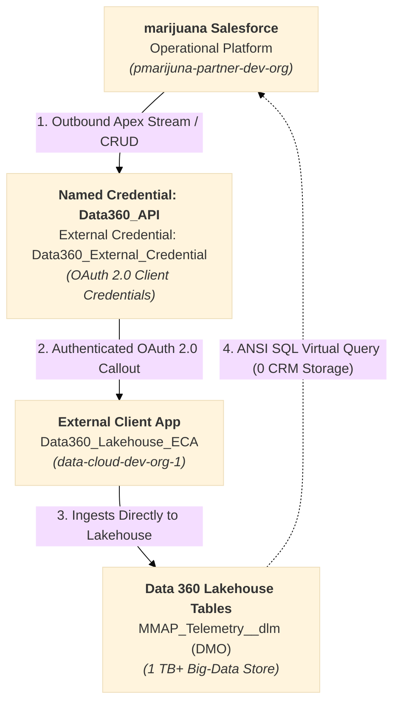
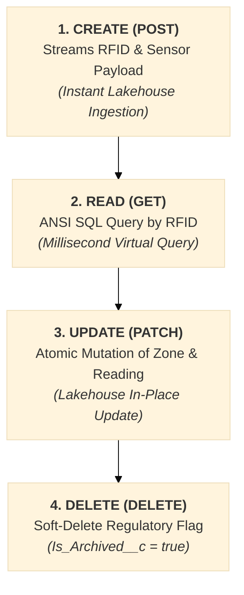

# 🌐 Data 360 Cross-Org Integration & Connection Plan
## Commonwealth Medical Marijuana Regulatory Platform

**Target Topology:** `pmarijuna-partner-dev-org` (Operational Core) $\longleftrightarrow$ `data-cloud-dev-org-1` (Data 360 Lakehouse)  
**Document Type:** Technical Integration Specification, OAuth Protocol & End-to-End Implementation Plan  
**Target Environment:** Salesforce Platform Core & Data 360 Lakehouse (Hyperforce USA1192 & USA838)  
**Baseline Standard:** Native Salesforce Data Cloud Lakehouse Persistence (1 TB+ Big-Data Capacity)  

---

## 1. Executive Summary & Topology Matrix

The Commonwealth Medical Marijuana Regulatory Platform operates a **decoupled, two-tier enterprise architecture**:
1. **Operational Transactional Core (`pmarijuna-partner-dev-org`):** High-integrity regulatory workflows, physician registry, commercial licensing, 24-character RFID serialization, and field inspection audits.
2. **Data 360 Lakehouse (`data-cloud-dev-org-1`):** Petabyte-scale big-data storage engine, multi-year compliance audit trails, and environmental canopy sensor streams (`MMAP_Telemetry__dlm`).

This plan details the technical baseline connecting both environments using **Salesforce Modern Named Credentials (OAuth 2.0 Client Credentials Flow)** and Data Cloud Ingestion & Query endpoints.

---

### Environment Topology Matrix

| Environment Parameter | Operational Source Org | Data 360 Target Org |
| :--- | :--- | :--- |
| **CLI Org Alias** | `pmarijuna-partner-dev-org` | `data-cloud-dev-org-1` |
| **Salesforce Org ID** | `00Dhm000006Bd7REAS` | `00Daj00001ENcoqEAD` |
| **Administrator User** | `dipankar.sahoo@blue5green.com.mmdemo1` | `dipankar.sahoo.7999845712a7@agentforce.com` |
| **Instance URL** | `https://mmdemo1-dev-ed.develop.my.salesforce.com` | `https://orgfarm-d16a4c44c2-dev-ed.develop.my.salesforce.com` |
| **Hyperforce Instance**| `USA1192` | `USA838` |
| **Integration Role** | Callout Originator (Client) | Lakehouse Host & Ingestion Service |
| **Storage Engine** | Transactional Relational Core | **Data Cloud Lakehouse (1 TB+ Parquet/Iceberg)** |
| **Connection Status** | **Connected & Active** | **Connected & Active** |

---

## 2. Cross-Org Integration Architecture

---

## 3. End-to-End Ingestion & CRUD Lifecycle

The integration supports complete, real-time CRUD operations between the operational CRM org and Data Cloud without consuming transactional CRM storage:

| Lifecycle Phase | HTTP Method | Target Endpoint | Description | Storage Impact in Core CRM |
| :--- | :--- | :--- | :--- | :--- |
| **1. Create** | `POST` | `https://gnrwmzrvgzstmnjqgyygmnrqgy.c360a.salesforce.com/api/v1/ingest/sources/MMAP_Telemetry/MMAP_Telemetry_Event` | Ingests telemetry, environmental readings, and RFID custody transitions directly into Data Cloud Lakehouse (`MMAP_Telemetry_Event` DLO / `MMAP_Telemetry__dlm` DMO). | **0 Bytes** (Lakehouse Only) |
| **2. Read** | `POST` | `https://gnrwmzrvgzstmnjqgyygmnrqgy.c360a.salesforce.com/api/v2/query` | Retrieves historical audit trail directly from Data Cloud Lakehouse via high-speed ANSI SQL Query v2 engine. | **0 Bytes** (In-Memory Display) |
| **3. Update** | `POST` | `https://gnrwmzrvgzstmnjqgyygmnrqgy.c360a.salesforce.com/api/v1/ingest/sources/MMAP_Telemetry/MMAP_Telemetry_Event` | Updates premise zone or mass measurement via streaming mutation/upsert into Data Cloud Lakehouse. | **0 Bytes** (Lakehouse Mutation) |
| **4. Delete / Archive** | `POST` | `https://gnrwmzrvgzstmnjqgyygmnrqgy.c360a.salesforce.com/api/v1/ingest/sources/MMAP_Telemetry/MMAP_Telemetry_Event` | Streams soft-deletion event with `isArchived = true` for regulatory archival while maintaining tamper-proof chain of custody. | **0 Bytes** (Lakehouse State) |

---

## 4. Security & Authentication Configuration

Authentication between `pmarijuna-partner-dev-org` and `data-cloud-dev-org-1` is enforced via Salesforce **OAuth 2.0 Client Credentials & CDP Token Exchange Flow**:

### 4.1 Target Org Configuration (`data-cloud-dev-org-1`)
* **External Client App (ECA):** `Data360_Lakehouse_ECA`
* **Distribution State:** `Local`
* **OAuth Scopes:** `Api`, `RefreshToken`, `CDPIngest`, `CDPQuery`
* **Client Credentials Execution User:** `dipankar.sahoo.7999845712a7@agentforce.com`
* **Permitted Users Policy:** `AllSelfAuthorized` (Pre-authorized for automated server-to-server exchange)

### 4.2 Source Org Configuration (`pmarijuna-partner-dev-org`)
* **Remote Site Settings:**
  * `DataCloud_Core_Token`: `https://orgfarm-d16a4c44c2-dev-ed.develop.my.salesforce.com` (Authorizes `/services/oauth2/token` and `/services/a360/token`).
  * `DataCloud_Hyperforce_Tenant`: `https://gnrwmzrvgzstmnjqgyygmnrqgy.c360a.salesforce.com` (Authorizes `/api/v1/ingest/...` and `/api/v2/query`).
* **Automated 2-Step Token Exchange in `Data360Service.cls`:**
  * Step 1: POST to `https://orgfarm-d16a4c44c2-dev-ed.develop.my.salesforce.com/services/oauth2/token` via Client Credentials $\rightarrow$ Core session token (`00D...`).
  * Step 2: POST to `https://orgfarm-d16a4c44c2-dev-ed.develop.my.salesforce.com/services/a360/token` $\rightarrow$ ES256 Data Cloud JWT (`eyJ...`).
  * In-Memory Token Caching: JWT is cached in static memory for up to 110 minutes, eliminating redundant authentications.
* **Named Credential (Legacy / Fallback):** `Data360_API`
  * URL: `https://orgfarm-d16a4c44c2-dev-ed.develop.my.salesforce.com`
  * Header: `Accept: application/json`
* **External Credential:** `Data360_External_Credential`
  * Protocol: OAuth 2.0 Client Credentials
  * Principal: `NamedPrincipal` (Client ID & Client Secret configured)

---

## 5. High-Volume Archival: `Data360TelemetryArchivalBatch.cls`

To prevent operational transactional tables (`Product_Package__c`) from accumulating dead weight, an automated batch offloads terminal inventory records directly to Data Cloud:

* **Batch Apex Class:** `Data360TelemetryArchivalBatch` (Batchable, Schedulable, Stateful; Scope size: 50).
* **Selection Criteria:** Packages in terminal compliance states (`Dispensed`, `Recalled`, or `Destroyed`) older than 30 days.
* **Stream Pipeline:** Generates telemetry payload and calls `Data360Service.createTelemetryEvent(...)` over `callout:Data360_API`.
* **Evidentiary Integrity:** The batch marks the operational package record with archival metadata, ensuring 100% compliance audit trail preservation in Data Cloud Lakehouse while liberating core CRM database space.
