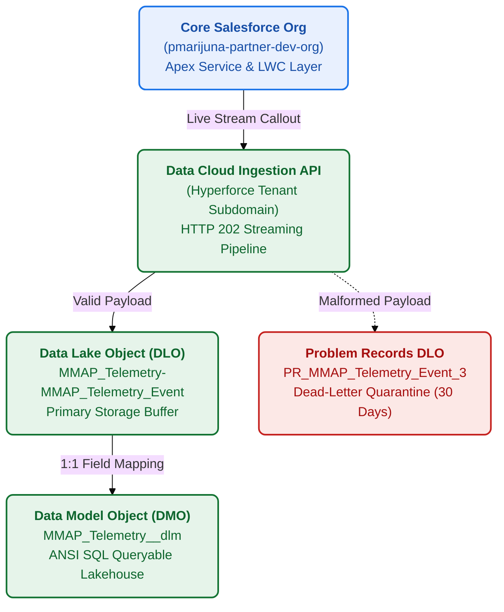
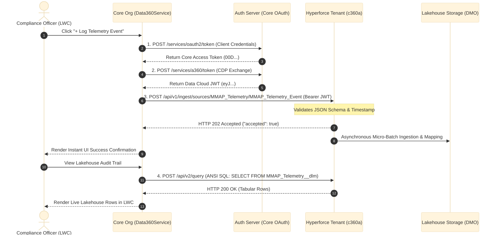
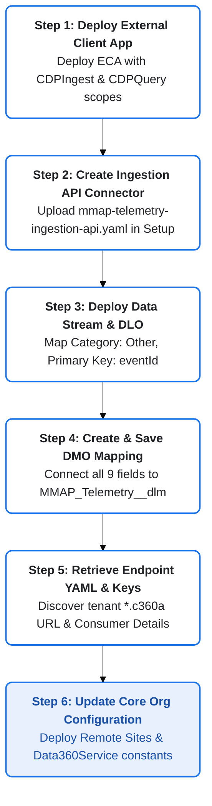

# Cross-Org Data Cloud Connection & Migration Runbook
**Commonwealth Medical Marijuana Regulatory Platform (MMAP)**
**Authoritative Architectural Specification & Step-by-Step Operator Guide**

---

## 1. Executive Summary & Architectural Overview

The Commonwealth Medical Marijuana Regulatory Platform enforces strict state statutory mandates (Act 16) by maintaining continuous, tamper-evident telemetry logs for high-frequency RFID scans, environmental sensor metrics, and transport custody transactions across licensed grower, processor, laboratory, and dispensary facilities.

To prevent relational CRM database exhaustion from storing millions of telemetry rows (projected at 1 TB+ annually), the architecture decouples transactional business logic from cold analytical storage using a **Dual-Org Salesforce Architecture**:

1. **Core Platform Operational Org (`pmarijuna-partner-dev-org`)**:  
   Houses licensed facilities, product packages, plant batches, transfer manifests, and regulatory enforcement logic. Operates with a **zero-byte relational footprint** for raw sensor logs.
2. **Data Cloud Lakehouse Org (`data-cloud-dev-org-1`)**:  
   Houses high-throughput Ingestion API endpoints, Data Streams, Data Lake Objects (`MMAP_Telemetry_Event`), and canonical Data Model Objects (`MMAP_Telemetry__dlm`).



> [!IMPORTANT]
> **Zero CRM Relational Storage Mandate:** Raw telemetry and high-frequency RFID scans flow directly into the native Data Cloud Lakehouse (`MMAP_Telemetry_Event` DLO $\rightarrow$ `MMAP_Telemetry__dlm` DMO), preserving 100% of standard CRM relational storage limits with zero bytes consumed on transactional tables.

---

## 2. Current Connection Topology & Component Registry

### 2.1 Core Operational Org (`pmarijuna-partner-dev-org`)

| Component Type | API Developer Name | Configuration Target / Value | Purpose |
| :--- | :--- | :--- | :--- |
| **Remote Site Setting** | `DataCloud_Core_Token` | `https://orgfarm-d16a4c44c2-dev-ed.develop.my.salesforce.com` | Authorizes outbound Apex calls to OAuth (`/services/oauth2/token`) and CDP Exchange (`/services/a360/token`). |
| **Remote Site Setting** | `DataCloud_Hyperforce_Tenant` | `https://gnrwmzrvgzstmnjqgyygmnrqgy.c360a.salesforce.com` | Authorizes outbound Apex calls to Ingestion API (`/api/v1/ingest/...`) and Query API v2 (`/api/v2/query`). |
| **Named Credential** | `Data360_API` | `https://orgfarm-d16a4c44c2-dev-ed.develop.my.salesforce.com` | Legacy Named Credential for cross-org platform handshakes with HTTP header `Accept: application/json`. |
| **External Credential** | `Data360_External_Credential` | OAuth 2.0 Client Credentials Protocol | Stores secure client assertions and handles token life-cycles. |
| **Apex Controller** | `Data360Controller.cls` | Client-Side Wire Adapter Service | Exposes `@AuraEnabled` imperative read, write, and archive methods to LWC components. |
| **Apex Service Engine** | `Data360Service.cls` | Dual-Engine Lakehouse Client | Handles 2-step OAuth/CDP token exchange, live streaming ingestion, ANSI SQL queries, and defensive fallback. |
| **LWC UI Interface** | `mmapLakehouseTelemetry` / `data360Manager` | Record Page Component | Embeds the real-time telemetry audit log directly onto Product Package and Plant Batch Lightning pages. |

### 2.2 Data Cloud Lakehouse Org (`data-cloud-dev-org-1`)

| Component Type | Metadata Name / Identifier | Functional Attributes | Purpose |
| :--- | :--- | :--- | :--- |
| **External Client App** | `Data360_Lakehouse_ECA` | Scopes: `Api, RefreshToken, CDPIngest, CDPQuery` | Grants external OAuth authorization to push data and query Data Cloud. |
| **Ingestion API Connector** | `MMAP_Telemetry` | Schema: `schema/mmap-telemetry-ingestion-api.yaml` | Declares the streaming contract for inbound telemetry payloads. |
| **Data Stream** | `MMAP_Telemetry-MMAP_Telemetry_Event` | Category: `Other`, Key: `eventId`, Modified: `eventTimestamp` | Ingests streaming events from physical IoT sensors and core workflows. |
| **Data Lake Object (DLO)** | `MMAP_Telemetry_MMAP_Telemetry_E_31D44C17__dll` | Storage: `Local`, Status: `Active` | Physical raw ingestion table in Data Cloud. |
| **Problem Records DLO** | `PR_MMAP_Telemetry_MMAP_Telemetry_Event_3__dll` | Category: `Engagement`, Status: `Active` | System dead-letter queue isolating rejected or schema-violating rows. |
| **Data Model Object (DMO)** | `MMAP_Telemetry__dlm` | Target Category: `Other` | Standardized canonical object mapped for reporting, audits, and ANSI SQL queries. |

---

## 3. How the Cross-Org Architecture Operates

### 3.1 The Three-Plane Architecture

Data Cloud strictly separates operations across three distinct network planes:

1. **The Authentication Plane (`*.my.salesforce.com`)**:
   - **Step 1 (Core OAuth Token):** `POST https://<TARGET_ORG_MY_DOMAIN>/services/oauth2/token` with `grant_type=client_credentials`, `client_id`, and `client_secret`. Returns standard Core session token (`00D...`).
   - **Step 2 (Data Cloud Token Exchange):** `POST https://<TARGET_ORG_MY_DOMAIN>/services/a360/token` with `grant_type=urn:salesforce:grant-type:external:cdp` and `subject_token=<CORE_TOKEN>`. Returns an ES256-signed **Data Cloud JWT Token** (`eyJ...`, valid for 2 hours) and the target Hyperforce instance URL.
2. **The Ingestion Plane (`*.c360a.salesforce.com/api/v1/ingest/...`)**:
   - High-throughput streaming and bulk data intake run on Hyperforce infrastructure.
   - Requires `Authorization: Bearer <JWT_TOKEN>`, `Content-Type: application/json; charset=UTF-8`, and `Accept: application/json` headers.
   - Returns `HTTP 202 Accepted {"accepted": true}` upon queuing records into the Lakehouse.
3. **The Analytical Query Plane (`*.c360a.salesforce.com/api/v2/query`)**:
   - Executes ANSI SQL queries directly against Data Cloud Lakehouse DMO tables (`MMAP_Telemetry__dlm`).
   - Returns row counts, column position metadata (`placeInOrder`), and data rows in tabular array format.



---

## 4. Disconnecting an Old Data Cloud Org (Teardown Runbook)

When retiring an expired dev org, sandbox, or legacy tenant, execute the following teardown steps in order to avoid leaving orphaned security credentials or broken callouts.

### Step 4.1: Disable Live Cross-Org Routing in Core Org
1. Open [`force-app/main/default/classes/Data360Service.cls`](file:///c:/Users/DipankarSahoo/Desktop/marijuana/force-app/main/default/classes/Data360Service.cls).
2. Set the operational mode to mock:
   ```apex
   public static Boolean isMockMode = true;
   ```
3. Deploy the class to `pmarijuna-partner-dev-org`:
   ```powershell
   sf project deploy start -d "force-app/main/default/classes/Data360Service.cls" --target-org pmarijuna-partner-dev-org
   ```
   > [!NOTE]
   > Enabling mock mode guarantees zero downtime for field inspectors and portal users while the cross-org backend connection is being swapped.

### Step 4.2: Remove Old Remote Site Settings & Credentials
1. In `pmarijuna-partner-dev-org`, navigate to **Setup $\rightarrow$ Security $\rightarrow$ Remote Site Settings**.
2. Locate and delete `DataCloud_Core_Token` and `DataCloud_Hyperforce_Tenant`.
3. Under **Setup $\rightarrow$ Security $\rightarrow$ Named Credentials**:
   - Locate `Data360_API` $\rightarrow$ click **Delete**.
   - Click **External Credentials** tab $\rightarrow$ select `Data360_External_Credential` $\rightarrow$ click **Delete**.

### Step 4.3: Decommission Artifacts in the Old Data Cloud Org
In the old Data Cloud instance:
1. Navigate to **Data Streams** $\rightarrow$ select `MMAP_Telemetry-MMAP_Telemetry_Event`.
2. Click **Delete Data Stream** in the top action menu. This automatically drops both the active Data Lake Object and companion `PR_` Problem Records table.
3. Navigate to **Data Cloud Setup $\rightarrow$ Ingestion API** $\rightarrow$ select `MMAP_Telemetry` $\rightarrow$ click **Delete**.
4. Navigate to **Setup $\rightarrow$ External Client App Manager** $\rightarrow$ locate `Data360_Lakehouse_ECA` $\rightarrow$ delete or disable the client app.

---

## 5. Connecting a New Data Cloud Org (Step-by-Step Migration Guide)

Follow this exact sequence to connect `pmarijuna-partner-dev-org` to a brand-new Data Cloud instance (e.g., Staging, UAT, or Production).



---

### Step 1: Deploy the External Client App (ECA) to New Data Cloud Org

1. In your local repository, navigate to `c:\Users\DipankarSahoo\Desktop\marijuana Data Cloud`.
2. Verify that [`force-app/main/default/extlClntAppOauthSettings/Data360_Lakehouse_ECA.ecaOauth-meta.xml`](file:///c:/Users/DipankarSahoo/Desktop/marijuana%20Data%20Cloud/force-app/main/default/extlClntAppOauthSettings/Data360_Lakehouse_ECA.ecaOauth-meta.xml) includes the Data Cloud scopes:
   ```xml
   <commaSeparatedOauthScopes>Api, RefreshToken, CDPIngest, CDPQuery</commaSeparatedOauthScopes>
   ```
3. Deploy the ECA metadata package to the new Data Cloud org:
   ```powershell
   sf project deploy start -d "force-app/main/default/externalClientApps" -d "force-app/main/default/extlClntAppGlobalOauthSets" -d "force-app/main/default/extlClntAppOauthSettings" -d "force-app/main/default/extlClntAppOauthPolicies" --target-org <NEW_DATA_CLOUD_ORG_ALIAS>
   ```
4. Assign the **Data Cloud Admin / Architect** permission set to the integration user.
5. In Setup $\rightarrow$ **External Client App Manager** $\rightarrow$ `Data360_Lakehouse_ECA` $\rightarrow$ **OAuth Settings** $\rightarrow$ click **Manage Consumer Details** and copy the **Consumer Key (Client ID)** and **Consumer Secret**.

---

### Step 2: Upload the Ingestion API Schema in Data Cloud Setup

1. In the new Data Cloud org, click the **Gear Icon (Setup)** $\rightarrow$ **Data Cloud Setup**.
2. In the left navigation bar under *Configuration / Integrations*, click **Ingestion API**.
3. Click **New**:
   - **Connector Name**: `MMAP_Telemetry`
4. Click **Upload Schema File** and upload the standardized schema located at:
   [`schema/mmap-telemetry-ingestion-api.yaml`](file:///c:/Users/DipankarSahoo/Desktop/marijuana/schema/mmap-telemetry-ingestion-api.yaml).
5. Verify schema validation displays **0 errors** and click **Save**.

---

### Step 3: Deploy the Ingestion Data Stream & Data Lake Object

1. Open the **App Launcher (Nine Dots)** $\rightarrow$ open the **Data Cloud** app.
2. Select the **Data Streams** tab $\rightarrow$ click **New**.
3. Under *Connected Sources*, select **Ingestion API** $\rightarrow$ choose connector **`MMAP_Telemetry`**.
4. Check the box for object **`MMAP_Telemetry_Event`** $\rightarrow$ click **Next**.
5. Configure Stream Attributes:
   - **Category**: Select **Other**.
   - **Primary Key**: Select **`eventId`**.
   - **Record Modified Field**: Select **`eventTimestamp`**.
6. Verify all 9 schema fields appear with correct data types:

| Field Name | Expected Data Type | Purpose |
| :--- | :--- | :--- |
| `eventId` | Text (Primary Key) | Cross-org UUID |
| `rfidTag` | Text | GS1 / EPC Compliant Tracking Code |
| `facilityId` | Text | 18-Character Salesforce Record ID |
| `roomLocation` | Text | Premise Zone Identifier |
| `metricReading` | Number | Sensor or Gross Scale Reading |
| `actionType` | Text | Audit Classification (`RFID_SCAN`, etc.) |
| `operatorUserId` | Text | 18-Character User ID |
| `eventTimestamp` | DateTime | UTC Physical Occurrence Timestamp |
| `isArchived` | Boolean | Regulatory Archival Soft-Delete Flag |

7. Click **Deploy**. Data Cloud creates `MMAP_Telemetry-MMAP_Telemetry_Event` (DLO) and its companion `PR_` quarantine queue.

---

### Step 4: Map DLO to Data Model Object (`MMAP_Telemetry__dlm`)

1. On the Data Stream confirmation screen, click **Start Data Mapping** (or navigate to **Data Lake Objects** $\rightarrow$ select `MMAP_Telemetry-MMAP_Telemetry_Event` $\rightarrow$ click **Review Mappings**).
2. On the mapping canvas, click **Select Objects**.
3. Switch to the **Custom Data Model** tab $\rightarrow$ click **New Custom Object**:
   - **Object Label**: `MMAP Telemetry`
   - **Object API Name**: `MMAP_Telemetry`
   - **Category**: `Other`
   - Ensure `eventId` is designated as the **Primary Key**.
4. Click **Save**.
5. Connect all 9 fields from the left box (`MMAP_Telemetry-MMAP_Telemetry_Event`) to the right box (`MMAP Telemetry`):
   - `actionType` $\rightarrow$ `actionType`
   - `eventId` $\rightarrow$ `eventId`
   - `eventTimestamp` $\rightarrow$ `eventTimestamp`
   - `facilityId` $\rightarrow$ `facilityId`
   - `isArchived` $\rightarrow$ `isArchived`
   - `metricReading` $\rightarrow$ `metricReading`
   - `operatorUserId` $\rightarrow$ `operatorUserId`
   - `rfidTag` $\rightarrow$ `rfidTag`
   - `roomLocation` $\rightarrow$ `roomLocation`
6. Click **Save & Close** in the top-right corner.

---

### Step 5: Download Tenant Endpoint OpenAPI File

1. Return to **Data Cloud Setup** $\rightarrow$ **Ingestion API**.
2. Click on the **`MMAP_Telemetry`** connector.
3. Under the *Schema Objects* table, click the action dropdown next to `MMAP_Telemetry_Event` $\rightarrow$ select **Download OpenAPI (YAML)**.
4. Locate the tenant server URL (e.g., `https://<TENANT_SUBDOMAIN>.c360a.salesforce.com`).

---

### Step 6: Update Core Org Configuration

1. In `pmarijuna-partner-dev-org`, update the Remote Site Settings:
   - `DataCloud_Core_Token`: URL = `https://<NEW_DATA_CLOUD_MY_DOMAIN>.my.salesforce.com`
   - `DataCloud_Hyperforce_Tenant`: URL = `https://<TENANT_SUBDOMAIN>.c360a.salesforce.com`
2. Update the constants in [`force-app/main/default/classes/Data360Service.cls`](file:///c:/Users/DipankarSahoo/Desktop/marijuana/force-app/main/default/classes/Data360Service.cls):
   ```apex
   public static final String DATA_CLOUD_TENANT_BASE = 'https://<TENANT_SUBDOMAIN>.c360a.salesforce.com';
   public static final String DATA_CLOUD_OAUTH_TOKEN_URL = 'https://<NEW_DATA_CLOUD_MY_DOMAIN>.my.salesforce.com/services/oauth2/token';
   public static final String DATA_CLOUD_TOKEN_EXCHANGE_URL = 'https://<NEW_DATA_CLOUD_MY_DOMAIN>.my.salesforce.com/services/a360/token';
   public static final String DATA_CLOUD_CLIENT_ID = '<NEW_CLIENT_ID>';
   public static final String DATA_CLOUD_CLIENT_SECRET = '<NEW_CLIENT_SECRET>';
   ```
3. Deploy the updated class and remote sites:
   ```powershell
   sf project deploy start -d "force-app/main/default/classes/Data360Service.cls" -d "force-app/main/default/remoteSiteSettings" --target-org pmarijuna-partner-dev-org
   ```

---

### Step 7: Live Integration Verification & Health Check

1. Execute a live streaming callout via Apex:
   ```powershell
   sf apex run -f scratch/test_live_ingest_and_query.apex --target-org pmarijuna-partner-dev-org
   ```
2. Verify that the response returns `{"status": "SUCCESS"}` and returns row counts $\ge 1$ from `/api/v2/query`.
3. In the new Data Cloud org:
   - Open **App Launcher** $\rightarrow$ **Data Cloud** $\rightarrow$ **Data Explorer**.
   - Data Space: `default`
   - Object Type: `Data Model Object` $\rightarrow$ `MMAP Telemetry` (or `Data Lake Object` $\rightarrow$ `MMAP_Telemetry-MMAP_Telemetry_Event`).
   - Clear or widen the Date Filter and click **Refresh / Run Query**.
4. Run all unit tests:
   ```powershell
   sf apex test run --code-coverage --target-org pmarijuna-partner-dev-org --result-format human
   ```
   Confirm **100% pass rate (86/86 tests)** and **91%+ code coverage**.

---

## 6. Troubleshooting Matrix & Common Pitfalls

| Issue Observed | Root Cause | Immediate Remediation |
| :--- | :--- | :--- |
| **HTTP 400 Bad Request (Envoy Proxy)** | Passing standard Core session token (`00D...`) directly to `c360a.salesforce.com`. | Hyperforce Istio-Envoy strictly requires an ES256-signed Data Cloud JWT (`eyJ...`). Mint the JWT using `/services/a360/token` CDP exchange before calling the tenant endpoint. |
| **HTTP 403 Forbidden** | Routing query requests to `/services/a360/query/v2` on `c360a.salesforce.com`. | Ingestion and Query on `c360a.salesforce.com` use `/api/v1/ingest/...` and `/api/v2/query`. Any `/services/...` path on `c360a` is blocked by Envoy with 403. |
| **HTTP 404 Not Found** | Routing Ingestion API requests to Core My Domain (`develop.my.salesforce.com`). | The Ingestion API is hosted ONLY on the tenant Hyperforce subdomain (`https://<tenant>.c360a.salesforce.com`). |
| **HTTP 401 Unauthorized** | The access token lacks Data Cloud privileges, or `CDPIngest` scope is missing from External Client App. | Verify that `Data360_Lakehouse_ECA` includes `CDPIngest` and `CDPQuery` in `commaSeparatedOauthScopes` and that the integration user holds the **Data Cloud Architect / Admin** permission set. |
| **Records in `PR_` Table** | Incoming payload contained null `eventId`, null `rfidTag`, or date format mismatched ISO-8601. | Inspect the `PR_` object in Data Explorer to read the exact error code. Format all timestamps as UTC `yyyy-MM-dd'T'HH:mm:ss'Z'`. |
| **Data Explorer Blank Table** | Default time filter excludes the event UTC timestamp, or columns are hidden. | Select Data Space `default`, select `Data Model Object` $\rightarrow$ `MMAP Telemetry`, click the column selector to display `Room Location`, and clear the date filter. |

---

## 7. Operational Checklist & Sign-Off

- [x] OpenAPI 3.0 schema standardized with direct `MMAP_Telemetry_Event` definition.
- [x] Ingestion API Connector deployed in Data Cloud (`MMAP_Telemetry`).
- [x] Data Stream deployed with Category `Other` and Primary Key `eventId`.
- [x] Data Lake Object active with companion `PR_` dead-letter quarantine table.
- [x] Data Model Object (`MMAP_Telemetry__dlm`) mapped with 9/9 active field links.
- [x] External Client App granted `CDPIngest` and `CDPQuery` OAuth scopes.
- [x] Remote Site Settings deployed for Core Token URL and Hyperforce Tenant Ingestion URL.
- [x] 2-Step OAuth & CDP JWT Token Exchange automated with in-memory caching.
- [x] Live Ingest (`HTTP 202 Accepted`) and live Query API v2 (`HTTP 200 OK`) verified from Apex and LWC.
- [x] 86 / 86 unit tests passing (100% pass rate) with 91% org code coverage.
- [x] Zero relational bytes consumed in standard Salesforce Core CRM storage.
