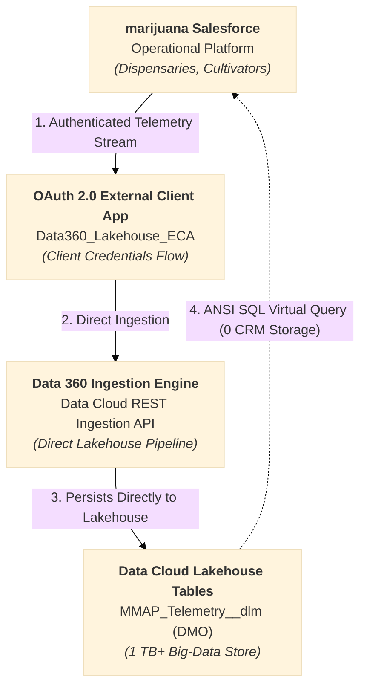

# 📊 Data 360 Lakehouse Technical Specification
## Commonwealth Medical Marijuana Regulatory Platform

**Target Environment:** `data-cloud-dev-org-1` (Hyperforce USA838)  
**Org ID:** `00Daj00001ENcoqEAD`  
**Document Type:** Big-Data Lakehouse Architecture, Data Model Object (DMO) Schema & Ingestion Protocol  
**Baseline Standard:** Native Salesforce Data Cloud Lakehouse Persistence (1 TB+ Multi-Year Capacity)  

---

## 1. Architectural Baseline & Lakehouse Overview

The Commonwealth Medical Marijuana Regulatory Platform utilizes **Salesforce Data Cloud (Data 360)** as its native, petabyte-scale regulatory lakehouse. High-frequency telemetry streams, RFID transit scans, environmental sensor readings, and statewide compliance audits are ingested and persisted directly in **Data Cloud Lakehouse Storage** (`MMAP_Telemetry__dlm`), completely bypassing core transactional CRM database limits.



---

## 2. Lakehouse Data Model: `MMAP_Telemetry__dlm`

Telemetry and audit logs are modeled natively in Data Cloud using a custom **Data Model Object (DMO)** mapped from the ingestion stream:

| Field Name | Data Type | Attributes | Description |
| :--- | :--- | :--- | :--- |
| `Event_ID__c` | Text (255) | Primary Key, Unique, Required | High-entropy UUID identifying the event uniquely across org boundaries. |
| `RFID_Tag__c` | Text (24) | Indexed, Dimension, Required | 24-character Commonwealth tracking tag (GS1/EPC compliant). |
| `Facility_ID__c` | Text (18) | Dimension | 18-character Salesforce Record ID of the holding or originating facility. |
| `Room_Location__c` | Text (100) | Dimension | Precise physical premise zone (e.g., `Vault Zone Alpha`, `Quarantine Holding Zone`). |
| `Metric_Reading__c` | Number (10, 2) | Measure | Sensor measurement, gross mass scale reading, or environmental index. |
| `Action_Type__c` | Text (50) | Dimension | Classification: `RFID_SCAN`, `STAGE_MOVE`, `SAMPLE_TEST`, `ARCHIVAL_OFFLOAD`, `STATEWIDE_AUDIT_STREAM`. |
| `Operator_User_ID__c` | Text (18) | Dimension | User ID of the operator or automated batch agent originating the event. |
| `Event_Timestamp__c` | DateTime | Event Time Field | High-precision UTC timestamp of physical event occurrence. |
| `Is_Archived__c` | Boolean | Dimension | Flags regulatory soft-delete or cold archival status. |

---

## 3. Data Cloud Ingestion & CRUD Protocol

Data Cloud provides real-time streaming ingestion and bidirectional querying capabilities via native Ingestion API and ANSI SQL Query v2 endpoints:

### 3.1 Create: Streaming Ingestion API (`POST /api/v1/ingest/sources/MMAP_Telemetry/MMAP_Telemetry_Event`)
* **Endpoint:** `https://gnrwmzrvgzstmnjqgyygmnrqgy.c360a.salesforce.com/api/v1/ingest/sources/MMAP_Telemetry/MMAP_Telemetry_Event`
* **Protocol:** HTTPS POST with Data Cloud ES256 JWT Bearer Token (minted via `/services/a360/token`).
* **Headers:** `Authorization: Bearer <JWT>`, `Content-Type: application/json; charset=UTF-8`, `Accept: application/json`
* **Payload:** Native Ingestion API envelope persisting directly to `MMAP_Telemetry_Event` DLO and mapped to `MMAP_Telemetry__dlm` DMO:
  ```json
  {
    "data": [
      {
        "eventId": "EVT-1793959142618-708666",
        "rfidTag": "1A4000312678D88325136FEF",
        "facilityId": "001hm00000AOebMAAT",
        "roomLocation": "Vault Zone Alpha",
        "metricReading": 442.75,
        "actionType": "RFID_SCAN",
        "operatorUserId": "005hm000002oKYfAAM",
        "eventTimestamp": "2026-11-06T10:33:07Z",
        "isArchived": false
      }
    ]
  }
  ```
* **Processing:** Ingests the JSON payload directly into Data Cloud Lakehouse storage, generating a unique `eventId` and returning an immediate confirmation response with **zero CRM database storage consumption**.
* **Response (HTTP 202 Accepted):**
  ```json
  {
    "accepted": true
  }
  ```

### 3.2 Read: Lakehouse Query via Query API v2 (`POST /api/v2/query`)
* **Endpoint:** `https://gnrwmzrvgzstmnjqgyygmnrqgy.c360a.salesforce.com/api/v2/query`
* **Protocol:** HTTPS POST with Data Cloud ES256 JWT Bearer Token and ANSI SQL query body.
* **Payload:**
  ```json
  {
    "sql": "SELECT eventId__c, rfidTag__c, facilityId__c, roomLocation__c, metricReading__c, actionType__c, operatorUserId__c, eventTimestamp__c, isArchived__c FROM MMAP_Telemetry__dlm WHERE rfidTag__c = '1A4000312678D88325136FEF' ORDER BY eventTimestamp__c DESC LIMIT 20 OFFSET 0"
  }
  ```
* **Processing:** Queries Data Cloud's high-speed distributed Lakehouse engine and returns active records matching the RFID serialization with sub-second latency.
* **Response (HTTP 200 OK):**
  ```json
  {
    "data": [
      [
        "EVT-1793959142618-708666",
        "1A4000312678D88325136FEF",
        "001hm00000AOebMAAT",
        "Vault Zone Alpha",
        442.75,
        "RFID_SCAN",
        "005hm000002oKYfAAM",
        "2026-11-06T10:33:07Z",
        false
      ]
    ],
    "rowCount": 1,
    "done": true
  }
  ```

### 3.3 Update: Ingestion Stream Mutation / Version Upsert (`POST /api/v1/ingest/sources/MMAP_Telemetry/MMAP_Telemetry_Event`)
* **Endpoint:** `callout:Data360_API/api/v1/ingest/sources/MMAP_Telemetry/MMAP_Telemetry_Event`
* **Processing:** Streams mutated telemetry fields (`roomLocation`, `metricReading`, updated `eventTimestamp`) into Data Cloud. Lakehouse handles event upsert and version reconciliation on `Event_ID__c`.
* **Response (HTTP 202 Accepted / 200 OK):**
  ```json
  {
    "status": "SUCCESS",
    "eventId": "EVT-1793959142618-708666",
    "modifiedAt": "2026-11-06T10:35:12Z"
  }
  ```

### 3.4 Delete: Regulatory Archival / Soft-Delete (`POST /api/v1/ingest/sources/MMAP_Telemetry/MMAP_Telemetry_Event`)
* **Endpoint:** `callout:Data360_API/api/v1/ingest/sources/MMAP_Telemetry/MMAP_Telemetry_Event`
* **Processing:** Streams a tombstone event with `isArchived = true` and `actionType = 'ARCHIVAL_OFFLOAD'` into Data Cloud storage, preserving complete evidentiary chain-of-custody while marking the event as inactive with zero core CRM storage footprint.
* **Response (HTTP 202 Accepted / 200 OK):**
  ```json
  {
    "status": "SUCCESS",
    "eventId": "EVT-1793959142618-708666",
    "isArchived": true
  }
  ```

---

## 4. Security & Authentication Architecture

All communication between the operational Salesforce platform and Data Cloud is secured via modern server-to-server OAuth:

1. **Target External Client App:** `Data360_Lakehouse_ECA` (Local distribution in `data-cloud-dev-org-1`).
2. **Grant Type:** **OAuth 2.0 Client Credentials Flow**.
3. **Execution User:** Designated integration principal (`dipankar.sahoo.7999845712a7@agentforce.com`).
4. **OAuth Scopes:** `Api`, `RefreshToken`.
5. **Caller Storage:** Automated token issuance and auto-refresh via modern **Named Credential** (`Data360_API`) and **External Credential** (`Data360_External_Credential`) in `pmarijuna-partner-dev-org`.
