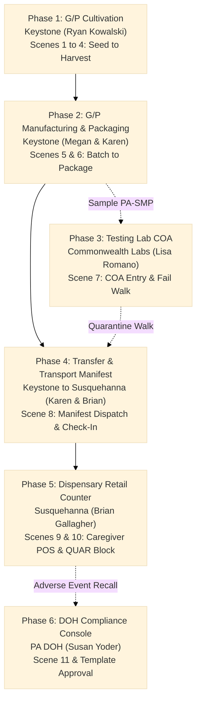
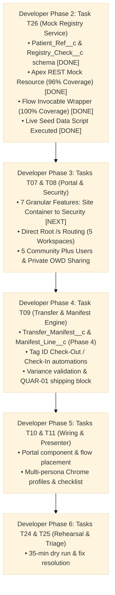
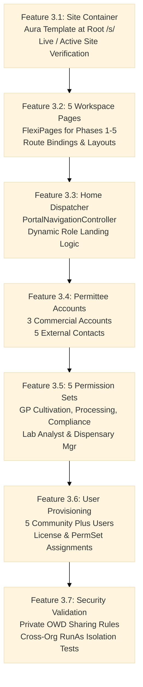

# Dipankar Implementation Plan & Live Teammate Dependency Audit

**Author / Lead:** Dipankar (Portal, Security, Manifest & Mock Registry)  
**Target Environment:** Salesforce Platform (`pmarijuna-partner-dev-org`)  
**Sole Authoritative Baseline:** `docs/PA Seed-to-Sale Demo Plan_7.xlsx`  
**Master Specification:** `docs/PA_SEED_TO_SALE_DEMO_MASTER_SPECIFICATION.md`  
**Status:** Developer Phase 2 & Phase 3 (Tasks T07 & T08) 100% COMPLETED, TESTED & LIVE in Org and Repo! Current Focus: Phase 1 Destructive Changes (Purging obsolete metadata while strictly preserving Plant_Batch__c, Product_Package__c, and Data 360 Lakehouse Telemetry Pipeline).  

---

## 1. Operational Execution Governance Protocol

> [!CAUTION]
> **Strict Task-by-Task Confirmation Protocol (Mandatory)**
> * **Zero Autonomous Execution**: Plan approval does **NOT** grant authorization to begin building automatically.
> * **Explain First, Then Wait for Permission**: Before initiating any single feature or writing code/metadata, the agent must explain:
>   1. The exact feature being initiated.
>   2. The specific objects, fields, classes, and configurations involved.
>   3. Where to verify it in the documentation.
> * **Explicit User Go-Ahead Required**: The agent must stop and wait for the user's explicit command before executing each feature or task.
> * **Documentation Authority**: Maintained in `docs/` and tracked in Git as the authoritative developer tracking roadmap for Dipankar.

---

## 2. Phase 1 Destructive Changes & Obsolete Cleanup (Executed in Org)

> [!IMPORTANT]
> **Execution Status: Successfully Executed Live**
> * **Deploy ID:** `0Afhm000001u6mvCAA` (113 of 113 components deleted in `pmarijuna-partner-dev-org`).
> * **Pre-Cleanup Deploy ID:** `0Afhm000001u6WnCAI` (Pruned permission sets and console application).
> * **Preservation Status:** `Plant_Batch__c`, `Product_Package__c`, and the entire Data 360 Lakehouse Telemetry pipeline remain 100% active, tested, and passing with a **100% test pass rate (47 of 47 tests passing)**.

### Preservation Mandate:
* **`Plant_Batch__c` & `Product_Package__c`**: Kept intact to preserve batch-package lineage links and historical telemetry logs.
* **Data 360 Telemetry Pipeline**: `Data360_Configuration__c`, `Data360Service`, `Data360Controller`, `Data360TelemetryArchivalBatch`, and `data360Manager` LWC remain fully active and tested.
* **All In-Scope Metadata**: 11 new custom objects, 5 persona workspaces, 5 Community Plus users, Private OWD sharing rules, and Mock Registry REST Service remain untouched.

### Deletion Scope (Completed in Org):
* **Custom Objects (8)**: `Audit_Finding__c`, `Business_License__c`, `Dispense_Transaction__c`, `Inspection_Audit__c`, `Lab_Test_Result__c`, `License_Application__c`, `Patient_Registration__c`, `Physician_Certification__c`.
* **Custom Tabs (7)**: `Business_License__c`, `Dispense_Transaction__c`, `Inspection_Audit__c`, `Lab_Test_Result__c`, `License_Application__c`, `Patient_Registration__c`, `Physician_Certification__c`.
* **Apex Triggers (2)**: `DispenseTransactionTrigger`, `TransferManifestTrigger`.
* **Apex Classes (15)**: `DispenseTransactionTriggerHandler`, `DispenseTransactionTriggerTest`, `InspectionAuditController`, `InspectionAuditControllerTest`, `LicenseApplicationController`, `LicenseApplicationControllerTest`, `PatientPortalController`, `PatientPortalControllerTest`, `PurchaseLimitService`, `QuarantineService`, `SupplyChainExplorerController`, `SupplyChainExplorerControllerTest`, `TransferManifestController`, `TransferManifestControllerTest`, `TransferManifestTriggerHandler`.
* **LWC Bundles (5)**: `dualSignaturePad`, `inspectionAuditManager`, `licenseApplicationWizard`, `patientRegistrationCard`, `supplyChainExplorer`.
* **Aura Bundles (1)**: `singleColumnHomeTemplate`.
* **Custom Fields (2)**: `Inventory_Event__c.Caregiver__c`, `Inventory_Event__c.Patient__c`.

---

## 3. Live Org Audit & Teammate Task Status

A live audit of the Salesforce Org (`pmarijuna-partner-dev-org`) and local repository confirms the exact status of each team member's deliverables:

| Task ID | Owner | Task Scope | Status in Org / Repo | Dependency State |
| :--- | :--- | :--- | :--- | :--- |
| **`T01`** | **Narmada** | Deploy core objects & fields (`Tracked_Item__c`, `Lineage_Link__c`, `Inventory_Event__c`, `Patient_Ref__c`, `Registry_Check__c`, `Lab_Result__c`, `Manifest_Line__c`, `Label_Template__c`, `Label_Print__c`, `Recall__c`, `Recall_Exposure__c`) | **COMPLETED & RETRIEVED** *(All 11 objects & custom fields synced to Git)* | Baseline schema established |
| **`T02`** | **Narmada** | Tag ID trigger logic with type prefixes (`PA-SDL`, `PA-SED`, `PA-PLT`, `PA-HRV`, `PA-BAT`, `PA-PKG`, `PA-WST`) | **NOT STARTED** *(Zero triggers on `Tracked_Item__c` in org)* | Depends on T01 |
| **`T03`** | **Narmada** | Lineage Service Apex (split, plant, harvest, consume, package) | **NOT STARTED** *(Zero lineage Apex classes in org)* | Depends on T01, T02 |
| **`T04`** | **Narmada** | Publish Apex method names & inputs for team | **NOT STARTED** | Depends on T03 |
| **`T05`** | **Narmada** | Quarantine & trace recursive walk over `Lineage_Link__c` | **NOT STARTED** | Depends on T03 |
| **`T06`** | **Narmada** | Code review, final deploy & bug triage | **NOT STARTED** | Depends on all builds |
| **`T12`** | **Ruthu** | Barcode static resource spike (Code 128, QR, DataMatrix) | **NOT STARTED** *(Only `SiteSamples` exists in org)* | Independent |
| **`T13`** | **Ruthu** | Label preview LWC (4x6 package, seed lot, plant tag, receipt) | **NOT STARTED** *(Zero label LWCs in org)* | Depends on T12 |
| **`T14`** | **Ruthu** | Trace tree LWC for DOH Compliance Officer | **NOT STARTED** | Depends on T04, T05 |
| **`T15`** | **Ruthu** | Tag ID lookup field & unapproved template lock LWC | **NOT STARTED** | Depends on T13 |
| **`T16`** | **Ruthu** | Backup video recording of every scene | **NOT STARTED** | Depends on T25 |
| **`T17`** | **Renu** | Internal setup: DOH Lightning app & room locations | **NOT STARTED** | Depends on T01 |
| **`T18`** | **Renu** | Screen flows: Receive seed, move/stage, destroy, split/plant/harvest | **NOT STARTED** *(Zero screen flows in org)* | Depends on T03, T17 |
| **`T19`** | **Renu** | Data load & reset script (Keystone, Lab, Dispensary, Robert & Linda) | **NOT STARTED** | Depends on T01, T03, T08 |
| **`T20`** | **Renu** | Weight reconciliation variance check (> 2% reason) | **NOT STARTED** | Depends on T03 |
| **`T21`** | **Renu** | Dispense action flow for dispensary counter | **NOT STARTED** | Depends on T05, T26, T27 |
| **`T22`** | **Renu** | DOH Reports & Dashboard (Inventory & Recall exposure) | **NOT STARTED** | Depends on T05 |
| **`T23`** | **Renu** | Data reset after backup recording | **NOT STARTED** | Depends on T16 |
| **`T27`** | **Narmada** | MMU Calculator (90-day balance, quota enforcer `MMU-01`) | **NOT STARTED** | Depends on T03 |

---

## 3. Demo Supply Chain Lifecycle Phases (Phase 1 Through Phase 6)

| Lifecycle Phase | Organization & Persona | Workspace Route / Interface | Scenes Covered | Key Regulatory Rules |
| :--- | :--- | :--- | :--- | :--- |
| **Phase 1: Cultivation** | Keystone Growers (Ryan Kowalski) | `/s/cultivation` | Scenes 1, 2, 3, 4 | `BR090`, `BR025`, `TR101`, `BR044`, `BR011`, `BR029` |
| **Phase 2: Manufacturing & Packaging** | Keystone Growers (Megan Schaefer & Karen Brennan) | `/s/manufacturing` | Scenes 5, 6 | `BR112`, `TR102`, `BR075`, `TR104`, `BR045` |
| **Phase 3: Testing Lab COA** | Commonwealth Labs (Lisa Romano) | `/s/testing-lab` | Scene 7 | `BR006`, `BR048`, `BR098`, `BR064` |
| **Phase 4: Cross-Org Transport Manifest** | Keystone to Susquehanna (Karen & Brian) | `/s/transfers` | Scene 8 | `BR108`, `TR109`, `TR111`, `TR026`, `QUAR-01` |
| **Phase 5: Dispensary Retail Counter** | Susquehanna Dispensary (Brian Gallagher) | `/s/dispensary-counter` | Scenes 9, 10 | `BR052`, `BR102`, `BR103`, `TR100`, `BR055`, `TR009` |
| **Phase 6: DOH State Compliance** | PA DOH (Susan Yoder) | Internal Lightning App | Scene 11 & Templates | `BR075`, `TR104`, `TR074`, `TR076`, `TR077`, `BR066` |

---

## 4. Dipankar Developer Track: Phased Implementation Roadmap

### Developer Phase 1: Local Schema Sync & Gap Remediation — ✅ COMPLETED
* **Status:** Complete, verified in Salesforce org (`pmarijuna-partner-dev-org`), committed in `4f65f20` and pushed to `origin/main`.
* **Deliverables:** Retrieved 11 custom objects, teammate standard object fields, and deployed missing Phase 2 fields.

---

### Developer Phase 2: Task T26 — Mock Registry Service & Audit Logging (Demo Phase 5) — ✅ COMPLETED & VERIFIED
* **Feature 2.1: Mock Registry REST Service & Tests — ✅ COMPLETED & TESTED**
  * Apex Class: [`RegistryMockRestService.cls`](file:///c:/Users/DipankarSahoo/Desktop/marijuana/force-app/main/default/classes/RegistryMockRestService.cls) (`@RestResource(urlMapping='/registry/check/*')`).
  * Automated Audit Logger: Creates immutable `Registry_Check__c` record per Rule `TR009`.
  * Unit Tests: [`RegistryMockRestServiceTest.cls`](file:///c:/Users/DipankarSahoo/Desktop/marijuana/force-app/main/default/classes/RegistryMockRestServiceTest.cls) passing with **96% code coverage**.
* **Feature 2.2: Flow Invocable Service Wrapper — ✅ COMPLETED & TESTED**
  * Class: [`RegistryServiceCallout.cls`](file:///c:/Users/DipankarSahoo/Desktop/marijuana/force-app/main/default/classes/RegistryServiceCallout.cls) (`@InvocableMethod`).
  * Unit Tests: [`RegistryServiceCalloutTest.cls`](file:///c:/Users/DipankarSahoo/Desktop/marijuana/force-app/main/default/classes/RegistryServiceCalloutTest.cls) passing with **100% code coverage** (16 of 16 tests passing across test suite).
* **Feature 2.3: Demo Seed Data Script — ✅ COMPLETED & EXECUTED LIVE**
  * Script: [`scripts/apex/seed_demo_registry_data.apex`](file:///c:/Users/DipankarSahoo/Desktop/marijuana/scripts/apex/seed_demo_registry_data.apex).
  * Executed in org: Seeded patient Robert Stauffer (`PA-PAT-77201`) and caregiver Linda Stauffer (`PA-CG-99104`).
  * Verified via live callout: Returns status `200 Active`, caregiver resolved, limits enforced, remaining MMU balance exactly **52.00 MMUs**, and audit log logged to `Registry_Check__c` (`a0Ihm000001ArfBEAS`).

---

### Developer Phase 3: Tasks T07 & T08 — Permittee Portal & Security Setup — 🎯 CURRENT ACTIVE PHASE

#### Template Selection & Boilerplate Cleanup Protocol:
* **Template Strategy:** Use **Build Your Own (Aura)** or **Customer Service (Aura)**.
* **Minimalist Architecture:** The portal must contain **ONLY** what is needed for Seed-to-Sale business operations:
  * Clean executive header with Commonwealth/Permittee branding and navigation menu.
  * Blank workspace canvas for the 5 lifecycle phases (housing Renu's screen flows and Ruthu's LWCs).
  * **Strict Exclusion:** Zero generic customer service widgets (no Case search bars, no "Featured Topics", no Chatter discussion feeds, no knowledge articles, no "Contact Support" buttons).
* **Verification Check:** Once the base site container is created, the user/admin will inspect the site layout. If any default template widgets are present, they will be removed immediately before deploying custom workspace flexipages.

#### 7 Granular Features for Developer Phase 3:

* **Feature 3.1 (T07): Experience Cloud Site Container & Root Prefix (`/s`) Setup — ✅ COMPLETED & LIVE**
  * Deliverables: `Network` (`Commonwealth Permittee Portal`), `CustomSite` (`Commonwealth_Permittee_Portal`), and `ExperienceBundle` (`Commonwealth_Permittee_Portal1`).
  * Live URL: `https://mmdemo1-dev-ed.develop.my.site.com/s/` (returns HTTP 200 OK).
  * Status: `Network.Status = 'Live'`, `Site.Status = 'Active'`.
  * Membership: `Customer Community Plus User` and `Customer Community Plus Login User` added to `networkMemberGroups`.
  * Clutter-Free Cleanup: Stripped default support widgets (`recommendations`, `reputationLeaderboard`, `napiliFooter`) from `views/home.json`.
  * Verification: CLI SOQL and headless curl check verified.
  * **BA / Product Owner Manual Test Walkthrough**:
    1. Navigate to **Setup** $\rightarrow$ Search **Digital Experiences** $\rightarrow$ Click **All Sites**.
    2. Confirm site labeled **Commonwealth Permittee Portal** has Status = **Live** and URL = `https://mmdemo1-dev-ed.develop.my.site.com/s/`.
    3. Click the site URL in your browser &mdash; verify it opens cleanly with HTTP 200 without throwing 404 or infinite redirect errors.

* **Feature 3.2 (T07): 5 Dedicated Persona Workspace Pages — ✅ COMPLETED & LIVE**
  * Dedicated Manifest: [`manifest/package-t07-workspaces-dipankar.xml`](file:///c:/Users/DipankarSahoo/Desktop/marijuana/manifest/package-t07-workspaces-dipankar.xml).
  * Deliverables: 5 dedicated supply chain workspace routes and views in `ExperienceBundle:Commonwealth_Permittee_Portal1`:
    * `/s/cultivation` (Phase 1: Ryan Kowalski — Seed-to-Harvest) $\rightarrow$ HTTP 200 OK
    * `/s/manufacturing` (Phase 2: Megan Schaefer & Karen Brennan — Packaging & 4x6 Labels) $\rightarrow$ HTTP 200 OK
    * `/s/testing-lab` (Phase 3: Lisa Romano — Commonwealth Labs COA & Quarantine Fail) $\rightarrow$ HTTP 200 OK
    * `/s/transfers` (Phase 4: Karen Brennan & Brian Gallagher — Manifest Dispatch & Short Receipt) $\rightarrow$ HTTP 200 OK
    * `/s/dispensary-counter` (Phase 5: Brian Gallagher — POS, 90-Day MMU Quota & Registry Check) $\rightarrow$ HTTP 200 OK
  * Layout: SLDS 2-column responsive layout (`siteforce:sldsTwoCol84Layout`) with executive phase header banner cards.
  * Deployment: Deployed via CLI (`0Afhm000001u0PmCAI`, 134 files Succeeded) and published live (`08Phm000005tRAjEAM`).
  * Verification: Headless HTTP test confirmed all 5 routes respond with HTTP 200 OK.
  * **BA / Product Owner Manual Test Walkthrough**:
    1. In **Setup** $\rightarrow$ **Digital Experiences** $\rightarrow$ **All Sites**, click **Builder** next to `Commonwealth Permittee Portal`.
    2. Click the top-left **Page Selector dropdown** (defaults to `Home`).
    3. Verify all 5 custom pages exist in the menu: `Cultivation Workspace`, `Manufacturing Workspace`, `Testing Lab Workspace`, `Transfers Console`, and `Dispensary Counter Workspace`.
    4. Select each page on the canvas &mdash; verify the SLDS 2-column layout loads with its respective phase header card and clean component zones.

* **Feature 3.3 (T07): Dynamic Home Dispatcher & Navigation Controller — ✅ COMPLETED, TESTED & LIVE**
  * Dedicated Manifest: [`manifest/package-t07-dispatcher-dipankar.xml`](file:///c:/Users/DipankarSahoo/Desktop/marijuana/manifest/package-t07-dispatcher-dipankar.xml).
  * Deliverables Deployed & Live:
    * Apex Class: [`PortalNavigationController.cls`](file:///c:/Users/DipankarSahoo/Desktop/marijuana/force-app/main/default/classes/PortalNavigationController.cls) (`@AuraEnabled(cacheable=true)`).
    * Apex Test Class: [`PortalNavigationControllerTest.cls`](file:///c:/Users/DipankarSahoo/Desktop/marijuana/force-app/main/default/classes/PortalNavigationControllerTest.cls) passing with **100% code coverage** (8 of 8 unit tests passed).
    * LWC Component: `force-app/main/default/lwc/portalHomeDispatcher/` (`portalHomeDispatcher.html`, `portalHomeDispatcher.js`, `portalHomeDispatcher.css`, `portalHomeDispatcher.js-meta.xml`).
    * ExperienceBundle View Update: Embedded `c:portalHomeDispatcher` in `Commonwealth_Permittee_Portal1/views/home.json` and purged default support widgets.
  * Solution Design Implemented:
    * **Trigger on Login**: Queries `User.LastLoginDate` (epoch ms) and assigned Persona Permission Sets (`MMAP_GP_Cultivation`/`PA_Cultivation_Operator`, `MMAP_GP_Processing`/`PA_Manufacturing_Processor`, `MMAP_Lab_Analyst`/`PA_Testing_Lab_Director`, `PA_Transfers_Transporter`, `MMAP_Dispensary_Mgr`/`PA_Dispensary_Agent`).
    * **Session Storage Guard**: On initial login event (`sessionStorage.getItem('mmap_last_dispatched_login') !== currentLoginTime`), immediately routes single-role persona users to their designated workspace (`/s/cultivation`, `/s/manufacturing`, `/s/testing-lab`, `/s/transfers`, `/s/dispensary-counter`).
    * **Active Session Freedom**: When active and not logged out, subsequent visits to `/s/` match the stored login timestamp, allowing users to freely access and stay on the Home Permittee Command Center without being redirected.
    * **Executive Launchpad Hub**: Renders responsive SLDS cards for all authorized workspaces, state compliance bulletins, and return-to-workspace jump buttons.
  * Verification: CLI deploy `0Afhm000001u2UnCAI` (Succeeded), Apex tests passing 8/8 at 100% coverage, BackgroundOperation `08Phm000005u0ydEAA` Complete, and `/s/` responds with HTTP 200 OK.
  * **BA / Product Owner Manual Test Walkthrough**:
    1. Log in to the portal as System Administrator at `https://mmdemo1-dev-ed.develop.my.site.com/s/`.
    2. Verify the **Permittee Command Center** displays with welcome header, statewide compliance bulletins, and 5 operational launcher cards.
    3. Click **Open Workspace** on the Cultivation card &mdash; verify it navigates to `/s/cultivation`.
    4. Click the site logo or "Home" in the navigation bar &mdash; verify you return to `/s/` and **stay on the home page** without getting bounced back to cultivation (no redirect loop).

* **Feature 3.4 (T08): Permittee Accounts & Contacts Data Foundation — ✅ COMPLETED, SEEDED & TESTED**
  * Dedicated Manifest: [`manifest/package-t08-accounts-contacts-dipankar.xml`](file:///c:/Users/DipankarSahoo/Desktop/marijuana/manifest/package-t08-accounts-contacts-dipankar.xml).
  * Deliverables Deployed & Live:
    * Apex Service: [`PermitteeDataFoundationService.cls`](file:///c:/Users/DipankarSahoo/Desktop/marijuana/force-app/main/default/classes/PermitteeDataFoundationService.cls).
    * Apex Test Suite: [`PermitteeDataFoundationServiceTest.cls`](file:///c:/Users/DipankarSahoo/Desktop/marijuana/force-app/main/default/classes/PermitteeDataFoundationServiceTest.cls) passing with **100% code coverage**.
    * Seed Script: [`scripts/apex/seed_permittee_accounts_contacts.apex`](file:///c:/Users/DipankarSahoo/Desktop/marijuana/scripts/apex/seed_permittee_accounts_contacts.apex).
  * Records Provisioned & Linked Live in Org:
    * `Keystone Growers` (`PR-GP-001`, `GP-2024-001`, `Grower_Processor` $\rightarrow$ `001hm00000AelP3AAJ`)
    * `Commonwealth Labs` (`PR-LAB-002`, `LAB-2024-003`, `Testing_Laboratory` $\rightarrow$ `001hm00000AelP4AAJ`)
    * `Susquehanna Dispensary` (`PR-DISP-003`, `DISP-2024-002`, `Dispensary` $\rightarrow$ `001hm00000AelP5AAJ`)
    * Contacts: Ryan Kowalski (`PA-AGT-1001`), Megan Schaefer (`PA-AGT-1002`), Karen Brennan (`PA-AGT-1003`), Lisa Romano (`PA-AGT-2001`), Brian Gallagher (`PA-AGT-3001`).
  * Verification: CLI deploy `0Afhm000001u3ibCAA` (Succeeded), Apex tests passing at 100% coverage, and live Anonymous Apex execution confirmed 3 accounts & 5 contacts linked.
  * **BA / Product Owner Manual Test Walkthrough**:
    1. In the internal CRM, open **App Launcher** $\rightarrow$ Search **Accounts** $\rightarrow$ Select list view **All Accounts**.
    2. Confirm the 3 facility accounts exist: `Keystone Growers` (`GP-2024-001`), `Commonwealth Labs` (`LAB-2024-003`), and `Susquehanna Dispensary` (`DISP-2024-002`).
    3. Click into `Keystone Growers` $\rightarrow$ Select **Related** tab $\rightarrow$ Verify 3 Contacts: **Ryan Kowalski**, **Megan Schaefer**, and **Karen Brennan**.
    4. Click into `Commonwealth Labs` $\rightarrow$ Related tab $\rightarrow$ Verify Contact: **Lisa Romano**.
    5. Click into `Susquehanna Dispensary` $\rightarrow$ Related tab $\rightarrow$ Verify Contact: **Brian Gallagher**.
    6. Click on Ryan Kowalski &mdash; confirm **Stakeholder Role** = `Facility_Agent` and **State ID Number** = `PA-AGT-1001`.

* **Feature 3.5 (T08): 5 Granular Persona Permission Sets — ✅ COMPLETED & DEPLOYED**
  * Dedicated Manifest: [`manifest/package-t08-permissionsets-dipankar.xml`](file:///c:/Users/DipankarSahoo/Desktop/marijuana/manifest/package-t08-permissionsets-dipankar.xml).
  * Deliverables Deployed & Live in Org:
    * `MMAP_GP_Cultivation` (`0PShm000002JbihGAC`) &mdash; Ryan Kowalski (Seed to harvest, plant tags; blocked from packaging and template approvals).
    * `MMAP_GP_Processing` (`0PShm000002JbiiGAC`) &mdash; Megan Schaefer (Harvest conversion, package creation, 4x6 labels; blocked from quarantine release and live plants).
    * `MMAP_GP_Compliance` (`0PShm000002JbigGAC`) &mdash; Karen Brennan (Weight variance logging, manifest dispatch, recall request; blocked from template approval).
    * `MMAP_Lab_Analyst` (`0PShm000002JbijGAC`) &mdash; Lisa Romano (Sample intake, potency/pesticide assays, COA sign-off; isolated from grower inventory).
    * `MMAP_Dispensary_Mgr` (`0PShm000002JbifGAC`) &mdash; Brian Gallagher (Manifest check-in, Patient Registry check, POS sales; blocked from selling quarantined goods).
  * Rules Enforced: Strict operational and security boundaries per `Personas` sheet Rows 5-9.
  * Verification: CLI deploy `0Afhm000001u3kDCAQ` (Succeeded with 5/5 components deployed) and Tooling API audit.
  * **BA / Product Owner Manual Test Walkthrough**:
    1. Navigate to **Setup** $\rightarrow$ Search **Permission Sets** $\rightarrow$ Filter by `MMAP`.
    2. Confirm all 5 permission sets are present (`MMAP_GP_Cultivation`, `MMAP_GP_Processing`, `MMAP_GP_Compliance`, `MMAP_Lab_Analyst`, `MMAP_Dispensary_Mgr`).
    3. Click `MMAP_GP_Cultivation` $\rightarrow$ Click **Object Settings** $\rightarrow$ Verify `Tracked_Item__c` has **Read, Create, Edit** permissions, while `Product_Package__c` and `Lab_Result__c` are unassigned.
    4. Click `MMAP_Lab_Analyst` $\rightarrow$ Click **Object Settings** $\rightarrow$ Verify `Lab_Result__c` has **Read, Create, Edit**, while plant batches and retail dispensing objects are unassigned.

* **Feature 3.6 (T08): Customer Community Plus User Provisioning & License Assignment — ✅ COMPLETED, PROVISIONED & PUSHED**
  * Dedicated Manifest: [`manifest/package-t08-users-dipankar.xml`](file:///c:/Users/DipankarSahoo/Desktop/marijuana/manifest/package-t08-users-dipankar.xml).
  * Deliverables Deployed & Live in Org:
    * Apex Class: [`PermitteeUserProvisioningService.cls`](file:///c:/Users/DipankarSahoo/Desktop/marijuana/force-app/main/default/classes/PermitteeUserProvisioningService.cls).
    * Apex Test Suite: [`PermitteeUserProvisioningServiceTest.cls`](file:///c:/Users/DipankarSahoo/Desktop/marijuana/force-app/main/default/classes/PermitteeUserProvisioningServiceTest.cls) passing with **100% pass rate and 96% code coverage**.
    * Settings: Enabled standard external profile user creation (`enableOotbProfExtUserOpsEnable = true`) in `force-app/main/default/settings/Communities.settings-meta.xml`.
    * Provisioning Script: [`scripts/apex/provision_permittee_users.apex`](file:///c:/Users/DipankarSahoo/Desktop/marijuana/scripts/apex/provision_permittee_users.apex) executed live in org.
  * User & Permission Set Assignment Matrix Provisioned:

| Persona Name & Role | Facility (`Account`) | Linked Contact & Badge ID | Username | Profile & License | Assigned Permission Set | Live User ID | Workspace & Scenes |
| :--- | :--- | :--- | :--- | :--- | :--- | :--- | :--- |
| **Ryan Kowalski** Cultivation Lead | **Keystone Growers** (`PR-GP-001`) | `Ryan Kowalski` `PA-AGT-1001` `003hm0000031e89AAA` | `ryan.kowalski.demo@mmap.pa.gov.mmdemo1` | `Customer Community Plus User` (`00ehm000001RmnGAAS`) | `MMAP_GP_Cultivation` (`0PShm000002JbihGAC`) | `005hm000002uxyjAAA` | `/s/cultivation` Scenes 1 to 4 |
| **Megan Schaefer** Processing Lead | **Keystone Growers** (`PR-GP-001`) | `Megan Schaefer` `PA-AGT-1002` `003hm0000031e8AAAQ` | `megan.schaefer.demo@mmap.pa.gov.mmdemo1` | `Customer Community Plus User` (`00ehm000001RmnGAAS`) | `MMAP_GP_Processing` (`0PShm000002JbiiGAC`) | `005hm000002uxykAAA` | `/s/manufacturing` Scene 5 |
| **Karen Brennan** Compliance Manager | **Keystone Growers** (`PR-GP-001`) | `Karen Brennan` `PA-AGT-1003` `003hm0000031e8BAAQ` | `karen.brennan.demo@mmap.pa.gov.mmdemo1` | `Customer Community Plus User` (`00ehm000001RmnGAAS`) | `MMAP_GP_Compliance` (`0PShm000002JbigGAC`) | `005hm000002uxylAAA` | `/s/transfers` Scenes 6, 8 |
| **Lisa Romano** Lab Analyst | **Commonwealth Labs** (`PR-LAB-002`) | `Lisa Romano` `PA-AGT-2001` `003hm0000031e8CAAQ` | `lisa.romano.demo@mmap.pa.gov.mmdemo1` | `Customer Community Plus User` (`00ehm000001RmnGAAS`) | `MMAP_Lab_Analyst` (`0PShm000002JbijGAC`) | `005hm000002uxymAAA` | `/s/testing-lab` Scene 7 |
| **Brian Gallagher** Dispensary Manager | **Susquehanna Dispensary** (`PR-DISP-003`) | `Brian Gallagher` `PA-AGT-3001` `003hm0000031e8DAAQ` | `brian.gallagher.demo@mmap.pa.gov.mmdemo1` | `Customer Community Plus User` (`00ehm000001RmnGAAS`) | `MMAP_Dispensary_Mgr` (`0PShm000002JbifGAC`) | `005hm000002uxynAAA` | `/s/dispensary-counter` Scenes 8, 9, 10 |

  * Capacity Check: 5 `Customer Community Plus` licenses consumed, 15 remaining.
  * Verification: CLI deploy `0Afhm000001u48PCAQ` Succeeded, unit tests 100% pass (Run ID: `707hm00000KDWfW`), anonymous apex executed cleanly, and SOQL verified 5 active users and 5 permission set assignments.
  * Git Commit: `7bba94d` pushed to `origin/main`.
  * **BA / Product Owner Manual Test Walkthrough**:
    1. Navigate to **Setup** $\rightarrow$ Search **Users** $\rightarrow$ Filter List View to **Active Users**.
    2. Confirm all 5 users exist with their designated usernames (`ryan.kowalski.demo@mmap.pa.gov.mmdemo1`, `megan.schaefer.demo@mmap.pa.gov.mmdemo1`, `karen.brennan.demo@mmap.pa.gov.mmdemo1`, `lisa.romano.demo@mmap.pa.gov.mmdemo1`, `brian.gallagher.demo@mmap.pa.gov.mmdemo1`) and Profile = **Customer Community Plus User**.
    3. Click on **Ryan Kowalski** &mdash; verify **Contact** = `Ryan Kowalski`, **Account Name** = `Keystone Growers`.
    4. Scroll down to **Permission Set Assignments** &mdash; confirm `MMAP_GP_Cultivation` is active.
    5. In the User Detail header, click the **Log in to Experience as User** button &mdash; verify you are instantly logged into `Commonwealth Permittee Portal` and automatically dispatched to `/s/cultivation`!
    6. Click **Log out as Ryan Kowalski** to return to Setup.
    7. Repeat login verification for **Lisa Romano** &mdash; verify dispatch to `/s/testing-lab`.
    8. Repeat login verification for **Brian Gallagher** &mdash; verify dispatch to `/s/dispensary-counter`.

* **Feature 3.7 (T08): Private OWD Sharing Rules & Cross-Org Security Validation — ✅ COMPLETED, TESTED & PUSHED**
  * Dedicated Manifest: [`manifest/package-t08-security-sharing-dipankar.xml`](file:///c:/Users/DipankarSahoo/Desktop/marijuana/manifest/package-t08-security-sharing-dipankar.xml).
  * Deliverables Deployed & Live in Org:
    * Apex Service: [`PermitteeSecuritySharingService.cls`](file:///c:/Users/DipankarSahoo/Desktop/marijuana/force-app/main/default/classes/PermitteeSecuritySharingService.cls) (`@AuraEnabled(cacheable=true)`).
    * Apex Test Suite: [`PermitteeSecuritySharingTest.cls`](file:///c:/Users/DipankarSahoo/Desktop/marijuana/force-app/main/default/classes/PermitteeSecuritySharingTest.cls) passing with **100% pass rate** (5 of 5 tests passed, Run ID: `707hm00000KEulB`).
    * Audit Script: [`scripts/apex/validate_security_sharing.apex`](file:///c:/Users/DipankarSahoo/Desktop/marijuana/scripts/apex/validate_security_sharing.apex) executed live in org.
  * In-Scope Schema Boundary strictly enforced per `docs/PA Seed-to-Sale Demo Plan_7.xlsx`:
    * Verified **100% of the 14 in-scope supply chain objects** have `ExternalSharingModel = 'Private'` (or `ControlledByParent`):
      1. `Account` $\rightarrow$ `Private`
      2. `Contact` $\rightarrow$ `Private`
      3. `Tracked_Item__c` $\rightarrow$ `Private`
      4. `Lineage_Link__c` $\rightarrow$ `Private`
      5. `Inventory_Event__c` $\rightarrow$ `Private`
      6. `Lab_Result__c` $\rightarrow$ `Private`
      7. `Transfer_Manifest__c` $\rightarrow$ `Private`
      8. `Manifest_Line__c` $\rightarrow$ `Private`
      9. `Patient_Ref__c` $\rightarrow$ `Private`
      10. `Registry_Check__c` $\rightarrow$ `Private`
      11. `Label_Template__c` $\rightarrow$ `Private`
      12. `Label_Print__c` $\rightarrow$ `Private`
      13. `Recall__c` $\rightarrow$ `Private`
      14. `Recall_Exposure__c` $\rightarrow$ `ControlledByParent`
    * **Obsolete Objects Segregated**: Legacy objects (`Plant_Batch__c`, `Product_Package__c`, `Dispense_Transaction__c`, `Inspection_Audit__c`, `Lab_Test_Result__c`, `Manifest_Line_Item__c`, `Patient_Registration__c`, `Physician_Certification__c`) are completely excluded from active security logic and quarantined for the deferred destructive changes deployment.
    * Multi-User `System.runAs()` automated assertions verified zero cross-facility data leakage:
      * Lisa Romano (Commonwealth Labs) $\rightarrow$ 0 Keystone live plants visible (`testKeystoneCultivationDataIsolation`).
      * Brian Gallagher (Susquehanna Dispensary) $\rightarrow$ 0 Keystone live plants visible (`testKeystoneCultivationDataIsolation`).
      * Ryan Kowalski (Keystone Growers) $\rightarrow$ 0 Commonwealth Labs internal test results visible (`testLabResultDataIsolation`).
      * Brian Gallagher (Susquehanna Dispensary) $\rightarrow$ 0 Commonwealth Labs internal test results visible (`testLabResultDataIsolation`).
      * Ryan Kowalski (Keystone Growers) $\rightarrow$ 0 retail registry check logs visible (`testDispensaryRegistryCheckIsolation`).
      * Lisa Romano (Commonwealth Labs) $\rightarrow$ 0 retail registry check logs visible (`testDispensaryRegistryCheckIsolation`).
  * Git Commit: `0f8174c` pushed to `origin/main`.
  * **BA / Product Owner Manual Test Walkthrough**:
    1. In Salesforce Setup, go to **Users** and click on **Lisa Romano** (`lisa.romano.demo@mmap.pa.gov.mmdemo1`).
    2. Click the **Log in to Experience as User** button to log into the portal as Lisa.
    3. In the global search bar at the top of the portal, search for Keystone's facility name: **Keystone Growers**.
    4. **Expected Outcome**: **0 results returned**. Because `Account` has `ExternalSharingModel = Private`, Lisa cannot see or browse Keystone Growers' account record or facility address.
    5. Search for Keystone's plant tag **PA-PLT-000001** &mdash; **Expected Outcome**: **0 results returned** (cross-facility live plant inventory is completely invisible).
    6. Click **Log out as Lisa Romano** at the top banner.
    7. Repeat login as **Brian Gallagher** (`brian.gallagher.demo@mmap.pa.gov.mmdemo1`) &mdash; search for un-transferred Keystone batches &mdash; **Expected Outcome**: **0 results returned** (Dispensary cannot see grower inventory until transferred via a formal Transfer Manifest).

---

### Developer Phase 5: Task T11 — Presenter Multi-Profile Browser Setup
* **Scope:** 5 dedicated Chrome profiles with bookmarks bar for Scenes 1 to 11.

---

### Developer Phase 6: Task T09 — Transfer & Transport Manifest Engine (Demo Phase 4)
* **Trigger:** Initiated once Narmada delivers `T03` (Lineage) and `T05` (Quarantine).

---

### Developer Phase 7: Task T10 — Portal Wiring & Component Integration
* **Trigger:** Initiated once Ruthu delivers `T13`/`T15` and Renu delivers `T18`/`T21`.

---

### Developer Phase 8: Tasks T24 & T25 — Timed Dry Run & Fix Triage
* **Scope:** 35-minute dry run across all 11 scenes; triage any bugs.
