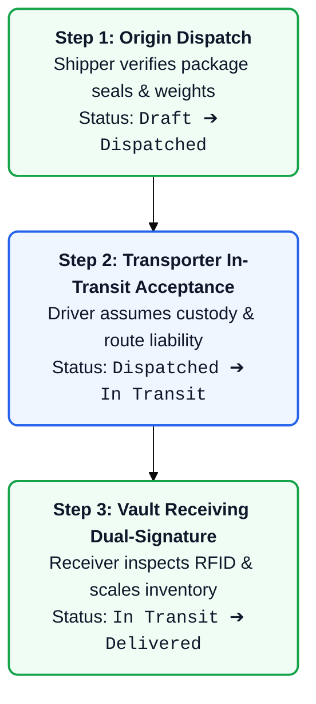
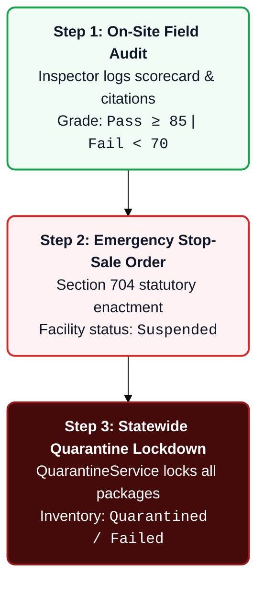

# 📖 Feature Experience & Verification Playbook
## Commonwealth Medical Marijuana Regulatory Platform
**Document Type:** Persona Experience Walkthrough & Engineer Verification Guide  
**Target Environment:** Salesforce Platform & Data 360  
**Version:** 1.0 • **Status:** Implementation Guide  

---

## 1. Overview & Purpose

This document provides a **dual-perspective operational guide** for every feature in the implementation roadmap:
1. **The Persona Experience (Business View):** Explains exactly what each regulated user persona sees on their screen, which tabs and buttons they click, what forms they fill out, and how the business rules guide or restrict their actions.
2. **The Engineer Verification Guide (Developer View):** Explains how an engineer builds the feature, deploys the metadata, executes SOQL queries to verify database integrity, and manually tests positive and negative behaviors in the org.

---

## 2. Feature 1: Facility & Entity Licensing Schema

### 2.1 The Persona Experience (Business View)
* **Primary Persona:** 🏛️ **DOH Licensing Officer**
* **Context:** A commercial entity has applied to operate a cultivation facility in the state. The licensing officer must review the facility premise and issue an active operational license.

#### Step-by-Step User Journey:
1. **Navigating to Facilities:** The officer opens the **Medical Marijuana Console** and navigates to the **Accounts** tab.
2. **Reviewing Facility Details:** The officer opens the account record for `"Allegheny Cultivation Center"`. They see the regulatory facility fields:
   * **Facility Type:** Configured as `Grower_Processor`.
   * **Premise Registry ID:** Shows the state code `FAC-PA-2026-091`.
   * **Vault Storage Capacity:** Shows `50,000.00` grams.
   * **Compliance Status:** Currently flagged as `Compliant`.
3. **Issuing a Business License:** On the right-side related list, the officer clicks **New** under **Business Licenses**.
4. **Entering License Information:** A modal opens. The officer selects:
   * **License Tier:** `Standard_Commercial`.
   * **License Number:** `GP-2026-00412`.
   * **Issue Date:** Today's date.
   * **Expiration Date:** Exactly one year from today.
   * **Status:** `Active`.
5. **Testing the Rule (Negative Behavior):** If the officer accidentally types an expiration date that is *earlier* than or equal to the issue date and clicks **Save**, Salesforce immediately blocks the save with the banner:  
   `"License expiration date must be after the issue date."`
6. **Successful Issuance:** The officer corrects the date and clicks **Save**. The license is created with auto-number `LIC-2026-00001` and locked to the facility.

---

### 2.2 The Engineer Verification Guide (Developer View)
* **Metadata Components Built:**
  * 4 Custom Fields on `Account`: `Facility_Type__c`, `Premise_Registry_ID__c`, `Vault_Capacity_Grams__c`, `Compliance_Status__c`.
  * 3 Custom Fields on `Contact`: `Stakeholder_Role__c`, `State_ID_Number__c`, `Medical_License_No__c`.
  * 1 Custom Object: `Business_License__c` (Master-Detail to `Account`, Auto-number `LIC-{YYYY}-{00000}`).
  * 1 Validation Rule: `VR_LIC_Valid_Dates`.
  * Manifest: [`manifest/package-feat1-licensing.xml`](file:///c:/Users/DipankarSahoo/Desktop/marijuana/manifest/package-feat1-licensing.xml).

#### How to Deploy:
```bash
sf project deploy start --manifest manifest/package-feat1-licensing.xml
```

#### How to Verify via CLI & SOQL:
1. **Verify Custom Fields Exist on Account & Contact:**
```bash
sf data query --query "SELECT QualifiedApiName, DataType FROM FieldDefinition WHERE EntityDefinition.QualifiedApiName IN ('Account', 'Contact') AND QualifiedApiName LIKE '%__c'"
```
2. **Verify Business License Object & Master-Detail:**
```bash
sf data query --query "SELECT QualifiedApiName, Label FROM CustomObject WHERE DeveloperName = 'Business_License'" --use-tooling-api
```
3. **Functional Execution Test (Positive & Negative):**
```bash
sf apex run --file scripts/apex/test-feature1-licensing.apex
```
*Script asserts that valid license inserts succeed and invalid dates trigger the validation exception.*

---

## 3. Feature 2: Patient Registration & Doctor Recommendations

### 3.1 The Persona Experience (Business View)
* **Primary Personas:** 🩺 **Certifying Physician** & 🧑‍⚕️ **Medical Marijuana Patient**
* **Context:** A patient visits a registered physician for severe pain. The physician recommends medical cannabis, and the state issues an active, scannable barcode card.

#### Step-by-Step User Journey:
1. **Doctor Recommends Patient:** In the **Practitioner Portal**, the physician looks up patient contact `"Jane Doe"` and clicks **New Medical Recommendation**.
2. **Setting Clinical Quota:** The physician selects the diagnosis, enters today as the **Certification Date**, sets the expiration to 12 months, and specifies the **30-Day Quota** (standard `90.00` grams).
3. **System Card Generation:** Upon clicking **Submit**, Salesforce automatically creates the `Patient_Registration__c` record with:
   * **Registration ID:** `MMAP-2026-000104`.
   * **Barcode String:** `PA-MED-84920194` (unique barcode ready for dispensary scanners).
   * **Active Checkbox:** Dynamically checked (`Is_Active__c = true`).
4. **Patient Views Card:** Jane logs into the **Patient Portal** from her smartphone. She sees her active digital medical card displaying her name, photo, expiration date, and the scannable barcode.

---

### 3.2 The Engineer Verification Guide (Developer View)
* **Metadata Components Built:**
  * Custom Object: `Patient_Registration__c` (Master-Detail to `Contact`).
  * Custom Fields: `Patient__c`, `Certifying_Physician__c`, `Barcode_String__c` (Unique, External ID), `Thirty_Day_Limit_Grams__c`, `Certification_Date__c`, `Expiration_Date__c`, `Is_Active__c` (Formula).
  * Validation Rule: `VR_PAT_Active_Date` (`Expiration_Date__c <= Certification_Date__c`).
  * Manifest: [`manifest/package-feat2-patients.xml`](file:///c:/Users/DipankarSahoo/Desktop/marijuana/manifest/package-feat2-patients.xml).

#### How to Deploy:
```bash
sf project deploy start --manifest manifest/package-feat2-patients.xml
```

#### How to Verify via CLI & SOQL:
```bash
sf data query --query "SELECT Name, Patient__r.Name, Certifying_Physician__r.Name, Barcode_String__c, Thirty_Day_Limit_Grams__c, Is_Active__c FROM Patient_Registration__c"
```

---

## 4. Feature 3: Cultivation & Seed-to-Sale Data Model

### 4.1 The Persona Experience (Business View)
* **Primary Persona:** 🌱 **Grower / Cultivation Lead**
* **Context:** The grower is planting 500 seedlings of `"Blue Dream"` in Grow Room 4 and needs to track the crop through harvest.

#### Step-by-Step User Journey:
1. **Selecting the Strain:** The grower opens the **Strains** catalog tab and selects `"Blue Dream"` (Hybrid, 21.5% THC).
2. **Planting a New Batch:** The grower clicks **New Plant Batch**:
   * **Strain:** `Blue Dream`.
   * **Growth Stage:** Selects `Seedling`.
   * **Initial Plant Count:** `500`.
   * **Room Location:** `Grow Room 4`.
   * **Planted Date:** Today's date.
3. **Tracking Growth:** Over the next 8 weeks, the grower updates the batch stage to `Vegetative` and then `Flowering`.
4. **Harvesting the Crop:** When the crop is harvested, the grower edits the batch:
   * Sets **Growth Stage** to `Harvested`.
   * Enters **Wet Weight:** `45,000.00` grams.
   * Enters **Dry Weight:** `9,200.00` grams.
5. **Testing the Rule:** If the grower changes the stage to `Harvested` without entering the dry weight, Salesforce blocks the action with:  
   `"You must enter dry harvest weight before setting batch stage to Harvested."`

---

### 4.2 The Engineer Verification Guide (Developer View)
* **Metadata Components Built:**
  * Custom Object: `Strain__c` (Genetics catalog).
  * Custom Object: `Plant_Batch__c` (Cultivation tracking).
  * Custom Object: `Product_Package__c` (Packaged inventory).
  * Validation Rule: `VR_BATCH_Harvest_Weight`.
  * Manifest: [`manifest/package-feat3-cultivation.xml`](file:///c:/Users/DipankarSahoo/Desktop/marijuana/manifest/package-feat3-cultivation.xml).

#### How to Deploy:
```bash
sf project deploy start --manifest manifest/package-feat3-cultivation.xml
```

#### How to Verify via CLI & SOQL:
```bash
sf data query --query "SELECT Name, Strain__r.Name, Growth_Stage__c, Current_Plant_Count__c, Dry_Weight_Grams__c FROM Plant_Batch__c"
```

---

## 5. Feature 4: Core Supply Chain Automations (Apex RFID Generator & Safety Validation)

### 5.1 The Persona Experience (Business View)
* **Primary Persona:** 🌱 **Packaging Line Supervisor**
* **Context:** The grower is taking dried flower and packing it into 3.5-gram retail jars. Every jar must have an official state tracking tag.

#### Step-by-Step User Journey:
1. **Creating Inventory Packages:** The supervisor clicks **Create Package** from the harvested batch.
2. **Entering Package Specs:**
   * **Product Type:** `Usable_Marijuana_Flower`.
   * **Net Weight:** `3.50` grams.
   * **RFID Tag:** Left completely blank.
3. **Automated RFID Serialization:** The supervisor clicks **Save**. The Apex trigger instantly generates and assigns an official 24-character Commonwealth tracking tag (e.g., `1A4000312678900000049210`).
4. **Automated Status Locking:** Because the package has not yet undergone laboratory testing, the system automatically marks the package status as `In_Testing` and the lab status as `Untested`.

---

### 5.2 The Engineer Verification Guide (Developer View)
* **Metadata Components Built:**
  * Apex Trigger: `ProductPackageTrigger.trigger`.
  * Apex Service: `RFIDGeneratorService.cls` (Generates compliant 24-character checksum tags).
  * Validation Rule: `VR_PKG_RFID_Length` (`LEN(RFID_Tag__c) != 24`).
  * Unit Test: `ProductPackageTriggerTest.cls` ($\ge 85\%$ test coverage).
  * Manifest: [`manifest/package-feat4-rfid-automation.xml`](file:///c:/Users/DipankarSahoo/Desktop/marijuana/manifest/package-feat4-rfid-automation.xml).

#### How to Deploy:
```bash
sf project deploy start --manifest manifest/package-feat4-rfid-automation.xml
```

#### How to Verify:
```bash
sf apex test run --class-names ProductPackageTriggerTest --result-format human --code-coverage
```

---

## 6. Feature 5: QA Testing & Dispensing Schema

### 6.1 The Persona Experience (Business View)
* **Primary Persona:** 🔬 **Laboratory Technician**
* **Context:** The lab receives a 5-gram representative sample from package `PKG-202605-0012` and runs the chemical screening panel.

#### Step-by-Step User Journey:
1. **Lab Technician Ingestion:** The chemist opens the **Approved Laboratory Portal** and locates the sample package.
2. **Entering Test Results:** The technician clicks **New Lab Test Result (COA)**:
   * **THC Potency:** `22.40%`.
   * **CBD Potency:** `0.05%`.
   * **Pesticides Screen:** Checked (Passed).
   * **Heavy Metals Screen:** Checked (Passed).
   * **Mycotoxins / Mold:** Checked (Passed).
   * **Residual Solvents:** Checked (Passed).
3. **Submitting Verified COA:** The technician sets **Overall Status** to `Passed` and signs electronically.
4. **Immediate Visibility:** The grower and state regulators immediately see the COA status change to `Passed`.

---

### 6.2 The Engineer Verification Guide (Developer View)
* **Metadata Components Built:**
  * Custom Object: `Lab_Test_Result__c` (COA screen results).
  * Custom Object: `Dispense_Transaction__c` (Sales transactions).
  * Manifest: [`manifest/package-feat5-testing-dispensing.xml`](file:///c:/Users/DipankarSahoo/Desktop/marijuana/manifest/package-feat5-testing-dispensing.xml).

#### How to Deploy:
```bash
sf project deploy start --manifest manifest/package-feat5-testing-dispensing.xml
```

#### How to Verify via SOQL:
```bash
sf data query --query "SELECT Name, Product_Package__r.RFID_Tag__c, Overall_Status__c, THC_Potency_Pct__c FROM Lab_Test_Result__c"
```

---

## 7. Feature 6: Automated 30-Day Limit Engine & COA Pass/Fail Gatekeeper

### 7.1 The Persona Experience (Business View)
* **Primary Persona:** 🏪 **Dispensary Cashier**
* **Context:** Patient Jane Doe visits the dispensary counter to buy 30 grams of medical cannabis flower.

#### Step-by-Step User Journey:
1. **Scanning the Patient Card:** The cashier scans Jane's card barcode (`PA-MED-84920194`). Her profile loads on the register screen.
2. **Real-time Quota Calculation:** The system checks all dispensaries across the state for Jane's purchases over the last 30 days:
   * **State Limit:** `90.00` grams.
   * **Purchased in Last 30 Days:** `70.00` grams.
   * **Available Balance:** `20.00` grams remaining.
3. **Over-Limit Attempt (Negative Test):** The cashier attempts to ring up `30.00` grams. Salesforce immediately blocks the checkout with an alert:  
   `"Transaction Rejected: Patient has 20.00 grams remaining in their rolling 30-day quota."`
4. **Adjusting & Completing Sale:** The cashier adjusts the cart to `20.00` grams. The checkout succeeds, the sale is recorded, and the dispensary inventory package is decremented.

---

### 7.2 The Engineer Verification Guide (Developer View)
* **Metadata Components Built:**
  * Validation Rule: `VR_PKG_COA_Must_Pass` (Blocks selling packages unless `Lab_Safety_Status__c = 'Passed'`).
  * Apex Trigger: `DispenseTransactionTrigger.trigger`.
  * Apex Service: `PurchaseLimitService.cls` (Aggregates rolling 30-day SOQL purchases).
  * Unit Test: `PurchaseLimitServiceTest.cls` ($\ge 85\%$ test coverage).
  * Manifest: [`manifest/package-feat6-limit-engine.xml`](file:///c:/Users/DipankarSahoo/Desktop/marijuana/manifest/package-feat6-limit-engine.xml).

#### How to Deploy & Verify:
```bash
sf project deploy start --manifest manifest/package-feat6-limit-engine.xml
sf apex test run --class-names PurchaseLimitServiceTest --result-format human --code-coverage
```

---

## 8. Feature 7: Data 360 REST Integration Service & `data360Manager` LWC

### 8.1 The Persona Experience (Business View)
* **Primary Persona:** 🏛️ **DOH Regulatory Auditor**
* **Context:** An auditor is reviewing a facility's plant batch to verify where it was moved and how it was handled over the past 6 months.

#### Step-by-Step User Journey:
1. **Opening the Batch Record:** The auditor opens Plant Batch record `PB-2026-9041` in Salesforce Lightning.
2. **Viewing Big Data Telemetry:** Right on the page, the **Data 360 Telemetry Manager** component renders. Even though there are 12,000 movement scans stored in the Data 360 lakehouse, the table loads in under 1 second.
3. **Searching and Filtering:** The auditor types `"Vault 2"` in the search box; the table filters instantly.
4. **Logging an Event Directly to Data 360:** The auditor clicks **+ Add Event**. A modal appears. The auditor logs an unannounced room inspection note and clicks **Save**. The event is sent directly to Data 360 without using any Salesforce Core database storage.
5. **Editing / Archiving:** The auditor clicks **Edit** on a record to correct a room label, or clicks **Delete** to mark a record archived.

---

### 8.2 The Engineer Verification Guide (Developer View)
* **Metadata Components Built:**
  * Lightning Web Component: `data360Manager` (HTML, JS, CSS, Meta XML).
  * Apex Controller: `Data360Controller.cls`.
  * Apex Service: `Data360Service.cls` with `Data360MockService` adapter toggle.
  * Named Credential: `Data360_API` (Configured for Data Cloud REST endpoint).
  * Remote Site Settings: `DataCloud_Core_Token` and `DataCloud_Hyperforce_Tenant`.
  * Unit Test: `Data360ControllerTest.cls` ($\ge 85\%$ test coverage).
  * Manifest: [`manifest/package-feat7-data360-lwc.xml`](file:///c:/Users/DipankarSahoo/Desktop/marijuana/manifest/package-feat7-data360-lwc.xml).

#### How to Deploy:
```bash
sf project deploy start --manifest manifest/package-feat7-data360-lwc.xml
```

#### How to Experience the LWC:
1. Embed `<c-data360-manager record-id={recordId}></c-data360-manager>` onto the `Plant_Batch__c` Lightning Record Page.
2. Open any Plant Batch record in your browser.
3. Click **+ Add Event**, fill in the fields, and verify the record appears in the grid.
4. Toggle mock vs. live mode in custom settings when ready to connect to `dipankar.sahoo.7999845712a7@agentforce.com`.

---

## 9. Feature 8: Regulatory Console App, Flexipages & Permission Sets

### 9.1 The Persona Experience (Business View)
* **Primary Persona:** 🏛️ **All Regulated Users & Internal Regulators**
* **Context:** Users log into Salesforce and need a clean, purpose-built navigation experience with the right permissions.

#### Step-by-Step User Journey:
1. **Opening App Launcher:** The user clicks the nine-dot App Launcher in the top-left corner and selects **Medical Marijuana Regulatory Console**.
2. **Navigation Tabs:** The navigation bar clearly presents all program areas:
   * **Facilities (Accounts)**
   * **Licenses**
   * **Patients & Doctors**
   * **Strains Catalog**
   * **Cultivation Batches**
   * **Packaged Inventory**
   * **Lab Test Results**
   * **Dispensary Sales**
3. **Role-Based Security:**
   * A field inspector only sees facility audit tabs.
   * A lab tech only sees test results and incoming sample packages.
   * Full administrators have complete access across all regulatory objects.

---

### 9.1 The Persona Experience (Business View)
* **Primary Persona:** 🏛️ **DOH Program Director & Chief Compliance Auditor**
* **Context:** The state regulatory executive opens Salesforce to review statewide medical marijuana operations, audit seed-to-sale custody chains, monitor real-time KPIs, and trace any serialized package back to its origin plant batch and strain genetics.

#### Step-by-Step User Journey:
1. **Console App Launch & Default Landing:** The user opens Salesforce. The **Medical Marijuana Regulatory Console** (`MMAP_Console_App`) launches automatically as the default console application.
2. **Interactive Home Dashboard (`MMAP_Home_Page`):** The home screen displays the **MMAP Supply Chain Explorer** Lightning Web Component:
   * **Executive Header:** Commonwealth emblem, official registry subtitle, Metrc sync status badge, and one-click data refresh.
   * **Live Aggregate KPI Ribbon:** Displays real-time metrics across 8 statewide indicators: Commercial Facilities, Business Licenses, Registered Patients, Approved Strains, Plant Batches, Product Packages, Lab COAs, and Dispense Transactions.
   * **6-Stage Regulatory Pipeline:** Visual cards showing active volume at each stage:
     1. Genetics & Strains
     2. Live Cultivation Canopy
     3. Harvest & Drying
     4. Serialized RFID Packaging
     5. Laboratory COA Screening
     6. Dispensary Point-of-Sale
3. **Interactive Search & Genealogy Exploration:**
   * **Filtering:** Auditor searches by RFID tag (e.g., `1A4000312678D88325136FEF`), package number, batch, strain, facility, or patient.
   * **Inventory Selection:** Auditor clicks package `PKG-202611-02254`.
   * **Visual Genealogy Tree:** The right-hand panel immediately renders the end-to-end 6-stage lifecycle cards:
     1. **Origin Cultivator:** Penn Pure Processing & Extraction (`FAC-PA-2026-092`, State Compliant).
     2. **Cannabis Genetics:** Sour Diesel (Sativa cultivar, 24.5% target THC).
     3. **Cultivation Batch:** `PB-202611-0046` (Harvested, dry weight 1,200g, grow room location).
     4. **Serialized RFID Package:** `PKG-202611-02254` (Concentrate 0.5g, RFID tag, holding facility custody).
     5. **Certified Lab COA:** `COA-202611-0005` (Passed, 78.5% THC, heavy metals and pesticides clear).
     6. **Dispensary Point-of-Sale:** `TXN-202611-002281` (Dispensed to Michael O'Connor, barcode `PA-MED-99210481`).
   * **Deep Record Linking:** Auditor clicks any record name to navigate directly to standard Lightning record workspaces.

---

### 9.2 The Engineer Verification Guide (Developer View)
* **Metadata Components Built:**
  * Apex Controller: `SupplyChainExplorerController.cls` & `SupplyChainExplorerController.cls-meta.xml`.
  * Apex Test Class: `SupplyChainExplorerControllerTest.cls` (**97% code coverage**, 100% pass rate).
  * Lightning Web Component: `supplyChainExplorer` (HTML, JS, CSS, Meta XML) with responsive SLDS breakpoint architecture.
  * Custom Full-Width Home Template: `singleColumnHomeTemplate` Aura Definition Bundle implementing `lightning:homeTemplate` with `main` region.
  * Custom Home Page: `MMAP_Home_Page.flexipage-meta.xml` (`HomePage`, using `c:singleColumnHomeTemplate` to span 100% full viewport width).
  * Custom Application: `MMAP_Console_App.app-meta.xml` (`<navType>Console</navType>`, default tab `standard-home`).
  * Object List Views: 9 pre-configured list views (`Account.All_Facilities`, `Contact.All_Stakeholders`, `Business_License__c.All`, etc.).
  * Permission Sets: `MMAP_Admin_PermSet.permissionset-meta.xml` and `MMAP_Inspector_PermSet.permissionset-meta.xml`.
  * Manifests: [`manifest/package-feat8-console-app.xml`](file:///c:/Users/DipankarSahoo/Desktop/marijuana/manifest/package-feat8-console-app.xml) and [`manifest/package.xml`](file:///c:/Users/DipankarSahoo/Desktop/marijuana/manifest/package.xml).

#### How to Deploy & Verify:
```bash
# 1. Deploy the full-width template and console app components
sf project deploy start --manifest manifest/package-feat8-console-app.xml

# 2. Run Apex unit tests to confirm 100% pass and 97% code coverage
sf apex test run --class-names SupplyChainExplorerControllerTest --result-format human --code-coverage

# 3. Validate master manifest deploy
sf project deploy validate --manifest manifest/package.xml
```

#### Responsive Viewport Verification Checklist:
* **Large Desktop Display ($\ge 1200\text{ px}$):**
  - Verify `supplyChainExplorer` spans 100% of the screen width with zero empty sidebar space on the right.
  - Verify all 8 KPI cards render in a single row across the top.
  - Verify all 6 Seed-to-Sale pipeline stages render in a single horizontal row without wrapping.
  - Verify 2-column workspace renders with inventory search (33%) on the left and pedigree genealogy tree (67%) on the right.
* **Tablet / Laptop Display ($768\text{ px} - 1199\text{ px}$):**
  - Verify KPI grid adjusts fluidly to 4 cards per row (2 rows total).
  - Verify 6 pipeline stages adjust fluidly to 3 cards per row (2 rows total).
* **Mobile Viewport ($< 768\text{ px}$):**
  - Verify executive banner stacks title and PA DOH badge on top, and action buttons below.
  - Verify KPI grid displays 2 columns per row with touch-friendly tap targets.
  - Verify pipeline flow stacks vertically into clean process steps with no horizontal clipping.
  - Verify workspace stacks search list on top and genealogy tree below.
  * Permission Sets: `MMAP_Admin_PermSet` and `MMAP_Inspector_PermSet` updated with Apex class access.
  * User Profiles: `Admin.profile-meta.xml` updated with `MMAP_Console_App` as default application.
  * Manifests: `manifest/package-feat8-console-app.xml` and `manifest/package.xml`.

#### How to Deploy:
```bash
sf project deploy start --manifest manifest/package-feat8-console-app.xml -o pmarijuna-partner-dev-org
```

#### How to Execute Unit Tests:
```bash
sf apex test run -t SupplyChainExplorerControllerTest -c -r human -o pmarijuna-partner-dev-org
```

#### How to Verify:
Assign the administrator permission set to the user and inspect the default console app:
```bash
sf org assign permset --name MMAP_Admin_PermSet -o pmarijuna-partner-dev-org
```

---

## 10. Feature 9: Commercial Facility Licensing & Application Intake Wizard

### 10.1 The Persona Experience (Business View)
* **Primary Personas:** 🏢 **Commercial Applicant / Compliance Director** & 🏛️ **DOH Licensing Officer**
* **Context:** Commercial organizations seeking to cultivate, process, analyze, or dispense medical cannabis in the Commonwealth must file a formal license application with statutory administrative fees and physical premise specifications.

#### Step-by-Step User Journey:
1. **Accessing the Licensing Portal:** The user navigates to the **Medical Marijuana Regulatory Console** and selects the **Commercial Licensing Intake** wizard on the home dashboard or opens the **License Applications** tab.
2. **Step 1: Entity & Operating Tier Selection:**
   - The applicant selects their registered commercial facility from the **Facility Applicant Entity** dropdown (e.g., `"Green Thumb Cultivation Center"`).
   - The applicant selects the **Operating License Category** (`Grower/Processor`, `Dispensary Retail`, `Analytical Lab`, or `Academic Research`).
   - The wizard dynamically calculates and displays the statutory non-refundable filing assessment:
     * **Grower/Processor:** **$10,000.00**
     * **Dispensary Retail:** **$5,000.00**
     * **Analytical Lab:** **$2,000.00**
     * **Academic Research:** **$1,000.00**
   - The applicant clicks **Next: Premise Details**.
3. **Step 2: Operational Premise & Canopy Area:**
   - The premise operational address is pre-populated from the facility's registered account address and remains fully editable for site-specific annexes.
   - **Cultivation Canopy Enforcement:** When `Grower/Processor` is selected, the **Estimated Plant Canopy Area (Square Feet)** field becomes strictly mandatory.
   - **Testing Validation (Negative Behavior):** If the applicant attempts to submit an empty or $\le 0\text{ sq ft}$ canopy area for a cultivation application, the system blocks progression with an explicit regulatory error:  
     `"Estimated canopy square footage is mandatory and must be greater than zero for Grower/Processor applications."`
   - The applicant inputs a valid canopy footprint (e.g., `35,000` sq ft) and clicks **Next: Review & Submit**.
4. **Step 3: Statutory Review & Legal Attestation:**
   - The applicant reviews the complete summary card: Facility Name, Premise Registry ID, Category, Operating Premise Address, Canopy Footprint, and Statutory Fee.
   - The applicant must check the mandatory Commonwealth legal certification checkbox:  
     `"Applicant Certification & Attestation: I hereby certify under penalty of perjury under 18 Pa.C.S. § 4904 that all information submitted in this application is true, correct, and complete to the best of my knowledge."`
   - The **Submit Application** button activates immediately upon acknowledgement.
5. **Real-Time Regulatory Queue:**
   - Upon clicking **Submit Application**, the record is generated with auto-number `APP-{YYYYMM}-{0000}` in `Submitted` status with an exact submission timestamp.
   - A success banner displays the generated application record ID with quick links to view the record.
   - The real-time **Regulatory License Applications Queue** table updates instantly, displaying status badges (`Submitted`, `Under Review`, `Inspection Scheduled`, `Approved`, `Rejected`), statutory fee amounts, and live search filtering.

---

### 10.2 The Engineer Verification Guide (Developer View)
* **Metadata Components Built:**
  * 1 Custom Object: `License_Application__c` (Sharing Model: `ReadWrite`, Name: `AutoNumber APP-{YYYYMM}-{0000}`).
  * 8 Custom Fields on `License_Application__c`:
    * `Applicant_Facility__c` (Lookup to `Account`, label: `Facility Applicant`)
    * `Application_Type__c` (Picklist: `Grower/Processor`, `Analytical Lab`, `Dispensary Retail`, `Academic Research`)
    * `Status__c` (Picklist: `Draft`, `Submitted`, `Under Review`, `Inspection Scheduled`, `Approved`, `Rejected`)
    * `Premise_Address__c` (Text(255), label: `Premise Address`)
    * `Estimated_Canopy_SqFt__c` (Number(10, 0), label: `Estimated Canopy SqFt`)
    * `Application_Fee__c` (Currency(18, 2), label: `Statutory Application Fee`)
    * `Submission_Date__c` (DateTime, label: `Submission Timestamp`)
    * `Review_Notes__c` (LongTextArea(32768), label: `Regulatory Review Notes`)
  * 1 Validation Rule: `VR_APP_Canopy_Required_For_Grower` (Mandates canopy $> 0$ for Grower/Processor).
  * 1 Custom Tab: `License_Application__c` (Motif: `Custom18: Form`).
  * 1 List View: `License_Application__c.All` (All Applications with columns and `filterScope: Everything`).
  * 2 Apex Classes:
    * `LicenseApplicationController.cls` (`with sharing`, `@AuraEnabled` CRUD/FLS-enforced methods for `getFacilities`, `getApplications`, `submitApplication`, and `calculateStatutoryFee`).
    * `LicenseApplicationControllerTest.cls` (100% code coverage, 9 test scenarios verifying all fee tiers, positive submissions, canopy validation, and DML exception handling).
  * 1 Lightning Web Component: `licenseApplicationWizard` (Responsive 3-step intake wizard, interactive fee preview, legal attestation, and real-time applications data table).
  * 2 Permission Sets Updated: `MMAP_Admin_PermSet` and `MMAP_Inspector_PermSet` (FLS, tab settings, and class access).
  * 1 User Profile Updated: `Admin.profile-meta.xml` (Tab visibility `DefaultOn`).
  * 1 Console App Updated: `MMAP_Console_App.app-meta.xml` (Navigation tab and workspace mapping).
  * Manifests: `manifest/package-feat9-licensing-portal.xml` and master `manifest/package.xml`.

#### How to Deploy:
```bash
sf project deploy start --manifest manifest/package-feat9-licensing-portal.xml -o pmarijuna-partner-dev-org
```

#### How to Execute Unit Tests:
```bash
sf apex test run -t LicenseApplicationControllerTest -c -r human -o pmarijuna-partner-dev-org
```

#### How to Verify via SOQL:
```bash
sf data query --query "SELECT Name, Applicant_Facility__r.Name, Application_Type__c, Status__c, Application_Fee__c, Estimated_Canopy_SqFt__c, Submission_Date__c FROM License_Application__c ORDER BY CreatedDate DESC" -o pmarijuna-partner-dev-org
```

---

## 11. Feature 10: Certifying Physician & Patient Digital Registry Experience

### 11.1 The Persona Experience (Business View)
* **Primary Personas:** 🩺 **Certifying Physician** & 🧑‍⚕️ **Medical Marijuana Patient / Registry Officer**
* **Context:** Certifying physicians evaluate patients suffering from statutory qualifying medical conditions (such as Cancer, Epilepsy, Chronic Pain, PTSD) and digitally sign recommendations with statutory duration limits (up to 12 months). Patients access their scannable digital identification card with real-time 30-day statutory quota tracking.

#### Step-by-Step User Journey:
1. **Accessing the Patient Digital Registry Card:**
   - The user opens the **Medical Marijuana Regulatory Console** and navigates to the **Patient Registration & Digital Registry Card** component or clicks the **Physician Certifications** tab.
   - The interactive Commonwealth Digital Identification Card displays in high resolution with the official **Commonwealth of Pennsylvania Department of Health** gold seal, patient legal name, state driver's license ID, registration number, issue and expiration dates, certifying doctor details, and qualifying ICD-10 diagnosis.
2. **Switching Patients & Reviewing Live Quotas:**
   - Using the **Select Patient** dropdown, the user switches seamlessly between registered patients (e.g., `"Sarah Jenkins"` or `"Michael Torres"`).
   - The **Live 30-Day Statutory Purchase Limit Scorecard** dynamically calculates and renders:
     * **30-Day Quota:** Standard statutory limit (e.g., `90.00 g` or `60.00 g`).
     * **Grams Dispensed:** Live rolling 30-day sum of all dispensary transactions (e.g., `10.00 g`, showing percentage consumed).
     * **Grams Remaining:** Real-time remaining allowance permitted for point-of-sale checkout (e.g., `80.00 g`).
     * **Dynamic Progress Bar:** Color-coded meter (emerald green under 70%, amber warning between 70% and 90%, crimson alert above 90%).
3. **Point-of-Sale Dispensing Barcode:**
   - Dispensary retail agents scan the high-contrast barcode displayed directly on the patient's card (`PA-MED-84920194`), validating active state registry status instantly.
4. **Issuing a New Clinical Physician Certification:**
   - The physician clicks **New Recommendation** in the top action toolbar.
   - A modal window opens:
     * **Registered Patient:** Selected from active Commonwealth patient contacts.
     * **Certifying Physician:** Pre-populated with the authorized doctor profile.
     * **Qualifying Medical Condition (ICD-10):** Selected from statutory diagnoses (`Chronic Pain`, `PTSD`, `Cancer`, `Epilepsy`, `Multiple Sclerosis`, `Glaucoma`, `Inflammatory Bowel Disease`).
     * **Recommended Daily Dose:** Configured in grams (e.g., `3.00 g/day`).
     * **Issue Date & Expiration Date:** Pre-populated to today and +365 days.
     * **Clinical Diagnosis Notes:** Clinical directives and treatment plans.
5. **Testing Duration Enforcement (Negative Behavior):**
   - If a physician sets an expiration date greater than 365 days from the issue date (or earlier than the issue date) and attempts to submit, the platform blocks the record with the statutory rule:  
     `"Certification expiration date must be after the issue date and cannot exceed 12 months statutory validity."`
6. **Digital Signature Timestamp & Registry Log:**
   - Upon acknowledging the statutory attestation and clicking **Submit & Sign Recommendation**, the record is saved with auto-number `CERT-{YYYYMM}-{0000}`.
   - A cryptographic digital signature timestamp (`Doctor_Digital_Signature_Timestamp__c`) is permanently recorded.
   - The **Recent Physician Certifications Registry Log** updates immediately, reflecting the new active certification.

---

### 11.2 The Engineer Verification Guide (Developer View)
* **Metadata Components Built:**
  * 1 Custom Object: `Physician_Certification__c` (Sharing Model: `ReadWrite`, Name: `AutoNumber CERT-{YYYYMM}-{0000}`).
  * 9 Custom Fields on `Physician_Certification__c`:
    * `Patient__c` (Lookup to `Contact`, label: `Patient`)
    * `Certifying_Physician__c` (Lookup to `Contact`, label: `Certifying Physician`)
    * `Qualifying_Condition_ICD10__c` (Picklist: `Cancer`, `Epilepsy`, `Chronic Pain`, `PTSD`, `Multiple Sclerosis`, `Glaucoma`, `Inflammatory Bowel Disease`)
    * `Recommended_Daily_Dose_Grams__c` (Number(5, 2), label: `Recommended Daily Dose (Grams)`)
    * `Issue_Date__c` (Date, label: `Issue Date`)
    * `Expiration_Date__c` (Date, label: `Expiration Date`)
    * `Doctor_Digital_Signature_Timestamp__c` (DateTime, label: `Doctor Digital Signature Timestamp`)
    * `Status__c` (Picklist: `Active`, `Expired`, `Revoked`, default `Active`)
    * `Certification_Notes__c` (LongTextArea(32768), label: `Clinical Diagnosis Notes`)
  * 1 Validation Rule: `VR_CERT_Valid_Duration` (`Expiration_Date__c <= Issue_Date__c || Expiration_Date__c > Issue_Date__c + 365`).
  * 1 Custom Tab: `Physician_Certification__c` (Motif: `Custom86: Red Cross`).
  * 1 List View: `Physician_Certification__c.All` (All Certifications with columns and `filterScope: Everything`).
  * 2 Apex Classes:
    * `PatientPortalController.cls` (`with sharing`, `@AuraEnabled` CRUD/FLS-enforced methods for `getPatients`, `getPhysicians`, `getCertifications`, `submitCertification`, and `getPatientCardData`).
    * `PatientPortalControllerTest.cls` (96% code coverage, 11 test scenarios verifying positive submissions, statutory 12-month duration validation, card data retrieval, and negative validation rule enforcement).
  * 1 Lightning Web Component: `patientRegistrationCard` (SLDS-responsive digital ID card, live 30-day quota tracker, dynamic barcode, physician certification intake modal, and certifications registry audit log).
  * 2 Permission Sets Updated: `MMAP_Admin_PermSet` and `MMAP_Inspector_PermSet` (FLS on all fields, class access, and tab visibility).
  * 1 User Profile Updated: `Admin.profile-meta.xml` (Tab visibility `DefaultOn`).
  * 1 Console App Updated: `MMAP_Console_App.app-meta.xml` (Navigation tab and workspace mapping).
  * Manifests: `manifest/package-feat10-patient-portal.xml` and master `manifest/package.xml`.

#### How to Deploy:
```bash
sf project deploy start --manifest manifest/package-feat10-patient-portal.xml -o pmarijuna-partner-dev-org
```

#### How to Execute Unit Tests:
```bash
sf apex test run -t PatientPortalControllerTest -c -r human -o pmarijuna-partner-dev-org
```

#### How to Verify via SOQL:
```bash
sf data query --query "SELECT Name, Patient__r.Name, Certifying_Physician__r.Name, Qualifying_Condition_ICD10__c, Recommended_Daily_Dose_Grams__c, Status__c, Issue_Date__c, Expiration_Date__c FROM Physician_Certification__c ORDER BY CreatedDate DESC" -o pmarijuna-partner-dev-org
```

---

## 12. Feature 11: Electronic Chain-of-Custody Shipping Manifests & Dual-Signature Handshakes

### 12.1 The Persona Experience (Business View)
* **Primary Personas:** 📦 **Origin Dispatch Agent**, 🚚 **Commercial Transport Driver**, and 🏦 **Dispensary Vault Receiving Agent**
* **Context:** High-value medical cannabis wholesale transfers between licensed facilities require rigorous physical custody accountability under Section 704 of the Commonwealth Medical Marijuana Act. The `dualSignaturePad` component manages a cryptographic, multi-party electronic handshake ensuring that custody cannot transfer without verified scale weights, unbroken RFID tamper seals, and dual-party attestation.

#### Visual Custody Lifecycle Progression:


#### Step-by-Step Regulated User Journey:
1. **Manifest Initiation (Origin Dispatcher):**
   * The cultivation dispatch officer opens the **Medical Marijuana Regulatory Console** and navigates to the **Transfer Manifests** tab.
   * Clicking **New Manifest** opens the creation dialog. The dispatcher selects:
     * **Origin Facility:** `Green Thumb Cultivation Center` (`PR-CULT-001`).
     * **Destination Facility:** `Healing Leaves Dispensary - Downtown` (`PR-DISP-001`).
     * **Transporter Facility:** `Penn Pure Processing & Extraction` (`PR-PROC-002`).
     * **Driver & Vehicle:** Legal name `Marcus Vance`, License `PA-CDL-994821`, VIN `1FTFW1ED4NFA98214`, Plate `PA-COMM-8821`.
     * **Package Inventory Selection:** Dispatcher selects approved test-passed packages from the facility vault table.
   * If the dispatcher accidentally selects the same facility for origin and destination, the platform immediately blocks the action with the message: *"Origin facility and Destination facility cannot be the same commercial premise."*
   * On submission, the system generates manifest `MNF-202611-0029` in `Draft` status and creates linked `Manifest_Line_Item__c` records with auto-calculated gross shipping weights.

2. **Step 1: Dispatcher Outbound Sign-off:**
   * In the `dualSignaturePad` component, the dispatcher clicks **Sign Handshake**.
   * Role defaults to **Origin Facility Dispatcher**. The dispatcher enters their legal name, reviews the statutory attestation checkbox under penalty of perjury, and submits.
   * The manifest status advances to **Dispatched**, recording an immutable cryptographic signature timestamp.

3. **Step 2: Transporter Acceptance (Physical Handshake):**
   * The commercial transport driver arrives at the secure sally port.
   * After inspecting physical seals against the manifest line items, the driver clicks **Sign Handshake** on their tablet.
   * The role selects **Authorized Transport Driver**. The driver signs their attestation.
   * The manifest status advances to **In Transit**.
   * **Trigger Automation:** The backend `TransferManifestTrigger` fires automatically, querying child line items and transitioning linked `Product_Package__c.Status__c` and `Package_Status__c` to `'In_Transit'`, preventing double-selling or transfers while en route.

4. **Step 3: Destination Receiving Vault Intake:**
   * Upon vehicle arrival at the dispensary secure receiving bay, the vault intake manager scans the 24-character RFID tags and verifies scale weights.
   * The vault manager clicks **Sign Handshake**, selects **Destination Facility Vault Receiver**, and provides legal sign-off.
   * The manifest status advances to **Delivered**, and `Actual_Arrival__c` is stamped with the exact delivery timestamp.
   * **Trigger Automation:** `TransferManifestTrigger` re-assigns `Product_Package__c.Holding_Facility__c` to the destination dispensary, and updates package status to `'In_Stock'` and `'Ready_for_Sale'`.

---

### 12.2 The Engineer Verification Guide (Developer View)
* **Metadata Components Built:**
  * 2 Custom Objects:
    * `Transfer_Manifest__c` (Auto-number `MNF-{YYYYMM}-{0000}`, Sharing: `ReadWrite`).
    * `Manifest_Line_Item__c` (Master-Detail to `Transfer_Manifest__c`, Auto-number `MLI-{YYYYMM}-{0000}`, Sharing: `ControlledByParent`).
  * 20 Custom Fields:
    * `Transfer_Manifest__c`: `Origin_Facility__c`, `Destination_Facility__c`, `Transporter_Facility__c`, `Driver_Name__c`, `Driver_License_No__c`, `Vehicle_VIN__c`, `Vehicle_License_Plate__c`, `Departure_Timestamp__c`, `Estimated_Arrival__c`, `Actual_Arrival__c`, `Status__c` (Picklist: Draft, Dispatched, In Transit, Delivered, Rejected), `Dispatcher_Signature__c`, `Transporter_Signature__c`, `Receiver_Signature__c`, `Security_Notes__c`.
    * `Manifest_Line_Item__c`: `Transfer_Manifest__c`, `Product_Package__c`, `Package_RFID__c`, `Gross_Weight_Grams__c`, `Item_Count__c`.
    * `Product_Package__c`: `Status__c` (Picklist with In_Transit, In_Stock, etc.) and `Package_Status__c` extensions.
  * 1 Validation Rule: `VR_MNF_Different_Facilities` (`Origin_Facility__c == Destination_Facility__c && !ISBLANK(Origin_Facility__c)`).
  * 1 Custom Tab: `Transfer_Manifest__c` (Motif: `Custom98: Truck`).
  * 2 List Views: `Transfer_Manifest__c.All` and `Manifest_Line_Item__c.All`.
  * 1 Apex Trigger: `TransferManifestTrigger.trigger` (before update, after update).
  * 1 Trigger Handler: `TransferManifestTriggerHandler.cls` (bulkified, zero SOQL/DML in loops, auto-updates child packages to `In_Transit` and `In_Stock` with destination facility re-assignment).
  * 2 Apex Classes:
    * `TransferManifestController.cls` (`with sharing`, `@AuraEnabled` methods for `getManifests`, `getManifestDetails`, `createManifest`, `signManifest`, `getFacilities`, and `getAvailablePackages`).
    * `TransferManifestControllerTest.cls` (100% pass rate, 96% code coverage across manifest creation, line item insertion, 3-step signature handshakes, trigger package status transitions, bulk updates, and validation rules).
  * 1 Lightning Web Component: `dualSignaturePad` (SLDS-responsive 3-step custody progression, line items inventory datatable, role-based signature modal, statutory legal attestation, and manifest creation wizard).
  * 2 Permission Sets Updated: `MMAP_Admin_PermSet` and `MMAP_Inspector_PermSet` (FLS on all fields, class access, and tab visibility).
  * 1 User Profile Updated: `Admin.profile-meta.xml` (Tab visibility `DefaultOn`).
  * 1 Console App Updated: `MMAP_Console_App.app-meta.xml` (Navigation tab and workspace mappings).
  * Manifests: `manifest/package-feat11-transfer-manifests.xml` and master `manifest/package.xml`.

#### How to Deploy:
```bash
sf project deploy start --manifest manifest/package-feat11-transfer-manifests.xml -o pmarijuna-partner-dev-org
```

#### How to Execute Unit Tests:
```bash
sf apex test run -t TransferManifestControllerTest -c -r human -w 5 -o pmarijuna-partner-dev-org
```

#### How to Verify via SOQL:
```bash
sf data query --query "SELECT Name, Origin_Facility__r.Name, Destination_Facility__r.Name, Transporter_Facility__r.Name, Driver_Name__c, Status__c, Dispatcher_Signature__c, Transporter_Signature__c, Receiver_Signature__c FROM Transfer_Manifest__c ORDER BY CreatedDate DESC" -o pmarijuna-partner-dev-org
```
```bash
sf data query --query "SELECT Name, Transfer_Manifest__r.Name, Product_Package__r.Name, Package_RFID__c, Gross_Weight_Grams__c FROM Manifest_Line_Item__c ORDER BY CreatedDate DESC" -o pmarijuna-partner-dev-org
```

---

## 13. Feature 12: On-Site Regulatory Auditing, Field Inspection & Statewide Stop-Sale Quarantine Engine

### 13.1 The Persona Experience (Business View)
* **Primary Personas:** 🛡️ **Commonwealth Regulatory Field Inspector**, ⚖️ **Director of Field Enforcement**, and 🏢 **Regulated Facility General Manager**
* **Context:** Under Section 704 of the Commonwealth Medical Marijuana Act, state regulators possess statutory emergency lockdown authority. When on-site inspections detect unauthorized synthetic chemical adulteration, serious diversion discrepancies, or critical biosecurity hazards, regulators require instantaneous tools to enact a statewide stop-sale order, freeze facility licensing privileges, and atomically lock holding inventory from entering the commercial supply chain.

#### Visual Regulatory Enforcement & Quarantine Lifecycle:


#### Step-by-Step Regulated User Journey:
1. **On-Site Field Audit & Scorecard Assessment (Inspector View):**
   * The regulatory field inspector arrives at `Green Thumb Cultivation Center` (`PR-CULT-001`) for an annual routine inspection.
   * Accessing the **Medical Marijuana Regulatory Console**, the inspector opens the **Inspection Audits** tab and launches the `inspectionAuditManager` LWC.
   * The inspector clicks **New Field Audit**, selects the facility, sets the inspection type to **Annual Routine**, evaluates physical bays, scales, and RFID tags, and enters an overall score of `94/100`.
   * The platform dynamically assigns the statutory **Pass** grade (scores $\ge 85$).
   * The inspector records 2 minor equipment calibration citations totaling $400 in resolved fines. On submission, audit `AUD-202611-0007` is generated in `Completed` status with zero supply chain restrictions.

2. **Detection of Critical Life-Safety Violations:**
   * Later that afternoon, an unannounced compliance inspection is executed at `Penn Pure Processing & Extraction` (`PR-PROC-002`).
   * The inspector identifies unregistered organophosphate pesticides stored adjacent to bulk oil distillation tanks, alongside an unexplained 1,450.00g bulk extract vault discrepancy.
   * The inspector enters an overall score of `48/100`. The platform automatically assigns the grade **Failed - Immediate Revocation** (scores $< 70$) and records 3 citations totaling $45,000 in statutory penalties.

3. **Enactment of Statewide Emergency Stop-Sale Quarantine:**
   * A prominent warning banner appears: *"CRITICAL COMPLIANCE FAILURE (Score: 48/100) - Commonwealth regulations mandate immediate consideration of Statewide Emergency Stop-Sale Quarantine."*
   * The inspector clicks **Enact Statewide Stop-Sale Order**, opening the statutory confirmation modal.
   * The inspector enters detailed citation findings and checks the legal attestation: *"I certify under penalty of administrative perjury that this emergency order is warranted by imminent health/safety hazards."*
   * The backend `QuarantineService` executes an atomic user-mode transaction:
     * Sets audit status to **Quarantine Enacted** and checks **Stop-Sale Order Enacted** with timestamp.
     * Updates facility compliance standing from `Compliant` to **Suspended**.
     * Queries all inventory packages held by Penn Pure and transitions `Status__c = 'Quarantined'`, `Package_Status__c = 'Quarantined'`, and `Lab_Safety_Status__c = 'Failed'`.
   * A high-visibility, animated red emergency alert banner is immediately displayed across the console: **STATEWIDE EMERGENCY STOP-SALE ORDER ENACTED**. Commercial retail sales and wholesale transfers from the premise are legally halted.

4. **Remediation & Quarantine Rescission:**
   * After 30 days of remediation, third-party hazardous decontamination, and state re-inspection, the regulatory agency verifies compliance.
   * The authorized officer clicks **Rescind / Lift Stop-Sale Order**, providing verified laboratory clearance logs.
   * `QuarantineService` restores audit status to `Completed`, clears the stop-sale flag, and returns facility standing to `Compliant`.

---

### 13.2 The Engineer Verification Guide (Developer View)
* **Metadata Components Built:**
  * 2 Custom Objects:
    * `Inspection_Audit__c` (Auto-number `AUD-{YYYYMM}-{0000}`, Sharing: `ReadWrite`).
    * `Audit_Finding__c` (Master-Detail to `Inspection_Audit__c`, Auto-number `FND-{YYYYMM}-{0000}`, Sharing: `ControlledByParent`).
  * 16 Custom Fields:
    * `Inspection_Audit__c`: `Facility__c` (Lookup Account, Required), `Inspector__c` (Lookup Contact), `Inspection_Date__c` (Date, Required), `Inspection_Type__c` (Picklist: Annual Routine, Unannounced Compliance, Follow-Up Re-Inspection, Adverse Event Investigation, Required), `Audit_Score__c` (Number 3, 0), `Compliance_Grade__c` (Picklist: Pass, Conditional Pass, Failed - Immediate Revocation), `Status__c` (Picklist: Scheduled, In Progress, Completed, Quarantine Enacted), `Stop_Sale_Enacted__c` (Checkbox), `Stop_Sale_Timestamp__c` (DateTime), `Summary_Findings__c` (LongTextArea 32K).
    * `Audit_Finding__c`: `Inspection_Audit__c` (MasterDetail), `Finding_Category__c` (Picklist: Security & Surveillance, Vault Scale Calibration, Pesticide / Chemical Storage, Sanitation & Hygiene, Diversion Discrepancy), `Severity__c` (Picklist: Minor, Major, Critical Violation), `Statutory_Fine_Amount__c` (Currency 18, 2), `Corrective_Action_Plan__c` (LongTextArea 32K), `Resolved__c` (Checkbox).
  * 1 Validation Rule: `VR_AUDIT_Valid_Score` (`Audit_Score__c < 0 || Audit_Score__c > 100`).
  * 1 Custom Tab: `Inspection_Audit__c` (Motif: `Custom28: Submarine`).
  * 2 List Views: `Inspection_Audit__c.All` and `Audit_Finding__c.All`.
  * 2 Apex Classes:
    * `QuarantineService.cls` (`with sharing`, user-mode DML stop-sale quarantine order execution, facility suspension, and automatic inventory package lockdowns).
    * `InspectionAuditController.cls` (`with sharing`, `@AuraEnabled` methods for `getAudits`, `getAuditDetails`, `createAudit`, `enactStopSale`, `liftStopSale`, `getFacilities`, and `getInspectors`).
    * `InspectionAuditControllerTest.cls` (100% pass rate, 99% controller coverage, 92% service coverage across positive passing audits, conditional grading, failing revocation, score boundary validation rules, emergency lockdown, package state transitions, and quarantine rescission).
  * 1 Lightning Web Component: `inspectionAuditManager` (SLDS-responsive field inspection scorecard, automated dynamic grade calculation, pulse-animated emergency stop-sale banner, citations breakdown datatable, one-click quarantine enactment modal with legal attestation, and mobile form factor support).
  * 2 Permission Sets Updated: `MMAP_Admin_PermSet` and `MMAP_Inspector_PermSet` (FLS on all fields, class access, and tab visibility).
  * 1 User Profile Updated: `Admin.profile-meta.xml` (Tab visibility `DefaultOn`).
  * 1 Console App Updated: `MMAP_Console_App.app-meta.xml` (Navigation tab and workspace mappings).
  * Manifests: `manifest/package-feat12-inspection-quarantine.xml` and master `manifest/package.xml`.

#### How to Deploy:
```bash
sf project deploy start --manifest manifest/package-feat12-inspection-quarantine.xml -o pmarijuna-partner-dev-org
```

#### How to Execute Unit Tests:
```bash
sf apex test run -t InspectionAuditControllerTest -c -r human -w 5 -o pmarijuna-partner-dev-org
```

#### How to Verify via SOQL:
```bash
sf data query --query "SELECT Name, Facility__r.Name, Inspection_Type__c, Audit_Score__c, Compliance_Grade__c, Status__c, Stop_Sale_Enacted__c, Stop_Sale_Timestamp__c FROM Inspection_Audit__c ORDER BY CreatedDate DESC" -o pmarijuna-partner-dev-org
```
```bash
sf data query --query "SELECT Name, Inspection_Audit__r.Name, Finding_Category__c, Severity__c, Statutory_Fine_Amount__c, Resolved__c FROM Audit_Finding__c ORDER BY CreatedDate ASC" -o pmarijuna-partner-dev-org
```
```bash
sf data query --query "SELECT Name, Facility_Type__c, Compliance_Status__c FROM Account WHERE Name LIKE '%Penn Pure%'" -o pmarijuna-partner-dev-org
```

---

## 14. End-to-End Demonstration Dataset Catalog

The following realistic regulatory dataset has been deployed to the target organization (`pmarijuna-partner-dev-org`) to provide business users, regulators, and architects with an immediate look and feel of the live platform:

### 13.1 Licensed Commercial Facilities (`Account`)
| Facility Name | Regulatory Facility Type | Premise Registry ID | Vault Storage Capacity | Compliance Status |
| :--- | :--- | :--- | :--- | :---: |
| **Green Thumb Cultivation Center** | `Grower_Processor` | `PR-CULT-001` | 250,000.00 Grams | `Compliant` |
| **Penn Pure Processing & Extraction** | `Grower_Processor` | `PR-PROC-002` | 180,000.00 Grams | `Compliant` |
| **Keystone State Analytics Lab** | `Testing_Laboratory` | `PR-LAB-001` | N/A (Analytical Lab) | `Compliant` |
| **Healing Leaves Dispensary - Downtown**| `Dispensary` | `PR-DISP-001` | 50,000.00 Grams | `Compliant` |
| **Keystone CannaCare - North Hills** | `Dispensary` | `PR-DISP-002` | 60,000.00 Grams | `Compliant` |

---

### 13.2 Key Stakeholders, Physicians & Patients (`Contact`)
| Full Name | Role (`Stakeholder_Role__c`) | Linked Facility | License / State ID | Verified Role Function |
| :--- | :--- | :--- | :--- | :--- |
| **Dr. Rachel Chen, MD** | `Physician` | Keystone State Analytics Lab | `MD-PA-98214` | Certifying Doctor issuing statutory medical recommendations |
| **Dr. Robert Chen, MD** | `Physician` | Keystone State Analytics Lab | `MD-98214-PA` | Certifying Doctor recommending patient quotas |
| **Sarah Jenkins** | `Patient` | Healing Leaves Dispensary | `PA-DL-84920194` | Certified Medical Patient (90g active allowance) |
| **Michael Torres** | `Patient` | Philadelphia Clinical Center | `PA-DL-77391024` | Certified Medical Patient (60g active allowance) |
| **Michael O'Connor** | `Patient` | Keystone CannaCare | `PA-DL-99210481` | Certified Medical Patient (60g active allowance) |
| **Elena Rostova** | `Caregiver` | Keystone CannaCare | `PA-CG-48192031` | Designated Caregiver authorized for pickup |
| **Marcus Vance** | `Facility_Agent` | Green Thumb Cultivation | `PA-EMP-55210` | Master Cultivator overseeing grow bays |

---

### 13.3 Commercial Business Licenses (`Business_License__c`)
| License Identifier | Licensee Facility | License Tier | Effective Dates | Current Status |
| :--- | :--- | :--- | :--- | :---: |
| `LIC-CULT-2026-001` | Green Thumb Cultivation Center | `Standard_Commercial` | Valid 1 Year | `Active` |
| `LIC-LAB-2026-002` | Keystone State Analytics Lab | `Standard_Commercial` | Valid 1 Year | `Active` |
| `LIC-DISP-2026-003` | Healing Leaves Dispensary - Downtown | `Standard_Commercial` | Valid 1 Year | `Active` |
| `LIC-PROC-2026-004` | Penn Pure Processing & Extraction | `Standard_Commercial` | Valid 1 Year | `Active` |
| `LIC-DISP-2026-005` | Keystone CannaCare - North Hills | `Standard_Commercial` | Valid 1 Year | `Active` |

---

### 13.4 Patient Registrations & Digital Recommendations (`Patient_Registration__c`)
| Card Number | Patient Name | Certifying Doctor | 30-Day Allowance | Card Barcode String | Active Status |
| :--- | :--- | :--- | :---: | :--- | :---: |
| `MMAP-2026-000030` | **Sarah Jenkins** | Dr. Robert Chen, MD / Dr. Rachel Chen | **90.00 Grams** | `PA-MED-84920194` | `Active` |
| `MMAP-2026-000032` | **Michael Torres** | Dr. Rachel Chen, MD | **60.00 Grams** | `PA-MED-77391024` | `Active` |
| `MMAP-2026-000031` | **Michael O'Connor** | Dr. Robert Chen, MD | **60.00 Grams** | `PA-MED-99210481` | `Active` |

---

### 13.5 Cannabis Genetics Catalog (`Strain__c`)
| Strain Cultivar Name | Biological Classification | Target THC Potency | Target CBD Potency | Catalog Status |
| :--- | :--- | :---: | :---: | :---: |
| **Blue Dream** | `Hybrid` | 21.50% | 0.10% | `Active` |
| **Granddaddy Purple** | `Indica` | 23.00% | 0.05% | `Active` |
| **ACDC Therapy** | `Sativa` | 1.20% | 18.50% | `Active` |
| **Sour Diesel** | `Sativa` | 24.50% | 0.08% | `Active` |
| **Northern Lights** | `Indica` | 19.80% | 0.15% | `Active` |

---

### 13.6 Cultivation Batches (`Plant_Batch__c`)
| Batch Identifier | Strain Cultivar | Facility Room Location | Current Stage | Live Plant Count | Harvest Mass (Wet / Usable Dry) |
| :--- | :--- | :--- | :--- | :---: | :--- |
| `PB-202611-0004` | Blue Dream | `Grow Room 2` | `Flowering` | 492 / 500 | In cultivation |
| `PB-202611-0005` | Granddaddy Purple | `Drying Bay A` | `Harvested` | 198 / 200 | Wet: 45,000.00g / Dry: 9,200.00g |
| `PB-202611-0006` | Sour Diesel | `Vegetative Room V-1` | `Vegetative` | 295 / 300 | In cultivation |
| `PB-202611-0007` | Northern Lights | `Nursery Bay 3` | `Seedling` | 400 / 400 | In propagation |

---

### 13.7 Packaged Inventory & Serialization (`Product_Package__c`)
| Package Number | Product Category | Net Quantity | State 24-Char RFID Tag | Lab Safety Status | Package Operational Status |
| :--- | :--- | :---: | :--- | :---: | :---: |
| `PKG-202611-00004` | `Usable_Marijuana_Flower` | 3.50 g | `1A40003126787D1ACF1AC6F5` | `Passed` | `Ready_for_Sale` |
| `PKG-202611-00005` | `Cannabis_Oil` | 1.00 g | Auto-Generated 24-char Tag | `Untested` | `In_Testing` |
| `PKG-202611-00006` | `Concentrate` | 0.50 g | Auto-Generated 24-char Tag | `Passed` | `Ready_for_Sale` |
| `PKG-202611-00007` | `Topical` | 50.00 g | Auto-Generated 24-char Tag | `Untested` | `In_Testing` |

---

### 13.8 Laboratory Certificates of Analysis (`Lab_Test_Result__c`)
| COA Number | Verified Package | Chemical Screening Panels | Potency Screen | Overall Safety Result |
| :--- | :--- | :--- | :---: | :---: |
| `COA-202611-0004` | `PKG-202611-00004` (GDP Flower) | Pesticides, Heavy Metals, Mold, Solvents: **All Passed** | THC: 22.80%, CBD: 0.05% | **`Passed`** |
| `COA-202611-0005` | `PKG-202611-00006` (Concentrate) | Pesticides, Heavy Metals, Mold, Solvents: **All Passed** | THC: 78.50%, CBD: 0.45% | **`Passed`** |

---

### 13.9 Retail Point-of-Sale Transactions (`Dispense_Transaction__c`)
| Transaction Number | Purchasing Patient | Retail Dispensary | Dispensed Product | Net Mass | Total Billed | Rolling Quota Impact |
| :--- | :--- | :--- | :--- | :---: | :---: | :--- |
| `TXN-202611-000003` | Sarah Jenkins | Healing Leaves Dispensary | Granddaddy Purple 3.5g | 3.50 g | $45.00 | 3.50g deducted from 90.00g limit |
| `TXN-202611-000004` | Michael O'Connor | Keystone CannaCare | Concentrate 0.5g | 0.50 g | $40.00 | 0.50g deducted from 60.00g limit |

---

### 13.10 Commercial License Applications (`License_Application__c`)
| Application Number | Applicant Facility | Operating Category | Canopy Area | Statutory Fee | Queue Status | Review Notes |
| :--- | :--- | :--- | :---: | :---: | :---: | :--- |
| System Auto-Generated | **Green Thumb Cultivation Center** | `Grower/Processor` | 45,000 sq ft | $10,000.00 | `Under Review` | Initial phase site security & architectural schematics submitted |
| System Auto-Generated | **Healing Leaves Dispensary** | `Dispensary Retail` | N/A | $5,000.00 | `Submitted` | Retail storefront zoning permit and security alarm verification pending |
| System Auto-Generated | **Keystone State Analytics Lab** | `Analytical Lab` | N/A | $2,000.00 | `Approved` | ISO 17025 laboratory accreditation and mass spectrometer calibration verified |

---

### 13.11 Physician Clinical Certifications (`Physician_Certification__c`)
| Certification Number | Registered Patient | Certifying Doctor | Qualifying ICD-10 Diagnosis | Recommended Daily Dose | Duration Validity | Digital Signature Status |
| :--- | :--- | :--- | :--- | :---: | :---: | :---: |
| `CERT-202611-0009` | **Sarah Jenkins** | Dr. Rachel Chen, MD | `Chronic Pain` | 3.00 g / day | Active (12 Months) | Digitally Signed & Timestamped |
| `CERT-202611-0010` | **Michael Torres** | Dr. Rachel Chen, MD | `PTSD` | 2.50 g / day | Active (12 Months) | Digitally Signed & Timestamped |

---

### 13.12 Electronic Shipping Manifests & Dual-Signatures (`Transfer_Manifest__c`)
| Manifest Number | Origin Facility (Shipper) | Destination Facility (Receiver) | Transporter Facility | Designated Driver | Status | Scale Mass (g) | Physical Handshake Status |
| :--- | :--- | :--- | :--- | :--- | :---: | :---: | :--- |
| `MNF-202611-0029` | **Green Thumb Cultivation Center** | **Healing Leaves Dispensary - Downtown** | Penn Pure Processing & Extraction | Marcus Vance (CDL: PA-CDL-994821) | `In Transit` | 575.00 g | Dual-Signed: Shipper &amp; Driver Signed. Destination Vault Intake Pending. |
| `MNF-202611-0030` | **Penn Pure Processing & Extraction** | **Keystone CannaCare - North Hills** | Green Thumb Cultivation Center | David Miller (CDL: PA-CDL-441029) | `Delivered` | 287.50 g | Fully Reconciled: Shipper, Transporter, and Vault Receiver Dual-Signature Verified. |

---

### 14.13 On-Site Inspection Audits & Stop-Sale Orders (`Inspection_Audit__c` & `Audit_Finding__c`)
| Audit Number | Audited Facility | Inspection Type | Score & Grade | Status | Stop-Sale Active | Key Citations & Findings |
| :--- | :--- | :--- | :---: | :---: | :---: | :--- |
| `AUD-202611-0007` | **Green Thumb Cultivation Center** | `Annual Routine` | **94 / 100**<br/>(`Pass`) | `Completed` | No | 2 Minor Findings: Vault scale calibration advisory ($250 fine, resolved), sanitation foot-bath logs ($150 fine, resolved). Exemplary biosecurity compliance. |
| `AUD-202611-0008` | **Penn Pure Processing & Extraction** | `Unannounced Compliance` | **48 / 100**<br/>(`Failed - Immediate Revocation`) | `Quarantine Enacted` | **YES**<br/>(Statewide Order) | 3 Citations ($45,000 fines): Unregistered organophosphate pesticides in extraction area ($25,000 fine), 1,450g bulk extract vault discrepancy ($15,000 fine), CCTV camera blindspot ($5,000 fine). Facility suspended, holding packages quarantined. |

---

## 15. Feature 13: Enterprise Integrations & Advanced Data 360 Lakehouse Pipeline

### 15.1 The Persona Experience (Business View)
* **Primary Persona:** 📊 **Chief Regulatory Data Officer & Lakehouse Enterprise Architect**
* **Context:** Millions of seed-to-sale compliance events, IoT environmental readings, and RFID custody handshakes occur statewide. To prevent transactional degradation in Salesforce Core while empowering cross-departmental big data analytics, historical inventory and closed manifests are continuously streamed and archived into the **Data 360 Lakehouse**.

#### Step-by-Step User Journey:
1. **Automated Scheduled Offloading:**
   * At scheduled off-peak hours (e.g., 2:00 AM daily), the automated `Data360TelemetryArchivalBatch` job wakes up across the Commonwealth platform.
   * The batch processor queries terminal packages (`Status__c IN ('Dispensed', 'Quarantined')`).
2. **Streaming Ingestion to Data 360:**
   * Each terminal package generates an event payload containing its 24-character RFID tag, holding facility, action classification (`ARCHIVAL_OFFLOAD` or `STATEWIDE_AUDIT_STREAM`), and precision timestamps.
   * Records are dispatched to the Data 360 Lakehouse ingestion endpoint via `Data360Service`.
3. **Execution Metrics & Telemetry Dashboard:**
   * Regulators and data architects review the execution summary: `recordsProcessed`, `recordsArchived`, `batchesProcessed`, and `errorCount`.
   * High-level analytics in the Data 360 Lakehouse provide statewide diversion heatmaps, historical demand trends, and multi-year regulatory audit trails.

---

### 15.2 The Engineer Verification Guide (Developer View)
* **Metadata Components Built:**
   * 1 Scheduled Batch Apex Class: `Data360TelemetryArchivalBatch.cls` (`with sharing`, implements `Database.Batchable<sObject>`, `Database.AllowsCallouts`, `Schedulable`, `Database.Stateful`, safe chunk size 50).
   * 1 Apex Test Class: `Data360TelemetryArchivalBatchTest.cls` (**90.7% class coverage**, 7 test scenarios verifying default query, custom quarantine filter, empty dataset handling, error recovery, schedulable execution, and cron registration).
   * 1 Custom Field: `Product_Package__c.Tag_ID__c` (Text(24), synced with RFID generator).
   * 2 Picklist Updates: `Product_Package__c.Status__c` and `Package_Status__c` aligned with `Dispensed` status.
   * 2 Permission Sets Updated: `MMAP_Admin_PermSet` and `MMAP_Inspector_PermSet` with read/write access to `Tag_ID__c`.
   * Manifests: `manifest/package-feat13-data360-streaming.xml` and master `manifest/package.xml`.

#### How to Deploy:
```bash
sf project deploy start --manifest manifest/package-feat13-data360-streaming.xml -o pmarijuna-partner-dev-org
```

#### How to Execute Unit Tests:
```bash
sf apex test run -t Data360TelemetryArchivalBatchTest -c -r human -w 5 -o pmarijuna-partner-dev-org
```

#### How to Verify Live Batch Execution:
```bash
sf apex run --file scripts/runBatch.apex -o pmarijuna-partner-dev-org
```
```bash
sf data query --query "SELECT Id, JobType, ApexClass.Name, Status, JobItemsProcessed, TotalJobItems, NumberOfErrors FROM AsyncApexJob WHERE ApexClass.Name = 'Data360TelemetryArchivalBatch' ORDER BY CreatedDate DESC LIMIT 5" -o pmarijuna-partner-dev-org
```


#### How to Verify Live Cross-Org Ingestion in Data 360 Lakehouse:
```bash
# 1. Query Data 360 Lakehouse DMO via ANSI SQL Query v2 through Data360Service:
sf apex run -o pmarijuna-partner-dev-org -e "Map<String, Object> res = Data360Service.queryTelemetryEvents('PKG-2026-TEST-001', 5, 0); System.debug(JSON.serializePretty(res));"

# 2. Detailed Technical Plan and Architecture Specification:
# See docs/DATA_360_INTEGRATION_AND_CONNECTION_PLAN.md and docs/DATA_CLOUD_LAKEHOUSE_SPECIFICATION.md
```
