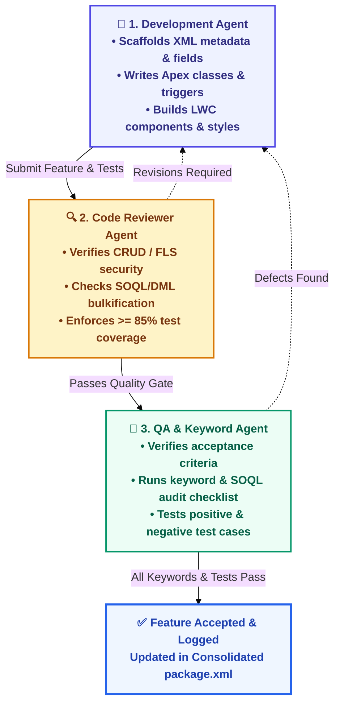
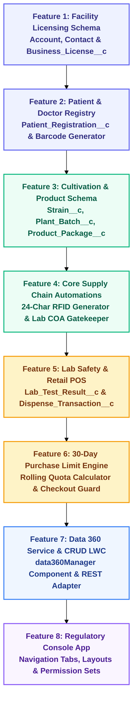

# 📋 Implementation Plan & Execution Blueprint
## Commonwealth Medical Marijuana Regulatory MVP
**Document Type:** Feature Roadmap, Multi-Agent Workflow & Deployment Manifest Strategy  
**Target Environment:** Salesforce Platform & Data 360  
**Version:** 1.0 • **Status:** Pending User Approval  

---

## 1. Plan Overview & Objectives

This implementation plan defines the step-by-step engineering process for the Medical Marijuana Regulatory MVP before any code or metadata is deployed. It establishes:
1. **A Feature-by-Feature Delivery Sequence:** 8 modular features built, tested, and validated progressively.
2. **A 3-Agent Collaborative Workflow:** Dedicated responsibilities for Development, Code Review, and QA/Keyword Verification.
3. **A Modular Manifest Strategy (`package.xml`):** Feature-specific manifests for modular deployments and rollback safety, paired with a consolidated manifest for cross-org portability.

---

## 2. Three-Agent Operational Workflow

Every feature progresses through a strict 3-stage validation pipeline before it is considered complete:



### Agent Responsibilities & Quality Gates

| Agent Role | Primary Focus | Mandatory Quality Deliverables |
| :--- | :--- | :--- |
| **1. Development Agent** | Engineering & Scaffolding | Metadata files, clean Apex logic conforming to standard architectural patterns, LWC templates/controllers, and corresponding unit test classes. |
| **2. Code Reviewer Agent** | Code Quality & Security | Security audit (CRUD/FLS enforcement, `with sharing` keyword, SOQL injection guards), zero governor limit violations, clean naming conventions, and $\ge 85\%$ test coverage with multi-scenario asserts. |
| **3. QA & Keyword Agent** | Functional & Traceability Audit | Executes a pre-defined **Keyword & Acceptance Checklist** for the feature, runs SOQL validation queries directly in the org, verifies user acceptance criteria, and confirms negative validation blocks. |

---

## 3. Step-by-Step Feature Breakdown

The MVP is structured into **8 self-contained features**, executed in strict dependency order:



### Detailed Feature Specifications

#### Feature 1: Facility & Entity Licensing (`Account`, `Contact`, `Business_License__c`)
* **Scope:** Standard extensions on `Account` (Premise Registry ID, Facility Type) and `Contact` (Stakeholder Role), plus the `Business_License__c` custom object.
* **Manifest:** `manifest/package-feat1-licensing.xml`
* **Keyword Checklist:** `Premise_Registry_ID__c`, `Facility_Type__c`, `License_Number__c`, `License_Tier__c`, `VR_LIC_Valid_Dates`.

#### Feature 2: Patient Registration & Doctor Recommendations (`Patient_Registration__c`)
* **Scope:** Master-Detail custom object on `Contact`, tracking registration number, doctor certification reference, 30-day quota limit, and barcode string.
* **Manifest:** `manifest/package-feat2-patients.xml`
* **Keyword Checklist:** `MMAP-`, `Certifying_Physician__c`, `Thirty_Day_Limit_Grams__c`, `Barcode_String__c`, `VR_PAT_Active_Date`.

#### Feature 3: Cultivation & Seed-to-Sale Data Model (`Strain__c`, `Plant_Batch__c`, `Product_Package__c`)
* **Scope:** Genetic cultivar catalog, plant batches (growth stages, counts, wet/dry harvest weights), and packaged inventory units.
* **Manifest:** `manifest/package-feat3-cultivation.xml`
* **Keyword Checklist:** `Strain__c`, `Growth_Stage__c`, `Wet_Weight_Grams__c`, `Dry_Weight_Grams__c`, `VR_BATCH_Harvest_Weight`.

#### Feature 4: Core Supply Chain Automations (Apex RFID Generator & Safety Validation)
* **Scope:** `ProductPackageTrigger` generating compliant 24-character RFID tags upon insert, and validation rule enforcing 24-character length.
* **Manifest:** `manifest/package-feat4-rfid-automation.xml`
* **Keyword Checklist:** `RFID_Tag__c`, `ProductPackageTrigger`, `VR_PKG_RFID_Length`, `1A4000312678`.

#### Feature 5: Quality Assurance & Dispensing Schema (`Lab_Test_Result__c`, `Dispense_Transaction__c`)
* **Scope:** COA test results (pesticides, heavy metals, THC/CBD potency) and retail checkout transaction records.
* **Manifest:** `manifest/package-feat5-testing-dispensing.xml`
* **Keyword Checklist:** `COA_Number__c`, `Pesticides_Pass__c`, `Heavy_Metals_Pass__c`, `Overall_Status__c`, `Grams_Dispensed__c`.

#### Feature 6: Automated 30-Day Limit Engine & COA Gatekeeper
* **Scope:** Validation blocking unpassed packages from sale, and Apex service calculating rolling 30-day purchases across all dispensaries.
* **Manifest:** `manifest/package-feat6-limit-engine.xml`
* **Keyword Checklist:** `VR_PKG_COA_Must_Pass`, `DispenseTransactionTrigger`, `PurchaseLimitService`, `LimitExceededException`.

#### Feature 7: Data 360 REST Integration Service & `data360Manager` LWC
* **Scope:** Apex service (`Data360Service`, `Data360Controller`) with mock/live adapter toggle, and the embedded `data360Manager` Lightning Web Component supporting Create, Read, Update, and Soft-Delete operations.
* **Manifest:** `manifest/package-feat7-data360-lwc.xml`
* **Keyword Checklist:** `data360Manager`, `Data360Controller`, `Data360Service`, `MMAP_Telemetry_Event`, `MMAP_Telemetry__dlm`, `STAGE_MOVE`, `RFID_SCAN`, `Is_Archived`.

#### Feature 8: Regulatory Console App, Full-Width Responsive Home Page & Seed-to-Sale Explorer
* **Scope:** Custom Lightning Console Application (`MMAP_Console_App` with `navType: Console` and `standard-home` landing tab), custom full-width template (`singleColumnHomeTemplate` implementing `lightning:homeTemplate`), interactive Supply Chain Explorer Lightning Web Component (`supplyChainExplorer`) with responsive desktop and mobile breakpoint matrix, backend Apex controller (`SupplyChainExplorerController` with 97% unit test coverage), Custom Home Page (`MMAP_Home_Page`), object list views (`All_Facilities`, `All_Stakeholders`, etc.), and Administrator / Inspector Permission Sets.
* **Manifest:** `manifest/package-feat8-console-app.xml`
* **Keyword Checklist:** `MMAP_Console_App`, `SupplyChainExplorerController`, `supplyChainExplorer`, `singleColumnHomeTemplate`, `MMAP_Home_Page`, `MMAP_Admin_PermSet`, `MMAP_Inspector_PermSet`, `All_Facilities`, `All_Stakeholders`, `CustomApplication`.

---

## 4. Package Manifest Strategy (`package.xml`)

To guarantee clean deployments, rollback safety, and complete portability to another org (such as your future Data Cloud connected environment), the project maintains a **Dual-Manifest Architecture**:

### 4.1 Feature-Specific Manifests (Modular & Reversible)
Every feature gets its own dedicated package XML stored in the `manifest/` directory. If a feature needs to be inspected, deployed independently, or reverted, its specific manifest isolates the exact components:

* `manifest/package-feat1-licensing.xml`
* `manifest/package-feat2-patients.xml`
* `manifest/package-feat3-cultivation.xml`
* `manifest/package-feat4-rfid-automation.xml`
* `manifest/package-feat5-testing-dispensing.xml`
* `manifest/package-feat6-limit-engine.xml`
* `manifest/package-feat7-data360-lwc.xml`
* `manifest/package-feat8-console-app.xml`
* `manifest/package-feat9-licensing-portal.xml`
* `manifest/package-feat10-patient-portal.xml`
* `manifest/package-feat11-transfer-manifests.xml`
* `manifest/package-feat12-inspection-quarantine.xml`
* `manifest/package-feat13-data360-streaming.xml`

### 4.2 Consolidated Master Manifest (`manifest/package.xml`)
The master `manifest/package.xml` aggregates all approved metadata components across all 13 features. This file serves as the definitive deployment package whenever you want to deploy the entire platform into another org in a single command:
```bash
sf project deploy start --manifest manifest/package.xml
```

### 4.3 Rollback & Reversion Safety (`destructiveChanges.xml`)
For every feature deployed, a corresponding `manifest/destructiveChanges-featX.xml` template will be pre-configured. If any component needs to be backed out, running a destructive changes deployment cleanly uninstalls the feature without affecting standard objects.

---

## 5. Review & Approval Decision Gate

This plan provides a structured, verifiable approach to development with zero ambiguity. 

Before we write code or create metadata:
1. Review the feature list and agent pipeline.
2. Confirm the sequence meets your expectations.
3. Give your sign-off to begin execution with **Feature 1**.

