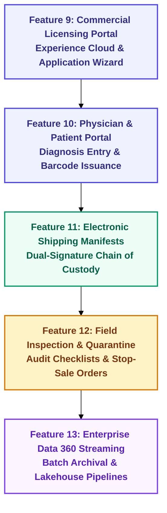
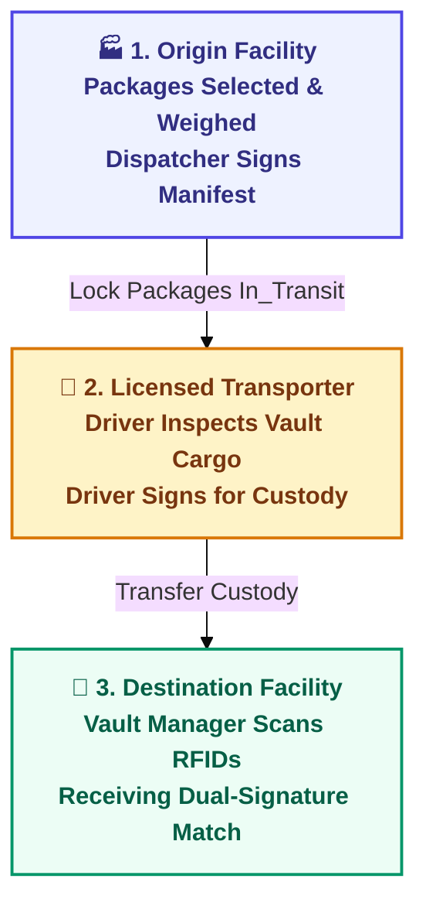

# 🚀 Phase 2 Roadmap & Detailed Specifications
## Commonwealth Medical Marijuana Regulatory Platform
**Document Type:** Phase 2 Technical Blueprint, Epic Specifications & Multi-Agent Delivery Roadmap  
**Target Environment:** Salesforce Platform, Experience Cloud, Microsoft Identity & Data 360 Lakehouse  
**Version:** 2.0 • **Status:** Prepared for Architecture Sign-Off  

---

## 1. Executive Summary & Phase 2 Objectives

Phase 1 (MVP) successfully delivered the foundational Seed-to-Sale regulatory infrastructure, including custom schema, automated 24-character RFID assignment, laboratory COA gatekeeper rules, statewide rolling 30-day patient limit engine, Data 360 REST integration component, and the full-width responsive Regulatory Console application.

**Phase 2** expands the platform from an internal back-office regulator tool into a state-wide collaborative ecosystem connecting commercial operators, independent laboratories, retail dispensaries, certifying physicians, and registered patients.

### Core Strategic Objectives for Phase 2:
1. **Self-Service Commercial Licensing Portal:** Enable paperless digital application intake, document uploads, and automated fee calculation.
2. **Physician Recommendation & Patient Portal:** Provide seamless digital qualifying diagnosis forms and scannable digital registration cards.
3. **Electronic Chain-of-Custody Shipping Manifests:** Enforce multi-party dual-signature custody handshakes for all inter-facility cannabis transport.
4. **On-Site Field Inspection & Stop-Sale Quarantine Engine:** Automate auditor checklists, violation scoring, and instant statewide product recalls.
5. **Data 360 High-Volume Telemetry Streaming:** Automated batch archival pipelines syncing millions of RFID scans and canopy sensor telemetry into Data 360.

---

## 2. Phase 2 Feature Roadmap & Sequence

---

## 3. Detailed Feature Specifications

### Feature 9: Commercial Facility Licensing Portal (`Experience Cloud` & Screen Flows)
* **Business Objective:** Eliminate paper-based license applications and renewals for Grower/Processors, Testing Labs, and Dispensaries.
* **Metadata Components:**
  * Custom Object: `License_Application__c` (Application Type, Premise Address, Status, Review Stage, Application Fee).
  * Screen Flow / LWC: `licenseApplicationWizard` (Multi-step applicant wizard with file upload validation).
  * Automated Approval Process: 3-tier regulatory review (Document Completeness $\to$ Criminal Background Clearance $\to$ On-Site Inspection).
* **Target Manifest:** `manifest/package-feat9-licensing-portal.xml`.

---

### Feature 10: Physician Recommendation & Patient Digital Registry Portal
* **Business Objective:** Give certified physicians and qualifying patients a direct, secure interface for submitting diagnoses and obtaining active patient cards.
* **Metadata Components:**
  * Custom Object Extension: `Physician_Certification__c` (Diagnosis ICD-10 Code, Dosage Guidelines, Expiration Date).
  * LWC: `patientRegistrationCard` (Dynamic SVG barcode generator rendering `PA-MED-{ID}`).
  * Integration Hook: Simulated PennDOT DMV identity service cross-referencing driver's license numbers.
* **Target Manifest:** `manifest/package-feat10-patient-portal.xml`.

---

### Feature 11: Electronic Chain-of-Custody Shipping Manifests & Dual-Sign Handshakes
* **Business Objective:** Prevent transit diversion by requiring electronic manifests and cryptographic handshakes between dispatchers, drivers, and receiving vault managers.
* **Metadata Components:**
  * Custom Objects:
    * `Transfer_Manifest__c` (Manifest Number, Origin Facility, Destination Facility, Transporter ID, Vehicle VIN, Estimated Arrival).
    * `Manifest_Line_Item__c` (Package Lookup, Gross Weight, RFID Tag verification).
  * Apex Automation: `TransferManifestTrigger` enforcing that packages in transit are locked to `In_Transit` custody.
  * LWC: `dualSignaturePad` (Touch-enabled signature capture for Dispatcher, Transporter, and Ingestion Agent).
* **Target Manifest:** `manifest/package-feat11-transfer-manifests.xml`.

---

### Feature 12: On-Site Regulatory Auditing, Field Inspection & Stop-Sale Quarantine Engine
* **Business Objective:** Provide state inspectors with mobile tablet audit checklists, automatic violation scoring, and one-click statewide recall capability.
* **Metadata Components:**
  * Custom Objects:
    * `Inspection_Audit__c` (Audit Date, Inspector, Facility, Inspection Type, Overall Score, Compliance Grade).
    * `Audit_Finding__c` (Finding Category, Severity Level, Corrective Action Required, Statutory Fine Amount).
  * Apex Service: `QuarantineService.cls` (Broadcasts instant stop-sale lock on all packages derived from a flagged batch).
  * In-App Notification: Real-time broadcast alerts delivered to dispensary cashiers if a product is quarantined.
* **Target Manifest:** `manifest/package-feat12-inspection-quarantine.xml`.

---

### Feature 13: Enterprise Data 360 Streaming & High-Volume Telemetry Pipelines
* **Business Objective:** Asynchronous offloading of millions of IoT environmental sensor records (temperature, humidity, CO2 canopy readings) and high-frequency RFID scans to Data 360 lakehouse.
* **Metadata Components:**
  * Apex Scheduled Batch Job: `Data360TelemetryArchivalBatch.cls` (Bulk offload of 30+ day old sensor scans).
  * Data Cloud Ingestion REST Adapter: Direct streaming of scan logs to Data 360 Lakehouse.
  * Tableau Connector View: Curated analytics queries for statewide supply-demand balancing and diversion heatmaps.
* **Target Manifest:** `manifest/package-feat13-data360-streaming.xml`.

---

## 4. Multi-Agent Development Governance & Standards

Phase 2 will strictly maintain the proven **3-Agent Collaborative Quality Pipeline**:

| Agent Role | Phase 2 Responsibilities | Mandatory Quality Gates |
| :--- | :--- | :--- |
| **Development Agent** | Writes clean, bulkified Apex classes, triggers, LWC components, and Aura templates. | Clean indentation, explicit variable typing, zero hardcoded IDs. |
| **Code Reviewer Agent** | Performs static analysis, CRUD/FLS security audits, and governor limit checks. | $\ge 85\%$ test coverage, `with sharing` keyword, SOQL injection defenses. |
| **QA & Keyword Agent** | Validates acceptance criteria against business stories and executes live SOQL queries. | 100% keyword checklist match, positive and negative assertion runs. |

---

## 5. Dual-Manifest Architecture for Phase 2

Every feature continues to maintain a dedicated manifest for modular deployment and rollback safety:

| Feature Identifier | Manifest Path | Primary Metadata Artifacts |
| :--- | :--- | :--- |
| **Feature 9** | `manifest/package-feat9-licensing-portal.xml` | `License_Application__c`, `licenseApplicationWizard` LWC, Approval Processes |
| **Feature 10** | `manifest/package-feat10-patient-portal.xml` | `Physician_Certification__c`, `patientRegistrationCard` LWC, Experience Pages |
| **Feature 11** | `manifest/package-feat11-transfer-manifests.xml` | `Transfer_Manifest__c`, `TransferManifestTrigger`, `dualSignaturePad` LWC |
| **Feature 12** | `manifest/package-feat12-inspection-quarantine.xml` | `Inspection_Audit__c`, `Audit_Finding__c`, `QuarantineService.cls` |
| **Feature 13** | `manifest/package-feat13-data360-streaming.xml` | `Data360TelemetryArchivalBatch.cls`, Data Cloud Stream Definitions |
| **Master Manifest** | `manifest/package.xml` | Consolidated deployment manifest containing all metadata components |

