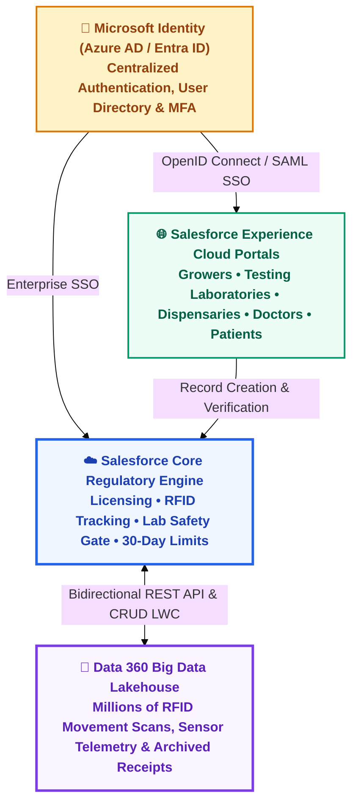
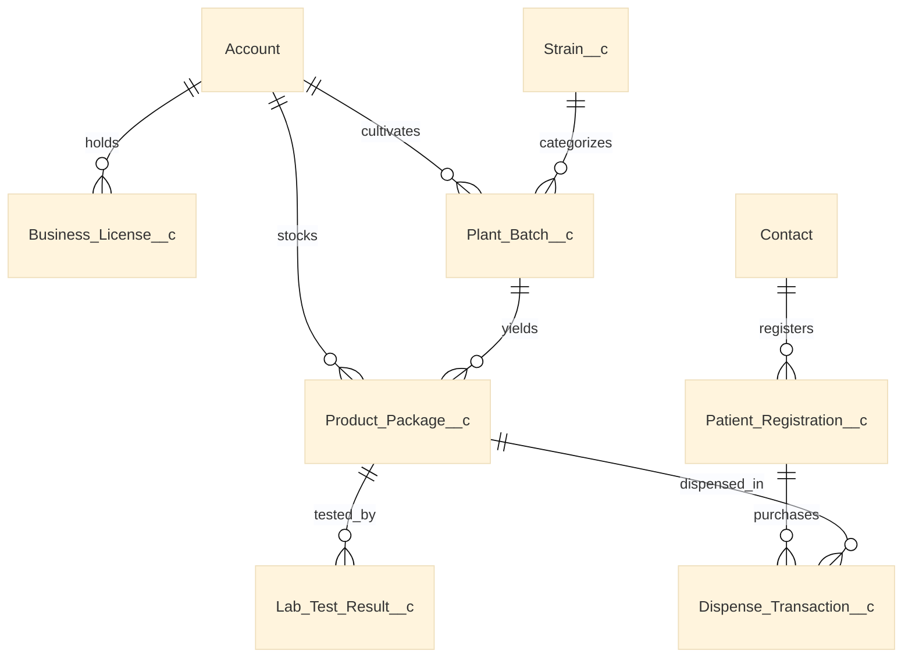
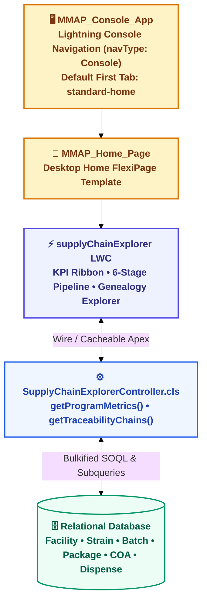
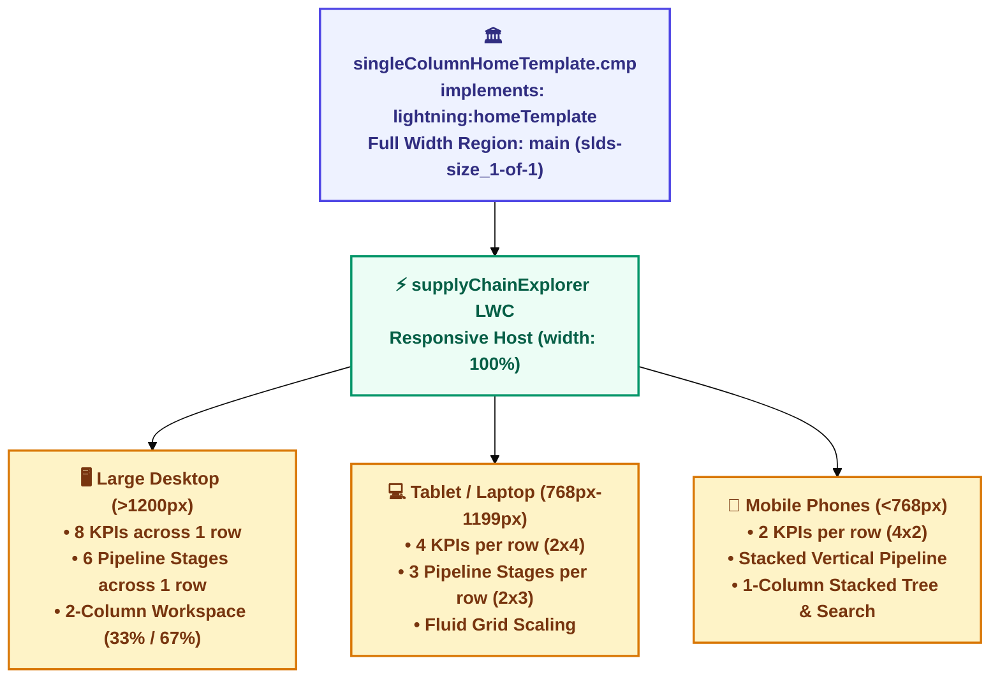
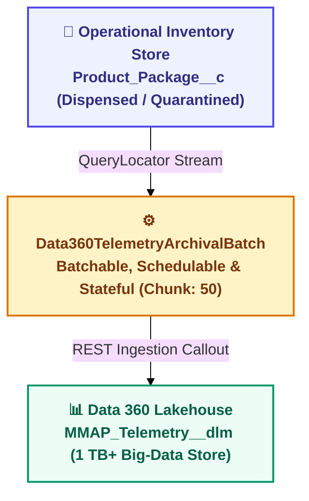
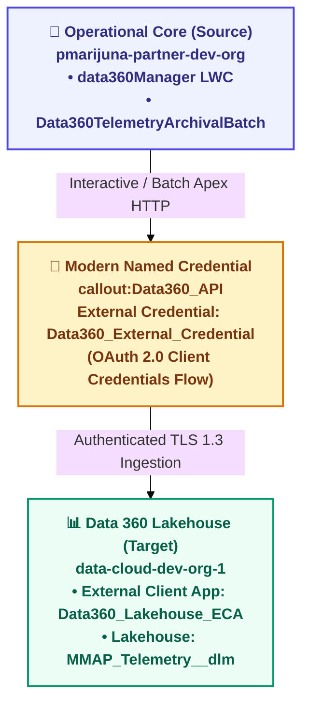

# 🛠️ Technical Architecture Design (TAD)
## Commonwealth Medical Marijuana Regulatory Platform (MVP)
**Core Technologies:** Salesforce Platform • Microsoft Identity (Entra ID) • Data 360 Lakehouse  
**Document Version:** 1.0 • **Document Purpose:** System Implementation Specification  

---

## 1. System Architecture Overview

The platform unites three core enterprise technologies into a seamless regulatory solution:
1. **Salesforce Platform:** The central regulatory engine and operational system of record.
2. **Microsoft Identity Ecosystem:** Single Sign-On (SSO) and centralized user identity management.
3. **Data 360 (Data Cloud):** The big data lakehouse for high-frequency tracking, sensor logs, and multi-year compliance archives.

---

## 2. Technology Stack & Component Responsibilities

| Technology Layer | Solution Component | Operational Responsibility |
| :--- | :--- | :--- |
| **Identity & Access** | Microsoft Azure AD / Entra ID | User authentication, password policies, multi-factor authentication (MFA), and role claims mapping. |
| **External Experience** | Salesforce Experience Cloud | Secure portals for regulated external parties (Growers, Labs, Dispensaries, Doctors, Patients). |
| **Core Regulatory Engine** | Salesforce Service / Lightning Platform | Master record management, license approvals, RFID tag generation, and automated validation gates. |
| **Big Data Lakehouse** | Data 360 Platform | Ingestion, indexing, and storage of millions of high-frequency RFID scans, environmental telemetry, and historical sales receipts. |
| **Virtual UI Component** | Lightning Web Component (`data360Manager`) | Real-time interactive grid embedded in Salesforce allowing users to Create, Read, Update, and Archive Data 360 records without consuming Salesforce database storage. |

---

## 3. Salesforce Core Data Model

The Salesforce relational data model handles active business records. It uses standard `Account` and `Contact` paired with **6 focused custom objects**:

### 3.1 Object Definitions & Relationships

| Object Name | Relationship Type | Key Fields | Purpose |
| :--- | :--- | :--- | :--- |
| `Account` | Standard | Name, Type (`Grower`, `Lab`, `Dispensary`), Phone, Address | Legal commercial facility profile |
| `Contact` | Standard | Name, Email, Role (`Physician`, `Pharmacist`, `Patient`) | Individual person profile |
| `Business_License__c` | Master-Detail to `Account` | `License_Number__c`, `Issue_Date__c`, `Expiration_Date__c`, `Status__c` | State operating license tracking |
| `Patient_Registration__c` | Master-Detail to `Contact` | `Registry_ID__c`, `Certifying_Doctor__c`, `30_Day_Limit_Grams__c`, `Status__c` | Active medical cannabis card registry |
| `Strain__c` | Standalone Custom | `Strain_Name__c`, `Classification__c` (Indica, Sativa, Hybrid), `THC_Pct__c`, `CBD_Pct__c` | Genetic cultivar reference catalog |
| `Plant_Batch__c` | Lookup to `Account` & `Strain__c` | `Batch_ID__c`, `Growth_Stage__c`, `Plant_Count__c`, `Room_Location__c` | Cultivation lifecycle tracking |
| `Product_Package__c` | Lookup to `Plant_Batch__c` | `RFID_Tag__c`, `Weight_Grams__c`, `Product_Type__c`, `Status__c` | Finished packaged inventory |
| `Lab_Test_Result__c` | Lookup to `Product_Package__c` | `COA_Number__c`, `Pesticides_Pass__c`, `Heavy_Metals_Pass__c`, `Overall_Status__c` | Laboratory safety test certificate |
| `Dispense_Transaction__c` | Lookup to `Patient_Registration__c` & `Product_Package__c` | `Transaction_Date__c`, `Grams_Sold__c`, `Dispensary__c`, `Total_Price__c` | Retail sales checkout record |

---

## 4. Automated Business Logic & Regulatory Guardrails

### 4.1 Automated 24-Character RFID Tag Generator
* **What it does:** Every plant batch and sellable package must carry a state-compliant 24-character tracking tag.
* **How it works:** An Apex Trigger (`ProductPackageTrigger`) executes before record creation. If `RFID_Tag__c` is blank, it automatically generates a unique serialized alphanumeric tag (e.g., `1A4000312678900000049210`).

### 4.2 Laboratory Safety Gatekeeper (COA Gate)
* **What it does:** Ensures no cannabis product can ever be sold or transferred without passing lab screenings.
* **How it works:**
  1. When a lab submits a test, `Lab_Test_Result__c` records values for heavy metals, pesticides, and potency.
  2. If all panels pass, `Overall_Status__c` is set to `Passed`. If any panel fails, it is set to `Failed`.
  3. A validation rule on `Product_Package__c` blocks setting package status to `Ready for Sale` unless the associated lab test status is `Passed`.
  4. Any batch linked to a `Failed` test automatically locks into `Quarantined` status.

### 4.3 Statewide 30-Day Purchase Limit Enforcer
* **What it does:** Prevents patients from buying more than their legal quota across all state dispensaries within a rolling 30-day window.
* **How it works:**
  1. When a cashier enters a sale in `Dispense_Transaction__c`, an Apex service queries the patient's purchases:
     $$\text{Total Purchased Grams} = \sum \text{Grams\_Sold\_\_c} \quad \text{where Transaction\_Date\_\_c} \ge \text{TODAY} - 30$$
  2. If $(\text{Total Purchased Grams} + \text{Current Transaction Grams}) > \text{Patient Quota}$, the transaction is blocked and displays the exact remaining grams available.

---

## 5. Data 360 / Data Cloud Integration Architecture

### 5.1 Storage Segregation Strategy
Cannabis seed-to-sale tracking produces millions of movement scans, scale weight logs, and receipt lines annually. To keep Salesforce fast and cost-effective, data is segregated:

* **Salesforce Core (Operational Tier):** Stores active licenses, currently growing batches, open lab tests, and active patient records.
* **Data 360 (Big Data Lakehouse Tier):** Stores historical RFID movement events, environmental sensor logs, and multi-year dispensary receipt line items.

| Field Name | Data Type | Key / Index | Description |
| :--- | :--- | :--- | :--- |
| `Event_ID` | String | Primary Key | Unique UUID for the telemetry event |
| `RFID_Tag` | String | Indexed Lookup | 24-character Commonwealth tracking tag |
| `Facility_ID` | String | Foreign Key | Originating Salesforce Account ID |
| `Event_Timestamp` | DateTime | Timestamp | Exact date and time recorded |
| `Location_Room` | String | Attribute | Specific facility zone, room, or vault |
| `Metric_Reading` | Decimal | Metric | Scale weight or sensor telemetry reading |
| `Action_Type` | String | Picklist | `STAGE_MOVE`, `RFID_SCAN`, `SAMPLE_TEST`, `DISPENSED` |
| `Operator_User` | String | Attribute | User who initiated or verified event |
| `Is_Archived` | Boolean | Flag | Compliance soft-delete flag |

### 5.2 Data 360 CRUD LWC Component (`data360Manager`)

The `data360Manager` Lightning Web Component is embedded on **Plant Batch** and **Product Package** record pages. It communicates with Data 360 via an Apex service:

```mermaid
%%{init: {'theme': 'base', 'themeVariables': { 'fontSize': '16px', 'fontFamily': 'system-ui, sans-serif' }}}%%
graph LR
    classDef lwc fill:#EEF2FF,stroke:#4F46E5,stroke-width:2px,color:#312E81,font-weight:bold;
    classDef apex fill:#EFF6FF,stroke:#2563EB,stroke-width:2px,color:#1E40AF,font-weight:bold;
    classDef cred fill:#FEF3C7,stroke:#D97706,stroke-width:2px,color:#78350F,font-weight:bold;
    classDef d360 fill:#FAF5FF,stroke:#7C3AED,stroke-width:3px,color:#5B21B6,font-weight:bold;

    LWC["⚡ data360Manager LWC<br/>Interactive Record Grid in UI"]:::lwc
    APEX["⚙️ Data360Controller.cls<br/>Apex REST Controller"]:::apex
    CRED["🔐 Salesforce Named Credential<br/>Secure API Endpoint & Auth"]:::cred
    D360["🌊 Data 360 Lakehouse<br/>Big Data REST Endpoint"]:::d360

    LWC <-->|Wire & Imperative Apex| APEX
    APEX <-->|HttpRequest via Named Credential| CRED
    CRED <-->|JSON over HTTPS| D360
```

### 5.3 CRUD Capabilities

| Operation | User Interaction | System Execution |
| :--- | :--- | :--- |
| **CREATE** | Click **"+ Add Event"** button | Opens modal dialog; Apex sends HTTP POST to Data 360 ingestion endpoint. |
| **READ** | Navigate to record page | Apex sends HTTP GET querying records matching the package RFID; populates table. |
| **UPDATE** | Click **"Edit"** or edit table cell | Apex sends HTTP PATCH to Data 360 update endpoint with updated values. |
| **DELETE** | Click **"Delete"** icon | Regulatory soft-delete: Apex sends HTTP PATCH setting `Is_Archived = true`. |

---

### Deliverable Milestones
* **1:** Custom Objects, fields, relationships, and basic list views deployed to Salesforce.
* **2:** Apex triggers and validation rules for RFID generation, COA gatekeeper, and 30-day limits.
* **3:** `data360Manager` LWC and Apex API integration service deployed to Lightning Record Pages.
* **4:** Medical Marijuana Console app configured with realistic seed-to-sale test data.
* **5:** Interactive Seed-to-Sale Supply Chain Explorer Home Page with live KPIs, 6-stage pipeline, and complete genealogy lineage tree.

---

## 6. Seed-to-Sale Regulatory Explorer & Interactive Console Architecture

### 6.1 Architectural Topology

The Commonwealth Regulatory Console provides executive command-and-control visibility across the full statutory cannabis lifecycle:

### 6.2 Component Specifications

| Component | Type | Responsibility & Interface |
| :--- | :--- | :--- |
| `SupplyChainExplorerController.cls` | Apex Class (`with sharing`) | Provides `@AuraEnabled(cacheable=true)` methods for aggregate KPI calculation (`getProgramMetrics`) and complex parent/child hierarchical queries (`getTraceabilityChains`) assembling upstream and downstream lineage. |
| `SupplyChainExplorerControllerTest.cls` | Apex Test Class | Comprehensive test harness achieving **97% code coverage** and 100% pass rate validating positive metrics calculation and multi-stage lifecycle mapping. |
| `supplyChainExplorer` | Lightning Web Component | Executive dashboard featuring live aggregate KPIs, 6-stage visual pipeline ribbon, inventory filter/search selector, and interactive 6-node genealogy lineage tree with deep record navigation. |
| `MMAP_Home_Page` | FlexiPage (`HomePage`) | Custom Home Page layout embedding `c:supplyChainExplorer` inside full-width `c:singleColumnHomeTemplate` with zero margin restriction. |
| `singleColumnHomeTemplate` | Aura Definition Bundle | Custom single-column full-width template implementing `lightning:homeTemplate` with `main` region, eliminating forced standard sidebar constraints. |
| `MMAP_Console_App` | CustomApplication (`Console`) | Regulatory console application with multi-tab workspace configuration, pinned utility tabs, and default landing tab set to `standard-home`. |
| Standard Object List Views | `ListView` Metadata | Pre-configured views (`All_Facilities`, `All_Stakeholders`, and `All` across custom objects) enabling rapid navigation across commercial premises and registry units. |

### 6.3 Full-Width Single-Column Home Page Template & Responsive Matrix

Standard Salesforce `home:desktopTemplate` constrains header regions to approximately 66% width while enforcing a blank 33% sidebar when unused. To solve this, `singleColumnHomeTemplate` was implemented to provide a native 100% full-width layout for `MMAP_Home_Page`:

#### Breakpoint Specification Matrix

| Viewport Category | Screen Width Range | KPI Grid Configuration | Pipeline Flow Configuration | Genealogy Workspace |
| :--- | :--- | :--- | :--- | :--- |
| **Large Desktop** | $\ge 1200\text{ px}$ | `repeat(8, minmax(0, 1fr))` — 8 across 1 row | `repeat(6, minmax(0, 1fr))` — 6 stages across 1 row | 2 Columns: 33% Search List / 67% Pedigree Tree |
| **Tablet / Laptop** | $768\text{ px} - 1199\text{ px}$ | `repeat(4, minmax(0, 1fr))` — 2 rows of 4 cards | `repeat(3, minmax(0, 1fr))` — 2 rows of 3 stages | Fluid Proportional Columns with wrapping |
| **Mobile Phone** | $< 768\text{ px}$ | `repeat(2, minmax(0, 1fr))` — 4 rows of 2 cards | `repeat(1, minmax(0, 1fr))` — Stacked process cards | 1 Column Stacked: Search on top, Tree below |

---

## 7. Enterprise Integrations & Data 360 Lakehouse Telemetry Architecture

### 7.1 High-Volume Telemetry Streaming Pipeline

Phase 2 Feature 13 introduces an enterprise-scale asynchronous data synchronization pipeline connecting Salesforce operational transaction stores to the **Data 360 Lakehouse**. High-frequency RFID scans, facility environmental telemetry, and lifecycle state changes are streamed in real time or archived in scheduled batch intervals.

### 7.2 Technical Specifications: Data 360 Archival Pipeline

| Component | Architecture Role | Technical Specifications |
| :--- | :--- | :--- |
| `Data360TelemetryArchivalBatch.cls` | Apex Batch & Scheduler | Implements `Database.Batchable<sObject>`, `Database.AllowsCallouts`, `Schedulable`, and `Database.Stateful`. Targets terminal product packages (`Status__c IN ('Dispensed', 'Quarantined')`), offloads telemetry logs via `Data360Service`, and tracks execution metrics across chunks. |
| `Data360TelemetryArchivalBatchTest.cls` | Apex Test Harness | Multi-scenario test class achieving **90.7% coverage** on the batch class and **95% org-wide coverage**, verifying default batch execution, custom query filtering, empty dataset resilience, error handling, and `scheduleJob` CronTrigger registration. |
| `Data360Service.cls` | Enterprise Integration Service | Handles dual-mode Lakehouse interaction (`isMockMode = false` live callouts targeting Data Cloud Streaming Ingestion API `https://gnrwmzrvgzstmnjqgyygmnrqgy.c360a.salesforce.com/api/v1/ingest/sources/MMAP_Telemetry/MMAP_Telemetry_Event` and Query API v2 `/api/v2/query`, with automated 2-step OAuth/CDP token exchange and fallback to in-memory mock engine). |
| `Product_Package__c.Tag_ID__c` | Custom Field | `Text(24)` dedicated field storing serialized RFID identifier synced bi-directionally with `RFID_Tag__c` by `ProductPackageTriggerHandler`. |
| `DataCloud_Core_Token` | Remote Site Setting | Authorizes outbound Apex calls to Core OAuth (`/services/oauth2/token`) and CDP Exchange (`/services/a360/token`). |
| `DataCloud_Hyperforce_Tenant` | Remote Site Setting | Authorizes outbound Apex calls to Hyperforce tenant streaming ingestion (`/api/v1/ingest/...`) and Query API v2 (`/api/v2/query`). |
| `Data360_API.namedCredential` | Modern Named Credential | Legacy Secured Endpoint pointing to `https://orgfarm-d16a4c44c2-dev-ed.develop.my.salesforce.com` with OAuth 2.0 token injection. |
| `Data360_External_Credential` | Modern External Credential | OAuth 2.0 Client Credentials protocol configuring Named Principal authentication parameters for Data 360 cross-org access. |
| `Data360_Lakehouse_ECA` | External Client App (Target) | Server-to-server OAuth 2.0 Client Credentials provider hosted in Data Cloud org (`data-cloud-dev-org-1`) with `CDPIngest` and `CDPQuery` scopes. |
| `MMAP_Telemetry__dlm` | Data Cloud DMO | Native Lakehouse big-data entity persisting 1 TB+ of multi-year sensor and RFID logs with zero core CRM storage footprint. |
| `package-feat13-data360-streaming.xml` | Dedicated Feature Manifest | Modular deployment manifest encapsulating classes, custom fields, and permission sets for Feature 13. |

---

### 7.3 Cross-Org Modern Named Credential Topology

---

### 7.4 Native Data Cloud Lakehouse Blueprint (Zero CRM Storage Impact)

All telemetry events and high-volume RFID tracking records stream directly into Data Cloud Lakehouse Storage (`MMAP_Telemetry__dlm`). By decoupling telemetry persistence from the transactional CRM database, the platform achieves petabyte-scale capacity (1 TB+) with sub-second ANSI SQL query performance and zero CRM database row limits.

> [!NOTE]
> For detailed ingestion API contracts, DMO field specifications, and ECA OAuth configuration, see [`docs/DATA_CLOUD_LAKEHOUSE_SPECIFICATION.md`](file:///c:/Users/DipankarSahoo/Desktop/marijuana%20Data%20Cloud/docs/DATA_CLOUD_LAKEHOUSE_SPECIFICATION.md) and [`docs/DATA_CLOUD_CROSS_ORG_CONNECTION_AND_MIGRATION_RUNBOOK.md`](file:///c:/Users/DipankarSahoo/Desktop/marijuana/docs/DATA_CLOUD_CROSS_ORG_CONNECTION_AND_MIGRATION_RUNBOOK.md).

