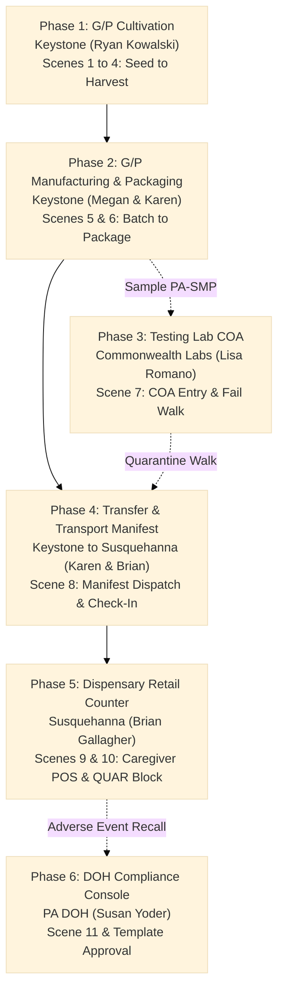
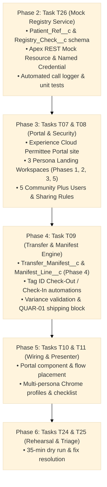

# 🏛️ Pennsylvania Seed-to-Sale Demo: Master Architectural Specification
## Unified Demo Lifecycle Blueprints (Phase 1 through Phase 6), Document Governance & Dipankar Implementation Roadmap

**Document Type:** Master System Specification, Multi-Phase Demo Blueprints & Technical Architecture  
**Sole Authoritative Baseline:** `docs/PA Seed-to-Sale Demo Plan_7.xlsx` (Rev. 2026-11-06 / Rev. 10/8/26 SOW)  
**Target Platform:** Salesforce Platform (Core CRM) & Experience Cloud Portal  
**Primary Architect / Developer:** Dipankar (Portal, Security, Manifest, Mock Registry)  
**Version:** 3.0 • **Status:** Active Authoritative Master Specification  

---

## 1. Document Control & Governance Baseline

> [!IMPORTANT]
> **Sole Authoritative Baseline: `PA Seed-to-Sale Demo Plan_7.xlsx`**
> * All design decisions, data models, validation rules, user access matrices, and implementation sequences originate **strictly and exclusively** from `docs/PA Seed-to-Sale Demo Plan_7.xlsx`.
> * **All legacy documentation has been marked as OBSOLETE** and renamed to prevent confusion or accidental updates. Do not edit or reference any historical files.

### Legacy Document Decommissioning Audit
The following 10 historical documents have been renamed with the `OBSOLETE_` prefix and are frozen from further modification:
1. `OBSOLETE_DATA_360_INTEGRATION_AND_CONNECTION_PLAN.md`
2. `OBSOLETE_DATA_CLOUD_CROSS_ORG_CONNECTION_AND_MIGRATION_RUNBOOK.md`
3. `OBSOLETE_DATA_CLOUD_LAKEHOUSE_SPECIFICATION.md`
4. `OBSOLETE_DATA_DICTIONARY_SPECIFICATION.md`
5. `OBSOLETE_DIAGRAM_TRACEABILITY_MATRIX.md`
6. `OBSOLETE_FEATURE_EXPERIENCE_AND_VERIFICATION_GUIDE.md`
7. `OBSOLETE_IMPLEMENTATION_PLAN.md`
8. `OBSOLETE_PHASE_2_ROADMAP_AND_DETAILED_SPECIFICATIONS.md`
9. `OBSOLETE_PRD_PRODUCT_REQUIREMENTS.md`
10. `OBSOLETE_TECHNICAL_ARCHITECTURE_DESIGN.md`

---

## 2. Decommissioning & Destructive Cleanup (Executed & In Progress)

> [!IMPORTANT]
> **Operational Directive on Deletion & Retention**
> Phase 1 Destructive Changes have been successfully executed against the Core CRM org (`pmarijuna-partner-dev-org`, Deploy ID: `0Afhm000001u6mvCAA`), purging 113 obsolete metadata components. Per user instructions, `Plant_Batch__c`, `Product_Package__c`, and the entire Data 360 Lakehouse Telemetry pipeline have been **strictly preserved and remain 100% active**. Local repository cleanup and master manifest synchronization are currently in progress.

### Metadata Architecture & Deletion Governance

#### Preserved Operational & Telemetry Components (Retained)
To ensure that historical telemetry logs and live streaming to Data Cloud Lakehouse (`data-cloud-dev-org-1`) remain 100% active and healthy, the following core CRM components are **explicitly preserved and excluded from destructive changes**:
* **Telemetry Core Objects**: `Plant_Batch__c` (Custom Object, Fields, Tab, FlexiPage) and `Product_Package__c` (Custom Object, Fields, Tab, FlexiPage). Kept to maintain the master telemetry data link and foreign key lookups.
* **Lakehouse Hierarchy Setting**: `Data360_Configuration__c` (Protected Hierarchy Custom Setting storing Lakehouse ECA credentials and tenant endpoints with zero SOQL limit impact).
* **Lakehouse Integration Pipeline**: `Data360Service`, `Data360Controller`, `Data360TelemetryArchivalBatch`, and unit tests (`Data360ControllerTest`, `Data360TelemetryArchivalBatchTest`).
* **Package Automation & RFID**: `ProductPackageTrigger`, `ProductPackageTriggerHandler`, `ProductPackageTriggerTest`, and `RFIDGeneratorService`.
* **Telemetry UI**: `data360Manager` Lightning Web Component.
* **In-Scope Target Model**: All 11 custom objects (`Tracked_Item__c`, `Lineage_Link__c`, `Inventory_Event__c`, `Patient_Ref__c`, `Registry_Check__c`, `Lab_Result__c`, `Manifest_Line__c`, `Label_Template__c`, `Label_Print__c`, `Recall__c`, `Recall_Exposure__c`), Portal Containers, 5 Persona Workspaces, Dispatcher, and Mock Registry Service.

#### Obsolete Metadata Inventory (Targeted for Deletion)
| Category | Obsolete Items (Targeted for Deletion) | Superseded By (`PA Seed-to-Sale Demo Plan_7.xlsx`) |
| :--- | :--- | :--- |
| **Custom Objects** | `Audit_Finding__c`, `Business_License__c`, `Dispense_Transaction__c`, `Inspection_Audit__c`, `Lab_Test_Result__c`, `License_Application__c`, `Manifest_Line_Item__c`, `Patient_Registration__c`, `Physician_Certification__c` | `Tracked_Item__c`, `Lineage_Link__c`, `Inventory_Event__c`, `Lab_Result__c`, `Manifest_Line__c`, `Patient_Ref__c`, `Registry_Check__c` |
| **Custom Tabs** | `Business_License__c`, `Dispense_Transaction__c`, `Inspection_Audit__c`, `Lab_Test_Result__c`, `License_Application__c`, `Patient_Registration__c`, `Physician_Certification__c` | In-Scope Workspace Navigation Tabs & Dynamic Dispatcher (`/s/*`) |
| **FlexiPages** | `MMAP_Home_Page` | Permittee Workspaces (`MMAP_Workspace_Cultivation`, `MMAP_Workspace_Processing`, etc.) |
| **Apex Triggers** | `DispenseTransactionTrigger`, `TransferManifestTrigger` | Triggers on `Tracked_Item__c`, `Inventory_Event__c`, `Transfer_Manifest__c` (Phase 4 / T09) |
| **Apex Services** | `DispenseTransactionTriggerHandler`, `DispenseTransactionTriggerTest`, `InspectionAuditController`, `InspectionAuditControllerTest`, `LicenseApplicationController`, `LicenseApplicationControllerTest`, `PatientPortalController`, `PatientPortalControllerTest`, `PurchaseLimitService`, `QuarantineService`, `SupplyChainExplorerController`, `SupplyChainExplorerControllerTest`, `TransferManifestController`, `TransferManifestControllerTest`, `TransferManifestTriggerHandler` | `RegistryMockRestService` (T26), Lineage Service (T03), Quarantine & Trace (T05), MMU Calculator (T27), Transfer Service (T09) |
| **LWC Bundles** | `dualSignaturePad`, `inspectionAuditManager`, `licenseApplicationWizard`, `patientRegistrationCard`, `supplyChainExplorer` | `labelPreview` (T13), `traceTree` (T14), `tagIdLookup` (T15), Barcode library (T12) |
| **Aura Bundles** | `singleColumnHomeTemplate` | Modern Experience Cloud full-width flexipage templates |

### Turnkey `destructiveChanges.xml`
```xml
<?xml version="1.0" encoding="UTF-8"?>
<Package xmlns="http://soap.sforce.com/2006/04/metadata">
    <types>
        <members>Audit_Finding__c</members>
        <members>Business_License__c</members>
        <members>Dispense_Transaction__c</members>
        <members>Inspection_Audit__c</members>
        <members>Lab_Test_Result__c</members>
        <members>License_Application__c</members>
        <members>Manifest_Line_Item__c</members>
        <members>Patient_Registration__c</members>
        <members>Physician_Certification__c</members>
        <name>CustomObject</name>
    </types>
    <types>
        <members>Business_License__c</members>
        <members>Dispense_Transaction__c</members>
        <members>Inspection_Audit__c</members>
        <members>Lab_Test_Result__c</members>
        <members>License_Application__c</members>
        <members>Patient_Registration__c</members>
        <members>Physician_Certification__c</members>
        <name>CustomTab</name>
    </types>
    <types>
        <members>MMAP_Home_Page</members>
        <name>FlexiPage</name>
    </types>
    <types>
        <members>DispenseTransactionTrigger</members>
        <members>TransferManifestTrigger</members>
        <name>ApexTrigger</name>
    </types>
    <types>
        <members>DispenseTransactionTriggerHandler</members>
        <members>DispenseTransactionTriggerTest</members>
        <members>InspectionAuditController</members>
        <members>InspectionAuditControllerTest</members>
        <members>LicenseApplicationController</members>
        <members>LicenseApplicationControllerTest</members>
        <members>PatientPortalController</members>
        <members>PatientPortalControllerTest</members>
        <members>PurchaseLimitService</members>
        <members>QuarantineService</members>
        <members>SupplyChainExplorerController</members>
        <members>SupplyChainExplorerControllerTest</members>
        <members>TransferManifestController</members>
        <members>TransferManifestControllerTest</members>
        <members>TransferManifestTriggerHandler</members>
        <name>ApexClass</name>
    </types>
    <types>
        <members>dualSignaturePad</members>
        <members>inspectionAuditManager</members>
        <members>licenseApplicationWizard</members>
        <members>patientRegistrationCard</members>
        <members>supplyChainExplorer</members>
        <name>LightningComponentBundle</name>
    </types>
    <types>
        <members>singleColumnHomeTemplate</members>
        <name>AuraDefinitionBundle</name>
    </types>
    <version>62.0</version>
</Package>
```

#### Companion `package.xml`
```xml
<?xml version="1.0" encoding="UTF-8"?>
<Package xmlns="http://soap.sforce.com/2006/04/metadata">
    <version>61.0</version>
</Package>
```

---

## 3. End-to-End Supply Chain Lifecycle Architecture: Phase 1 Through Phase 6

The demo experience is delivered across **6 sequential Supply Chain Lifecycle Phases** (operating across dedicated Permittee Portal and DOH Lightning workspaces), aligning strictly with the 11 demo scenes and the 10 sheets of `PA Seed-to-Sale Demo Plan_7.xlsx`:



---

### Phase 1: Grower/Processor Cultivation Workspace (`Keystone Growers`)
* **Portal Route:** `/portal/s/cultivation`
* **Assigned Persona:** `Ryan Kowalski` (Cultivation Technician — Scenes 1, 2, 3, 4)
* **Access Scope:** Keystone records only (`Owner_Account__c = 'Keystone Growers'`). Cannot access packages, sales, or DOH approvals.
* **Excel Source Mapping:** `Demo Sequence` (Rows 5-8), `Data Model` (Rows 24-28), `Rules` (Rows 9, 14, 15), `Labels` (Rows 5-8).

#### Detailed Component Blueprint
1. **Header & Global Tag Search (`T15`):**
   * Top-level barcode scanner / tag lookup input accepting typing or USB scanner emulated keystrokes.
2. **Scene 1 — Seed Import & Lot Splitting:**
   * **Receive Seed Lot Flow (`T18`):** Enforces 30-day import window validation on `Account` (`BR090`, `BR004`). Creates `Tracked_Item__c` with tag prefix `PA-SDL-000001`, seed count, and weight.
   * **Seed Lot Tag LWC (`T13`):** Generates 4x2 inch label with Code 128 barcode of `PA-SDL-000001` (`BR025`).
   * **Split Lot Flow:** Prompts split count (e.g. 10 seeds). Generates 10 individual child records (`PA-SED-000001` through `000010`) linked via `Lineage_Link__c` and reduces parent lot count (`BR025`, `BR091`).
   * **Seed Labels Sheet LWC:** Generates a 10-label sheet with DataMatrix 2D barcodes for pouches/tray cells (`BR092`, `TR098`).
3. **Scene 2 — Plant Tagging:**
   * **Planting Screen Flow:** Selects 10 seeds by Tag ID; creates 10 plant records (`PA-PLT-000001` through `000010`) linked to their source seeds.
   * **Plant Tags Sheet LWC:** Generates 4x2 inch plant tags with Code 128 barcodes (`TR101`, `BR044`).
4. **Scene 3 — Grow Tracking & Waste:**
   * **Room Location Move:** Moves plants room-to-room (`Location__c`: Germination $\rightarrow$ Veg $\rightarrow$ Flower). Writes `Inventory_Event__c` (`Event_Type__c = 'Move'`).
   * **Growth Stage Change:** Flips `Stage__c` (`Vegetative` $\rightarrow$ `Flowering`).
   * **Nutrient Application Log:** Captures batch feeding event.
   * **Waste Destruction Action:** Logs 1 destroyed plant as waste (`PA-WST-000001`) with reason code (`BR011`).
5. **Scene 4 — Harvest:**
   * **Harvest Screen Flow:** Combines 9 remaining plants into harvest lot `PA-HRV-000001`.
   * Prompts wet weight entry (supports dual grams/ounces per `TR099`).
   * Generates 4x2 inch Harvest Lot Tag with Code 128 barcode (`BR118`, `BR029`).

---

### Phase 2: Grower/Processor Manufacturing & Packaging Workspace (`Keystone Growers`)
* **Portal Route:** `/portal/s/manufacturing`
* **Assigned Personas:** 
  * `Megan Schaefer` (Processing Tech — Scene 5)
  * `Karen Brennan` (Compliance Manager — Scene 6)
* **Access Scope:** Keystone production batches and finished packages. Cannot approve templates; cannot release quarantined goods.
* **Excel Source Mapping:** `Demo Sequence` (Rows 9-10), `Data Model` (Rows 29-30), `Rules` (Rows 7, 8, 10, 13), `Labels` (Row 9).

#### Detailed Component Blueprint
1. **Scene 5 — Production & Packaging (Megan Schaefer):**
   * **Batch Consumption:** Harvest lot `PA-HRV-000001` is consumed into production batch `PA-BAT-000001`.
   * **Package Creation:** Screen flow creates 20 child vape cartridge packages (`PA-PKG-000001` through `000020`), deducting batch inventory.
   * **Full Package Label Preview LWC (`T13`):**
     * Sized at production 4x6 inches with a scannable QR code of `PA-PKG-000001`.
     * Renders all regulated fields per `BR112` and `TR102`: Product name, form, net weight, dose count, mg THC/CBD per dose, full cannabinoid panel in `BR006` order, terpene %, batch/lot numbers, serial number, packaging date, expiration date, preparer employee ID, G/P permit, receiving dispensary name, allergens, and mandatory DOH warnings.
     * Includes remediation notice if material originated from remediated stock (`BR099`, `BR111`).
   * **Template Approval Enforcer (`T15`):** If Megan attempts to generate labels using an unapproved template (e.g. `Version__c = 3` in *Submitted* status), the Generate button is disabled with error: `Template v3 is Submitted, not approved` (`BR075`, `TR104`).
2. **Scene 6 — Weight Reconciliation (Karen Brennan):**
   * **Reconciliation Dashboard:** Displays input weight (harvest wet weight) vs sum of finished output packages.
   * **Variance Enforcer (`T20`):** Compares variance against the 2% tolerance threshold. If variance exceeds 2%, save is blocked until Karen provides a mandatory `Variance_Reason__c` (`BR045`, `BR029`).

---

### Phase 3: Testing Lab COA Workspace (`Commonwealth Labs`)
* **Portal Route:** `/portal/s/testing-lab`
* **Assigned Persona:** `Lisa Romano` (Lab Analyst — Scene 7)
* **Access Scope:** Samples assigned to Commonwealth Labs (`PA-SMP-000001`, `PA-SMP-000002`) and their COA test results (`Lab_Result__c`). Completely isolated from grower inventory.
* **Excel Source Mapping:** `Demo Sequence` (Row 11), `Data Model` (Row 14), `Rules` (Rows 5, 6), `Labels` (Row 10).

#### Detailed Component Blueprint
1. **Sample Intake Queue:**
   * Lists received sample items with 2-inch Code 128 sample tags (`BR042`, `BR109`).
2. **Certificate of Analysis (COA) Entry Interface:**
   * **Cannabinoid Test Panel:** Numeric inputs for THC, CBD, THCA, CBDA, CBG, CBN percentages (rendered in strict `BR006` legal order).
   * **Terpene Test Panel:** Myrcene, Caryophyllene, Pinene, Limonene, Linalool percentages.
   * **Contaminant Screening:** Pass/Fail checkboxes for Heavy Metals, Pesticides, Residual Solvents, and Microbials.
3. **Pass / Fail Evaluation & Quarantine Automation (`T05`):**
   * **Passed Test:** Lisa enters passing metrics for batch 1 (`PA-BAT-000001`). Status updates to *Passed*.
   * **Failed Retest (Scene 7):** Lisa enters failing test results for pre-built batch 2 (`PA-BAT-000002`).
   * **Recursive Quarantine Walk:** Apex Quarantine Service walks down `Lineage_Link__c` and automatically flips `PA-BAT-000002` and all descendant packages to `Status__c = 'Quarantined'`, logging an `Inventory_Event__c` on each item with code `QUAR-01: Batch PA-BAT-000002 failed harvest test` (`BR048`, `BR098`, `BR064`).

---

### Phase 4: Cross-Org Transport Manifest Console (Cross-Org Permittee Portal)
* **Portal Route:** `/portal/s/transfers`
* **Assigned Personas:** 
  * `Karen Brennan` (Keystone Compliance Manager — Shipper)
  * `Brian Gallagher` (Susquehanna Dispensary Manager — Receiver)
* **Access Scope:** Shared manifest workspace for permitted shipping and receiving accounts.
* **Excel Source Mapping:** `Demo Sequence` (Row 12), `Data Model` (Rows 15-16), `Rules` (Rows 11, 12), `Dev Tasks` (Row 13 - Dipankar's `T09`).

#### Detailed Component Blueprint
1. **Outbound Manifest Dispatch (Karen Brennan — Keystone):**
   * Manifest Header: Origin, Destination, Driver Name, License Number, Vehicle Registration, Planned Route, Departure Time, Estimated Arrival (`BR108`, `TR109`).
   * Line Item Selection: Packages `PA-PKG-000001` through `000019`.
   * **Quarantine Gatekeeper (`T09`):** Attempting to add packages from quarantined batch `PA-BAT-000002` triggers an immediate block: `QUAR-01: Quarantined items cannot ship`.
   * **Electronic Manifest PDF (`T13`):** Generates letter-size shipping manifest PDF featuring QR code of Manifest Number.
   * **Dispatch Action:** Sets manifest to *In Transit* and flips package items to `Status__c = 'In Transit'`.
   * **Mid-Transit Change Lock:** If manifest is modified after departure, a mandatory `Change_Reason__c` is required (`TR111`).
2. **Inbound Manifest Verification & Check-In (Brian Gallagher — Susquehanna):**
   * Check-in scanner allows scanning or entering package Tag IDs upon delivery.
   * **Short Receipt / Variance Detection:** Package `PA-PKG-000020` was intentionally not shipped. Brian enters received quantity (19 vs sent 20).
   * **Variance Enforcer:** Save is blocked until Brian provides a mandatory `Variance_Reason__c` on `Manifest_Line__c` (`BR108`).
   * **Receive Action:** Flips manifest to *Received*, transfers item ownership to Susquehanna (`Owner_Account__c = 'Susquehanna Dispensary'`), and sets status to *Active*.

---

### Phase 5: Dispensary Retail Counter & POS Workspace (`Susquehanna Dispensary`)
* **Portal Route:** `/portal/s/dispensary-counter`
* **Assigned Persona:** `Brian Gallagher` (Dispensary Manager — Scenes 9 & 10)
* **Customer Personas (No Login):** `Linda Stauffer` (Caregiver) buying for `Robert Stauffer` (Patient)
* **Access Scope:** Susquehanna active package inventory, patient reference records (`Patient_Ref__c`), and registry verification logs (`Registry_Check__c`).
* **Excel Source Mapping:** `Demo Sequence` (Rows 13-14), `Data Model` (Rows 19-20), `Rules` (Rows 16, 17), `Labels` (Row 12), `Dev Tasks` (Row 30 - Dipankar's `T26`).

#### Detailed Component Blueprint
1. **Caregiver & Registry Verification Console (`T26`):**
   * Brian enters Linda Stauffer's Caregiver ID (`PA-CG-99104`).
   * **Mock Registry REST Service (`T26`):** Apex service callout returns:
     * Patient: Robert Stauffer (`PA-PAT-77201`)
     * Certification: *Active* (Expiry: 2027-11-06)
     * Caregiver Link: Verified (`BR052`, `BR102`)
     * Practitioner Limits: "Vape cartridges and tinctures only; no whole flower"
     * 90-Day Allowance: 192 MMUs | Consumed in last 90 days: 140 MMUs | Remaining: 52 MMUs
   * **Audit Log Automation:** Every query automatically inserts an audit record into `Registry_Check__c` (`TR009`).
2. **Dispense Cart & 90-Day MMU Quota Enforcer (`T21`, `T27`):**
   * Brian scans cartridge `PA-PKG-000001` (40 MMUs). Patient's remaining balance decreases from 52 to 12 MMUs.
   * **Quota Enforcer Check:** Brian attempts to add a second cartridge (40 MMUs). Total cart ($40 + 40 = 80$) exceeds remaining balance (52).
   * **Refusal Block:** Checkout is blocked with red alert: `MMU-01: Transaction exceeds patient remaining 90-day allowance of 52 MMUs` (`BR103`, `TR100`).
3. **Transaction Completion & Receipt Generation:**
   * Brian removes the second item and proceeds with 1 cartridge.
   * Completing sale inserts `Inventory_Event__c` (`Event_Type__c = 'Sale'`), sets package to `Sold`, and links patient and caregiver IDs.
   * **Dispensing Receipt LWC (`T13`):** Generates receipt paper format with QR code of receipt number, dispensary permit, patient/caregiver names, item Tag ID, batch number, and timestamp (`BR055`, `BR113`).
4. **Scene 10 — Quarantine Refusal Gatekeeper:**
   * Brian attempts to dispense a cartridge originating from failed batch `PA-BAT-000002`.
   * POS terminal immediately blocks sale with error: `QUAR-01: Item PA-PKG-000025 belongs to quarantined batch PA-BAT-000002 and cannot be sold`.

---

### Phase 6: DOH State Compliance & Executive Recall Console (`PA DOH`)
* **Interface:** Salesforce Internal Lightning App (Public Sector Solutions)
* **Assigned Persona:** `Susan Yoder` (DOH Compliance Officer — Scene 11 & Template Governance)
* **Access Scope:** State-wide cross-organizational read access; recall issuance; label template approval.
* **Excel Source Mapping:** `Demo Sequence` (Row 15), `Data Model` (Rows 12, 17-18), `Rules` (Rows 6, 7), `Dev Tasks` (Rows 18, 22).

#### Detailed Component Blueprint
1. **Label Template Governance Panel:**
   * Susan reviews pending label designs (`Label_Template__c`).
   * Reviews Keystone submitted template (`Version__c = 3`).
   * Approval Action: Updates status to *DOH Approved*, instantly unlocking printing in Phase 2 (`BR075`, `TR104`).
2. **Adverse Event Report & Mandated Recall (Scene 11):**
   * DOH receives an adverse event notification on cartridge `PA-PKG-000001`.
   * Susan clicks *Initiate Mandated Recall* on batch `PA-BAT-000001`.
   * Generates `Recall__c` record and initiates statewide trace (`TR074`, `TR076`, `TR077`).
3. **Supply Chain Trace Tree LWC (`T14`):**
   * Interactive genealogy tree rendering under 10 seconds:
     * **Backward Trace:** Cartridge $\rightarrow$ Production Batch $\rightarrow$ Harvest Lot $\rightarrow$ 9 Plants (`PA-PLT-000001` through `000009`) $\rightarrow$ 10 Seeds $\rightarrow$ Seed Lot (`PA-SDL-000001`).
     * **Forward Trace & Exposure Map (`Recall_Exposure__c`):** Renders every package categorized by real-time status color:
       * *In Stock (Green)*: Keystone warehouse packages
       * *In Transit (Yellow)*: Packages on manifests
       * *Sold (Blue)*: Identifies the specific cartridge sold to caregiver Linda Stauffer for patient Robert Stauffer (`BR102`, `TR075`)
       * *Destroyed (Grey)*: Documented waste
4. **Statewide Executive Dashboard:**
   * Summary KPI cards showing total active inventory by county/facility, open recall exposure, and compliance audit trail.

---

## 4. Dipankar's Phased Implementation Roadmap



### Execution Details: Phase 1 (Schema Sync & Gap Remediation) — ✅ COMPLETED
* **Status:** Complete, verified in Salesforce org (`pmarijuna-partner-dev-org`), committed in `4f65f20` and pushed to `origin/main`.
* **Deliverables:**
  * Retrieved all 11 new custom objects and their fields: `Tracked_Item__c`, `Patient_Ref__c`, `Registry_Check__c`, `Lineage_Link__c`, `Inventory_Event__c`, `Lab_Result__c`, `Manifest_Line__c`, `Label_Template__c`, `Label_Print__c`, `Recall__c`, `Recall_Exposure__c`.
  * Retrieved teammate custom fields on standard objects: `Product2` (`Allergens__c`, `Cannabis_Strain__c`, `Dose_Count__c`, `Form__c`, `MMU_Per_Unit__c`, `Warnings__c`), `Location` (`Account__c`), `Account` (`Permit_Number__c`, `Active__c`, etc.), `Contact` (`Languages__c`, `Level__c`).
  * Scaffolded and deployed missing Phase 2 fields:
    * `Registry_Check__c.Patient_Ref__c` (Lookup to `Patient_Ref__c`)
    * `Registry_Check__c.Caregiver_Ref__c` (Lookup to `Patient_Ref__c`)
    * `Registry_Check__c.Practitioner_Limits__c` (corrected from Number to `Text(255)`)
    * `Patient_Ref__c.Practitioner_Limits__c` (`Text(255)`)
    * `Patient_Ref__c.MMU_Allowance__c` (`Number(10,2)`, default 192)
    * `Patient_Ref__c.MMU_Used_90_Days__c` (`Number(10,2)`, default 0)
    * `Patient_Ref__c.MMU_Remaining__c` (Formula: `MMU_Allowance__c - MMU_Used_90_Days__c`)
    * `Patient_Ref__c.Registry_ID__c` (flagged as `External ID & Unique`)
    * `Manifest_Line__c.Manifest__c` (Lookup to `Transfer_Manifest__c`)

---

### Execution Details: Phase 2 (Task T26: Mock Registry Service & Audit Logger)
To manage complexity and ensure granular verification, Task T26 is decomposed into **4 modular features**:

#### Feature 2.1: Apex REST Mock Resource (`RegistryMockRestService.cls`)
* **URL Mapping:** `/services/apexrest/registry/check/*`
* **HTTP Method:** `GET`
* **Query Behavior:** Extracts the registry identifier from the request URI path (e.g., `/registry/check/PA-CG-99104` or `/registry/check/PA-PAT-77201`).
* **Genealogy & Linkage Logic:**
  * If queried by a Patient ID, verifies direct active certification and limits.
  * If queried by a Caregiver Card ID (`Person_Type__c = 'Caregiver'`), queries `Linked_Patient__c` to retrieve the associated patient record.
* **Audit Logging Automation (`TR009`):** Automatically creates and inserts an immutable record into `Registry_Check__c` with timestamp, queried user ID, response code (`200 OK` or error), practitioner limits, allowance, used, and remaining balance snapshot.
* **Response Payload Schema:**
  ```json
  {
    "statusCode": "200",
    "status": "Active",
    "patientId": "PA-PAT-77201",
    "patientName": "Robert Stauffer",
    "caregiverId": "PA-CG-99104",
    "caregiverName": "Linda Stauffer",
    "certificationExpiry": "2027-11-06",
    "practitionerLimits": "No whole flower; vape cartridges and tinctures only",
    "allowanceMMU": 192.00,
    "consumedMMU": 140.00,
    "remainingMMU": 52.00
  }
  ```

#### Feature 2.2: Flow Invocable Service Wrapper (`RegistryServiceCallout.cls`)
* **Purpose:** Provides an `@InvocableMethod(label='Verify Registry Eligibility')` so Renu's dispensary screen flow (`T21`) can query the registry check directly without writing Apex.
* **Inputs:** `registryId` (Text).
* **Outputs:** `isEligible` (Boolean), `patientName` (Text), `caregiverName` (Text), `remainingMMU` (Decimal), `practitionerLimits` (Text), `errorMessage` (Text).

#### Feature 2.3: Comprehensive Unit Test Suite (`RegistryMockRestServiceTest.cls`)
* **Test Coverage Target:** $\ge 90\%$ line coverage with strict assertions.
* **Test Scenarios:**
  1. Positive Patient Query: `PA-PAT-77201` returns Active with remaining 52 MMUs.
  2. Positive Caregiver Query: `PA-CG-99104` resolves to patient Robert Stauffer.
  3. Expired/Inactive Patient: Returns non-active status with refusal reason.
  4. Non-Existent ID: Returns 404/NOT_FOUND with clean error handling.
  5. Audit Log Assertion: Verifies row inserted in `Registry_Check__c` with exact matching timestamps and balance.
  6. Invocable Method Test: Verifies Flow wrapper inputs and outputs.

#### Feature 2.4: Patient & Caregiver Seed Data Script
* **Purpose:** Populates realistic demo records for Robert Stauffer and Linda Stauffer in `Patient_Ref__c`.
* **Data Specification:**
  * Patient: `Name = 'Robert Stauffer'`, `Registry_ID__c = 'PA-PAT-77201'`, `Person_Type__c = 'Patient'`, `Certification_Status__c = 'Active'`, `Certification_Expiry__c = Date.today().addYears(1)`, `Practitioner_Limits__c = 'No whole flower; vape cartridges and tinctures only'`, `MMU_Allowance__c = 192`, `MMU_Used_90_Days__c = 140`.
  * Caregiver: `Name = 'Linda Stauffer'`, `Registry_ID__c = 'PA-CG-99104'`, `Person_Type__c = 'Caregiver'`, `Linked_Patient__c` $\rightarrow$ Robert Stauffer record.
